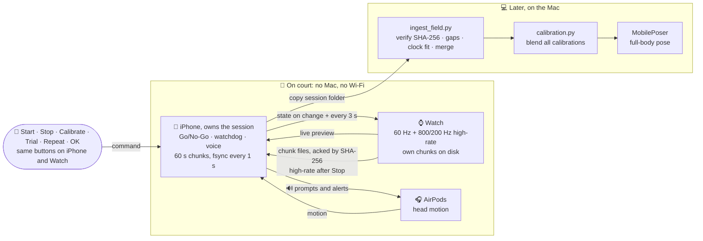
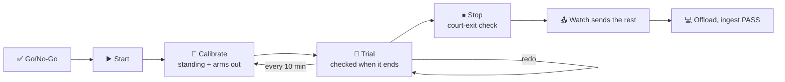

# IMU Sports Pose Instructor (ES 224)

Full-body motion capture for sports such as tennis, from an iPhone, Apple Watch and AirPods.

**Where we are:** see **Status** at the top of [`docs/plan/dev-plan.md`](docs/plan/dev-plan.md#status).

## How the app works

The iPhone owns the session; the Watch and AirPods record into it. Details: [`docs/plan/design.md`](docs/plan/design.md).





## Repository layout

```
apps/MotionStreamer/      iPhone + Apple Watch recording app (Swift)
pipeline/                 Mac-side Python, run as `python -m pipeline.<folder>.<script>`
├── ingest/                   verify and merge field sessions copied off the phone
├── preprocessing/            load, resample, calibrate recordings
├── pose/                     run MobilePoser, render meshes
├── live/                     UDP receiver, live viewer, test senders
└── analysis/                 trajectory and knee plots
experiments/              offline studies E00-E03, shared code, annotations
docs/                     plan/ (design, dev plan, tests, decisions) · research/ · deferred/
tools/                    checks and setup scripts
third_party/              MobilePoser, IMUCoCo (cloned, not in git) + our patches
data/                     recordings (not in git)
```

## Documents

Each topic lives in exactly one file; other files link to it instead of repeating it.

| Topic | File |
|---|---|
| What we're building (field recording design) | [`docs/plan/design.md`](docs/plan/design.md) |
| Build stages, status, and what already exists | [`docs/plan/dev-plan.md`](docs/plan/dev-plan.md) |
| Tests, including device tests T1-T21 | [`docs/plan/test-plan.md`](docs/plan/test-plan.md) |
| Decisions and open questions | [`docs/plan/decisions.md`](docs/plan/decisions.md) |
| Device facts from Apple docs and forums | [`docs/research/device-research.md`](docs/research/device-research.md) |
| OpenCap ground truth (deferred) | [`docs/deferred/opencap.md`](docs/deferred/opencap.md) |
| Literature, model survey, proposal | [`docs/research/`](docs/research) |
| Experiment and device-test log | [`EXPERIMENT_LOG.md`](EXPERIMENT_LOG.md) |
| Mac pipeline and commands | [`pipeline/README.md`](pipeline/README.md) |
| Experiments and how to run them | [`experiments/README.md`](experiments/README.md) |
| iOS / Watch app setup and data format | [`apps/MotionStreamer/README.md`](apps/MotionStreamer/README.md) |
| Third-party models and patches | [`third_party/README.md`](third_party/README.md) |
| Setup, development loop, commit rules | [`CONTRIBUTING.md`](CONTRIBUTING.md) |

Recordings and model files are not in git; they live on the shared drive.
