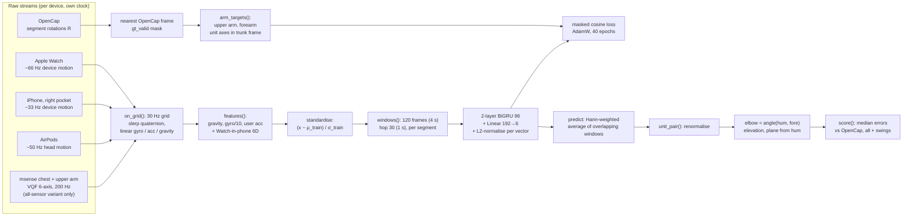
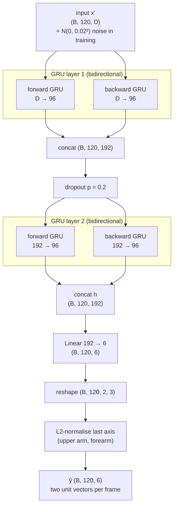
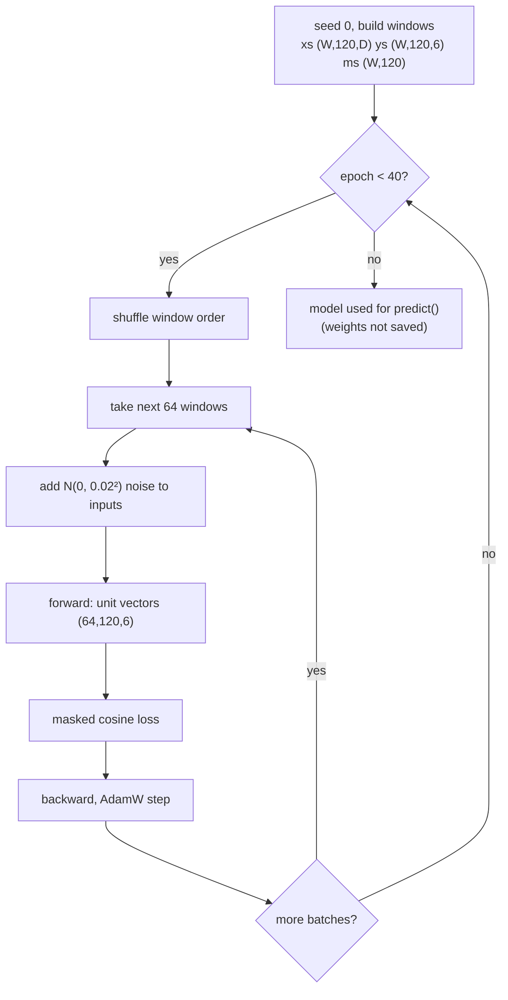

# Bidirectional GRU arm model: method details

This document explains how our bidirectional GRU arm model is built, trained and scored, so that
someone new to the project can rebuild it. Every value comes from the code; `path:line` points
to where it is set. The linear baseline that shares the same inputs, targets, splits and scoring
is described in [`ridge_regression.md`](ridge_regression.md).

Abbreviations (each defined once):

- **IMU**: inertial measurement unit (gyroscope + accelerometer, here with the device's own
  orientation filter).
- **GRU**: gated recurrent unit, a recurrent neural network layer. **Bidirectional**: one GRU
  reads the window forwards, a second one backwards; their outputs are concatenated.
- **OpenCap**: video motion capture from phone videos. It fits an OpenSim body model and gives
  segment rotations and joint angles. It is our ground truth.
- **GT**: ground truth (OpenCap).
- **6D**: a rotation written as the first two columns of its 3×3 matrix (6 numbers).
- **MAE**: in this project, the *median* absolute error in degrees (not the mean), see section 8.
- **xplayer**: train on the other player only. **personal**: also train on the test player's own
  minutes from the same session.
- **CPU / MPS**: processor / Apple's Metal GPU backend for PyTorch.

## 1. Purpose and summary

The model predicts the direction of the right upper arm and right forearm, in the trunk frame,
from the Apple Watch (right wrist), iPhone (right front pocket) and AirPods (head), 30 times per
second. From the two directions we get elbow flexion, shoulder elevation and the plane of
elevation.

It is our own model, written for this project; it does not come from a paper or pretrained
weights. A 2-layer bidirectional GRU (96 hidden units per direction) reads 4 s windows of
standardised, heading-free sensor features and outputs, at every frame, two unit vectors. It is
trained from scratch with a cosine loss masked to frames where OpenCap is valid. At inference,
overlapping windows are blended with a Hann weight. Code:
`experiments/E07_pose_methods/learned_own.py` (E07, 10/28 data) and
`experiments/E08_janys_1105/run.py`, `cross.py` (E08, retraining on other sessions with the
same class).

It is the best method in the project that needs only Apple devices: trained on Janys 10/28 it
gets the elbow within 14° and shoulder elevation within 10° (median) during Janys's 11/05 swings.

## 2. Pipeline overview



## 3. Inputs

### 3.1 Devices, streams and units

Each Apple device gives Core Motion "device motion" in its own frame
(`pipeline/preprocessing/motion_io.py:25-28`):

| Field | Shape | Unit | Meaning |
|---|---|---|---|
| `quat` | (N, 4) x, y, z, w | – | rotates device axes into the device's world frame (z up) |
| `rot_rate` | (N, 3) | rad/s | gyroscope, bias-corrected by Apple |
| `user_acc` | (N, 3) | g | acceleration without gravity; Apple sign (minus physical acceleration) |
| `gravity` | (N, 3) | g (unit length) | gravity direction in the device frame, pointing down |

Delivered rates (E03, `docs/research/device-research.md:12`): iPhone 33.5 Hz, Watch 66.4 Hz,
AirPods 50 Hz. The Watch's separate 200 Hz stream only finds swings (section 7.5).

All-sensor variant only: the commercial msense sensors on the chest (`2F5A`) and right upper arm
(`1D03`) (`experiments/E07_pose_methods/data.py:30`) are given the same four fields by VQF
without magnetometer at 200 Hz (`experiments/E07_pose_methods/vqf_orient.py:37-57`): gravity =
world down rotated into the sensor frame, user acceleration $= -a/g - \text{gravity}$, gyro bias
= mean over the 3 s Calibrate hold.

### 3.2 Resampling to the 30 Hz grid

`on_grid()` (`experiments/E07_pose_methods/data.py:38-52`), grid step $1/30$ s (`data.py:28`):

1. Sort samples by time, drop repeated timestamps.
2. Clip grid times to the stream's range.
3. Quaternions: slerp. Rotation rate, user acceleration, gravity: linear, per axis.
4. `valid` = a raw sample within 0.05 s (stored; not used by the model).

10/28 segments: one per Calibrate hold, from 3 s after the hold to the next hold, cut to
OpenCap's range, kept if longer than 30 s (`data.py:113-121`). 11/05: one segment per OpenCap
segment of about 25 s (`experiments/E08_janys_1105/data.py:49-78`). Segment ids (`seg`) matter:
windows never cross a segment boundary.

### 3.3 Feature formulas

`features(d, devs, extra)` (`learned_own.py:35-45`). For every device $k$ in the variant (order
Watch, phone, AirPods), at frame $t$:

- gravity $\mathbf g_k(t)$ (g, unit length, 3 numbers)
- scaled rotation rate $\boldsymbol\omega_k(t)/10$ (rad/s ÷ 10, `learned_own.py:38`)
- user acceleration $\mathbf a_k(t)$ (g, 3 numbers)

If the phone is in the variant, the Watch's orientation relative to the phone
(`learned_own.py:39-42`, `r6` at `learned_own.py:31-32`):

$$R_{pw}(t) = R_p(t)^\top R_w(t), \qquad \text{6D}(R_{pw}) = [R_{00}, R_{01}, R_{10}, R_{11}, R_{20}, R_{21}]$$

Both quaternions are in the same Apple world frame, so $R_{pw}$ does not depend on heading.

All-sensor variant (`all_sensor_features`, `learned_own.py:203-224`) adds 36 columns: 6D of
$R_{trunk}^\top R_{upper}$, $R_{trunk}^\top R_{watch}$, $R_{upper}^\top R_{watch}$ (heading-corrected
segment rotations from `align.py`), then gravity, gyro/10 and user acceleration of the upper-arm
and chest sensors.

| Variant (`learned_own.py:23-27`) | Devices | Input size $D$ |
|---|---|---|
| `watch` | Watch | 9 |
| `watch_phone` | Watch, phone | 18 + 6 = 24 |
| `watch_phone_airpods` | Watch, phone, AirPods | 27 + 6 = 33 |
| `allsensors` | + chest, upper arm | 33 + 36 = 69 |

### 3.4 Standardisation

Per feature, over all training frames (valid GT or not) (`learned_own.py:185-186`,
`learned_own.py:194`, `run.py:32-33`, `run.py:40-42`):

$$\mu = \text{mean}(X_{tr}), \quad \sigma = \text{std}(X_{tr}) + 10^{-6}, \quad x' = \frac{x - \mu}{\sigma}$$

The test features use the training $\mu$, $\sigma$. Inputs are cast to float32. No context
stacking (unlike ridge): the GRU sees time itself.

### 3.5 Windowing

`windows(n, seg)` (`learned_own.py:59-68`), `WIN = 120` frames (4 s), `HOP = 30` frames (1 s)
(`learned_own.py:28`). For each segment spanning frames $[a, b)$:

1. Starts $a, a+30, a+60, \dots$ while the window fits.
2. If the last start is not $b-120$, add a final window ending exactly at $b$.
3. Segments shorter than 120 frames give no window.

When several training sets are concatenated, their segment ids are offset by $1000\,i$ (and the
11/05 half by 5000 in `both+half`) so they stay distinct (`learned_own.py:183`, `run.py:53`,
`run.py:67`). Example: Janys 10/28 full gives 1 594 windows, Tom 10/28 full 715.

## 4. Targets and outputs

### 4.1 What is predicted

Per frame, $y = [\,\mathbf h,\ \mathbf f\,] \in \mathbb R^6$ (`targets()`, `learned_own.py:48-49`):
the unit vector along the right upper arm (shoulder → elbow) and along the right forearm
(elbow → wrist), in OpenCap's trunk (torso) frame: x forward, y up, z to the body's right
(`experiments/E07_pose_methods/common.py:3-9`).

### 4.2 From OpenCap to targets

`arm_targets()` (`data.py:67-72`). In the OpenSim model a body's y axis points proximally, so:

$$\mathbf h = \frac{R_{torso}^\top(-R_{humerus\_r}\,\mathbf e_y)}{\|\cdot\|}, \qquad \mathbf f = \frac{R_{torso}^\top(-R_{radius\_r}\,\mathbf e_y)}{\|\cdot\|}$$

The nearest OpenCap frame is used (`data.py:161-168`). `gt_valid` is true if it is within 0.02 s
and OpenCap has no gap ≥ 0.2 s there (10/28, 60 fps, `data.py:165-166`), or within 0.04 s on
11/05 (30 fps, `experiments/E08_janys_1105/data.py:70`). Targets are finite on every frame,
including invalid ones (checked on all five datasets), so masking by multiplication is safe.

### 4.3 From predictions to angles

The network already outputs unit vectors; after Hann blending (section 5.4) they are
renormalised by `unit_pair()` (`learned_own.py:156-160`). Then:

| Quantity | Formula | Code |
|---|---|---|
| Elbow flexion | $\arccos(\hat{\mathbf h}\cdot\hat{\mathbf f})$, 0° = straight | `common.py:96-101` |
| Shoulder elevation | $\arccos(-\hat h_y)$, 0° = arm hanging | `data.py:75-79` |
| Plane of elevation | $\operatorname{atan2}(\hat h_z, \hat h_x)$, 0° forward, 90° sideways | `data.py:78` |
| Forearm inclination | $\arccos(-\hat f_y)$, heading-free | `evaluate.py:30-31` |

The GT elbow is OpenCap's inverse-kinematics `elbow_flex_r` (`data.py:170`).

## 5. Network

### 5.1 Architecture and tensor shapes

`class GRU` (`learned_own.py:71-91`). $B$ = batch (64 in training, up to 256 in prediction),
$T = 120$ frames, $D$ = input size.



Each GRU cell (PyTorch's `torch.nn.GRU`, input $x_t$, previous state $h_{t-1}$, $\sigma$ = logistic
sigmoid, $\odot$ = element-wise product):

$$r_t = \sigma(W_{ir}x_t + b_{ir} + W_{hr}h_{t-1} + b_{hr})$$
$$z_t = \sigma(W_{iz}x_t + b_{iz} + W_{hz}h_{t-1} + b_{hz})$$
$$n_t = \tanh\big(W_{in}x_t + b_{in} + r_t \odot (W_{hn}h_{t-1} + b_{hn})\big)$$
$$h_t = (1 - z_t)\odot n_t + z_t \odot h_{t-1}$$

The initial state is zero at the start of every window. Weights use PyTorch's default
initialisation (uniform in $\pm 1/\sqrt{96}$).

### 5.2 Parameter count

Per direction and layer: $3\cdot(96\cdot d_{in} + 96\cdot 96 + 2\cdot 96)$. Total
$= 576D + 224\,646$ (verified with `torch` on 11/10):

| Block | Shapes (per direction) | Parameters |
|---|---|---|
| Layer 1, 2 directions | $W_{ih}$ (288, D), $W_{hh}$ (288, 96), $b_{ih}$, $b_{hh}$ (288) | $576D + 56\,448$ |
| Layer 2, 2 directions | $W_{ih}$ (288, 192), $W_{hh}$ (288, 96), $b_{ih}$, $b_{hh}$ (288) | 167 040 |
| Linear head | $W$ (6, 192), $b$ (6) | 1 158 |

| Variant | $D$ | Total parameters |
|---|---|---|
| `watch` | 9 | 229 830 |
| `watch_phone` | 24 | 238 470 |
| `watch_phone_airpods` | 33 | 243 654 |
| `allsensors` | 69 | 264 390 |

### 5.3 Loss

For window $i$, frame $t$, predicted unit vectors $\hat{\mathbf h}, \hat{\mathbf f}$ and GT
$\mathbf h, \mathbf f$, with $m_{i,t} \in \{0,1\}$ = `gt_valid` (`learned_own.py:105-110`):

$$c^{h}_{i,t} = \hat{\mathbf h}_{i,t}\cdot\mathbf h_{i,t}, \qquad c^{f}_{i,t} = \hat{\mathbf f}_{i,t}\cdot\mathbf f_{i,t}$$

$$\mathcal L = \frac{\sum_{i\in\text{batch}}\sum_{t=1}^{120} m_{i,t}\,\big[(1 - c^{h}_{i,t}) + (1 - c^{f}_{i,t})\big]}{\max\big(\sum_{i,t} m_{i,t},\ 1\big)}$$

Both vectors are unit length, so $1 - c = 1 - \cos\phi$ where $\phi$ is the angle error; the loss
lies in $[0, 4]$ and weights the upper arm and forearm equally. Frames without valid OpenCap
still pass through the network as input but add nothing to the loss.

### 5.4 Inference: Hann blending

`predict(X, seg)` (`learned_own.py:116-133`):

1. Cut the test features into the same 120-frame windows, hop 30.
2. Run them in batches of 256 with `torch.no_grad()`.
3. Weight each window's output with a Hann window $w_t$ = `np.hanning(122)[1:-1]` (120 strictly
   positive weights, near zero at the edges, 1 in the middle):
   $$\hat y_t = \frac{\sum_{\text{windows } k \ni t} w_{t - s_k}\,\hat y^{(k)}_t}{\max\big(\sum_k w_{t-s_k},\ 10^{-9}\big)}$$
4. Renormalise with `unit_pair()`. Frames covered by no window (segments < 4 s) get
   $0/0 = $ NaN and are marked invalid (`learned_own.py:200`, `run.py:72`).

Each interior frame is covered by 4 windows; the Hann weight trusts the window centre, where the
bidirectional GRU has context on both sides.

### 5.5 Training settings

`GRU.fit` (`learned_own.py:93-114`):

| Setting | Value | Code |
|---|---|---|
| Window / hop | 120 / 30 frames (4 s / 1 s) | `learned_own.py:28` |
| Hidden size | 96 per direction | `learned_own.py:72` |
| Layers | 2, bidirectional, `batch_first=True` | `learned_own.py:81-83` |
| Dropout | 0.2 between GRU layers | `learned_own.py:82` |
| Head | Linear 192 → 6, then L2-normalise each 3-vector | `learned_own.py:84`, `learned_own.py:88-91` |
| Input noise | Gaussian, σ = 0.02 (standardised units), fresh each batch | `learned_own.py:105` |
| Optimiser | AdamW, lr 2e-3, weight decay 1e-3, default betas | `learned_own.py:100` |
| Learning-rate schedule | none (constant) | – |
| Epochs | 40 | `learned_own.py:93` |
| Batch | 64 windows, reshuffled every epoch (`torch.randperm`) | `learned_own.py:102-104` |
| Seed | `torch.manual_seed(0)` | `learned_own.py:95` |
| Validation / early stopping | none; the last epoch is used | – |
| Device | CPU. Comment: MPS returns NaN for this GRU in torch 2.1 | `learned_own.py:76-78` |
| Library | torch 2.1.2 | `requirements.txt:118` |
| Runtime | E08 `run.py` (15 GRU fits + 15 ridge fits) takes about 1 h on CPU (E08 README); in `cross.py` on 11/10 one Watch-only GRU fit took roughly 3-5 min | – |

Gradient steps = epochs × ⌈windows / 64⌉. Examples: trained on Janys 10/28 full (1 594 windows)
→ 25 batches × 40 = 1 000 steps; on Tom 10/28 full (715) → 480 steps; on Janys + Tom (2 309) →
1 480 steps.



## 6. Model variants run

| Run | Code | Inputs | Training data | Test |
|---|---|---|---|---|
| E07 Apple variants | `run_split`, `learned_own.py:163-200` | 3 variants | xplayer / personal | 10/28 block |
| E07 all sensors | `run_all_sensors`, `learned_own.py:227-263` | 69 features | other player's block (+ own other half) | 10/28 block |
| E08 11/05 | `run.py:45-75` | 3 variants | `janys`, `both`, `tom`, `both+half` | Janys 11/05 |
| E08 cross-session | `cross.py:49-65` | 3 variants | 5 splits | 10/28 full |

## 7. Data and splits

### 7.1 Datasets

| Dataset | File | Grid minutes | Valid-GT minutes | Segments | Swings |
|---|---|---|---|---|---|
| Janys 10/28 block (all sensors) | `E07…/results/janys/dataset.npz` | 8.1 | 6.4 | 2 | 36 |
| Tom 10/28 block (all sensors) | `E07…/results/tom/dataset.npz` | 12.6 | 8.9 | 2 | 92 |
| Janys 10/28 full (Apple only) | `E07…/results/janys/dataset_full.npz` | 26.8 | 17.0 | 7 | 114 |
| Tom 10/28 full (Apple only) | `E07…/results/tom/dataset_full.npz` | 12.0 | 8.9 | 2 | 92 |
| Janys 11/05 (Apple only) | `E08…/results/janys/dataset.npz` | 35.8 | 35.8 | 97 | 278 |

(Read from the saved `.npz` files on 11/10.) On 11/05, 4 segments (274 frames, 0.15 min, no
swings) are shorter than 4 s, so the GRU scores 35.62 min against ridge's 35.77.

### 7.2 E07 splits on 10/28

Test = the test player's **block**.

- **xplayer**: train on the other player's `dataset_full`.
- **personal**: add the test player's `dataset_full` frames more than 10 s outside the block
  (`split_mask`, `learned_own.py:52-56`); skipped below 1 min of valid GT
  (`learned_own.py:169-172`). Tom's full dataset is his block, so only Janys has a personal
  result (18.4 min grid, 10.5 min valid GT, 1 092 extra windows).
- **all sensors**: xplayer = other player's block; personal = two folds at the block's median
  time, train on the other half minus ±10 s around the median plus the other player's block
  (`learned_own.py:233-261`).

### 7.3 E08 training sets, tested on Janys 11/05 (`run.py:27`)

| Name | Training data |
|---|---|
| `janys` | Janys 10/28 full |
| `both` | Janys + Tom 10/28 full |
| `tom` | Tom 10/28 full |
| `both+half` | Janys + Tom 10/28 full + the other half of 11/05 (two folds at the median time, 10 s gap) |

### 7.4 E08 cross-session splits (`cross.py:32-38`)

| Split | Train | Test (10/28 full) |
|---|---|---|
| `j1028>tom` | Janys 10/28 | Tom |
| `j1028+j1105>tom` | Janys 10/28 + Janys 11/05 | Tom |
| `tom>j1028` | Tom 10/28 | Janys |
| `j1105>j1028` | Janys 11/05 | Janys |
| `j1105+tom>j1028` | Janys 11/05 + Tom 10/28 | Janys |

### 7.5 Swings

Peaks of the Watch's 200 Hz rotation speed above 15 rad/s, merged within 1.5 s; a frame is in a
swing if within ±0.5 s of a peak (`data.py:31`, `data.py:55-64`, `data.py:175-186`). Used only
for scoring.

## 8. Evaluation and results

`score()` (`experiments/E07_pose_methods/evaluate.py:16-54`) uses frames where GT and the
prediction are both valid, over all frames and over swing frames. All errors are medians:
`elbow_mae`, `elevation_mae`, `forearm_incl_mae` (absolute angle errors);
`forearm_dir_deg`, `upper_arm_dir_deg` (angle between predicted and GT unit vectors);
`plane_mae` (only where GT elevation > 30°, `evaluate.py:13`); `*_r` Pearson correlations.

### 8.1 E07, tested on the 10/28 blocks

Swings, median error in degrees, Janys / Tom (`E07…/results/scores.json`; "–" = split skipped):

| GRU variant | Split | Elbow | Elevation | Forearm incl. | Forearm dir. | Upper-arm dir. | Elbow r |
|---|---|---|---|---|---|---|---|
| Watch | xplayer | 21 / 21 | 30 / 20 | 14 / 15 | 26 / 25 | 43 / 30 | 0.38 / 0.62 |
| Watch | personal | 10 / – | 8 / – | 6 / – | 13 / – | 14 / – | 0.81 / – |
| Watch+phone | xplayer | 21 / 25 | 35 / 29 | 14 / 18 | 35 / 32 | 50 / 43 | 0.28 / 0.49 |
| Watch+phone | personal | 11 / – | 8 / – | 6 / – | 14 / – | 15 / – | 0.81 / – |
| Watch+phone+AirPods | xplayer | 22 / 27 | 34 / 33 | 16 / 22 | 40 / 33 | 53 / 51 | 0.24 / 0.55 |
| Watch+phone+AirPods | personal | 11 / – | 8 / – | 7 / – | 15 / – | 16 / – | 0.80 / – |
| All sensors | xplayer | 23 / 29 | 25 / 59 | 18 / 33 | 48 / 44 | 49 / 75 | 0.03 / 0.39 |
| All sensors | personal (other half) | 10 / 8 | 8 / 5 | 7 / 5 | 14 / 12 | 16 / 10 | 0.81 / 0.88 |

Whole blocks, elbow / elevation: Watch xplayer 14/15, 10/8; Watch personal 8, 5 (Janys); all
sensors personal 6/6, 5/4.

### 8.2 E08, tested on Janys 11/05

`experiments/E08_janys_1105/results/summary.md`. Degrees:

| GRU variant | Trained on | Elbow | Elevation | Forearm dir. | Elbow (all) | Elev. (all) |
|---|---|---|---|---|---|---|
| Watch | *E07 personal, tested on Janys 10/28* | 10 | 8 | 13 | 8 | 5 |
| Watch | Janys 10/28 | 14 | 10 | 22 | 9 | 6 |
| Watch | Janys + Tom 10/28 | 14 | 10 | 22 | 9 | 7 |
| Watch | Tom 10/28 | 24 | 34 | 35 | 19 | 11 |
| Watch | + half of 11/05 | 11 | 8 | 17 | 9 | 6 |
| Watch+phone | Janys 10/28 | 16 | 11 | 21 | 11 | 6 |
| Watch+phone | Janys + Tom 10/28 | 14 | 10 | 22 | 12 | 6 |
| Watch+phone | Tom 10/28 | 24 | 35 | 32 | 18 | 9 |
| Watch+phone | + half of 11/05 | 11 | 8 | 16 | 8 | 5 |
| Watch+phone+AirPods | Janys 10/28 | 15 | 11 | 21 | 9 | 6 |
| Watch+phone+AirPods | Janys + Tom 10/28 | 15 | 10 | 21 | 11 | 6 |
| Watch+phone+AirPods | Tom 10/28 | 23 | 38 | 34 | 19 | 9 |
| Watch+phone+AirPods | + half of 11/05 | 12 | 8 | 16 | 9 | 6 |

Extra numbers for the Watch GRU trained on Janys 10/28 (`results/scores.json`): elbow bias
−6.6° in swings (reads straighter than OpenCap), elbow r 0.66 in swings and 0.81 overall,
plane-of-elevation error 17° in swings.

### 8.3 Cross-session, tested on 10/28

`experiments/E08_janys_1105/results/cross.json`. On 11/10 the GRU cross run was still in
progress; only these rows existed (the ridge rows are complete, see the ridge document):

| GRU variant | Test | Trained on | Elbow | Elevation | Forearm dir. | Elbow (all) | Elev. (all) |
|---|---|---|---|---|---|---|---|
| Watch | Tom 10/28 | Janys 10/28 | 22 | 22 | 25 | 17 | 9 |
| Watch | Tom 10/28 | Janys 10/28 + 11/05 | 14 | 15 | 28 | 14 | 8 |
| Watch | Janys 10/28 | Tom 10/28 | 23 | 39 | 25 | 14 | 11 |

Rerun `cross.py figures` after the run finishes to refresh `results/cross.md`.

What the results say: the same player on another day costs a few degrees (elbow 10 → 14°);
training only on the other player costs about 10° on the elbow and 20-30° on elevation (34-39° in
Janys's swings when trained on Tom). A second Janys day cuts Tom's swing
elbow error from 22° to 14°. The phone and AirPods add nothing over the Watch alone.

## 9. Rebuild recipe

Environment: `.venv`, Python 3.9.6, numpy 1.23.0, scipy 1.8.0, torch 2.1.2
(`requirements.txt`). Run from the repo root. Keep `device="cpu"`.

Inputs that must exist (not in git): E06 results `experiments/E06_side_by_side/results/<label>/meta.json`;
OpenCap GT `data/external/20261028/aligned_hrnet3/<player>/opencap_gt.npz`; commercial IMU logs
`data/external/20261028/IMU1|IMU4/*_imu.csv`; the session folders named in `meta.json` (with
`watch_hf/`); for 11/05, `data/recordings/field/20261105-124805-P01` and
`data/external/20261105/aligned/<recording>/{opencap_gt.npz, alignment.json}`.

```bash
# 1. 10/28 datasets
.venv/bin/python -m experiments.E07_pose_methods.data          # results/<player>/dataset.npz
.venv/bin/python -m experiments.E07_pose_methods.data --full   # results/<player>/dataset_full.npz
.venv/bin/python -m experiments.E07_pose_methods.align         # results/<player>/aligned.npz (all sensors)

# 2. E07: GRU, 3 Apple variants x (xplayer, personal), then all sensors
.venv/bin/python -m experiments.E07_pose_methods.learned_own gru
.venv/bin/python -m experiments.E07_pose_methods.learned_own gru --all-sensors
.venv/bin/python -m experiments.E07_pose_methods.evaluate      # results/scores.json
.venv/bin/python -m experiments.E07_pose_methods.figures       # results/summary.md

# 3. E08: 11/05 test set, four training sets, cross-session tests
.venv/bin/python -m experiments.E08_janys_1105.data            # results/janys/dataset.npz
.venv/bin/python -m experiments.E08_janys_1105.run gru         # results/scores.json
.venv/bin/python -m experiments.E08_janys_1105.cross gru       # results/cross.json
.venv/bin/python -m experiments.E08_janys_1105.cross figures   # results/cross.md, figures/cross_*.png
.venv/bin/python -m experiments.E08_janys_1105.figures         # results/summary.md
```

Files produced: `experiments/E07_pose_methods/results/<player>/method_own_gru_<variant>_<split>.npz`
and `experiments/E08_janys_1105/results/janys/method_gru_<variant>_<train>.npz`, each with
`hum (n,3)`, `fore (n,3)`, `elbow (n,)` degrees, `valid (n,)` (`common.py:100-105`,
`run.py:71-74`). Network weights are not saved; every run retrains.

Minimal re-implementation (same steps as the code):

```python
X  = [features(s, devs) for s in train_sets]               # list of (N_i, D)
Y  = [targets(s) for s in train_sets]                      # (N_i, 6)
M  = [s["gt_valid"] for s in train_sets]
S  = [s["seg"] + 1000 * i for i, s in enumerate(train_sets)]
mu = np.concatenate(X).mean(0); sd = np.concatenate(X).std(0) + 1e-6
Xn = np.concatenate([(x - mu) / sd for x in X]).astype(np.float32)
net = GRU(Xn.shape[1]).fit(Xn, np.concatenate(Y), np.concatenate(M), np.concatenate(S))
P = net.predict(((features(te, devs) - mu) / sd).astype(np.float32), te["seg"])
hum, fore = unit_pair(P)
elbow = np.degrees(np.arccos(np.clip((hum * fore).sum(1), -1, 1)))
```

## 10. Limitations and caveats

- **Dropout stays on at prediction.** `GRU` never calls `self.net.eval()`, and `torch.nn`
  modules start in training mode, so the 0.2 dropout between GRU layers is active inside
  `predict()` (`learned_own.py:116-133`). Checked on 11/10: `net.training` is `True`, and two
  `predict()` calls on the same input give different outputs. The Hann blend over 4 windows
  averages some of this noise; results are reproducible only because the seed fixes the random
  stream. Adding `self.net.eval()` before predicting would likely change the numbers a little.
- **Two players, two dates.** About 20 min of 10/28 data and 36 min of Janys on 11/05.
  Cross-player error is 10-25° worse than same-player; the all-sensor model (69 inputs) fails
  across players (Tom elevation 59° in swings).
- **Personal and `both+half` splits are within one session**; they are a best case.
- **No validation set, no early stopping, no tuning.** Hyperparameters are fixed; the model after
  epoch 40 is used.
- **Short segments are dropped.** Segments under 4 s get no prediction (0.15 min on 11/05).
- **Windows start from a zero state.** Frames near a segment's ends see context on one side only;
  the Hann weight reduces but cannot remove this.
- **Elbow mismatch.** Predicted elbow = angle between two axes; OpenCap's elbow is an IK joint
  angle.
- **GT quality.** OpenCap's own error is about 15°, and on some 11/05 segments it tracked another
  person; those frames stay in the scores.
- **MPS not used.** The code comment says MPS gives NaN with torch 2.1; this was not re-tested.
