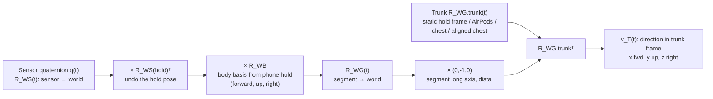
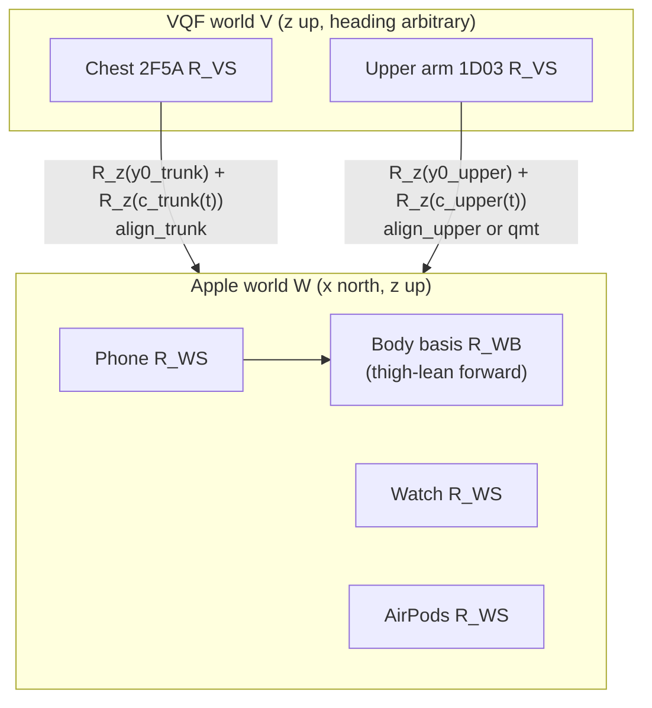
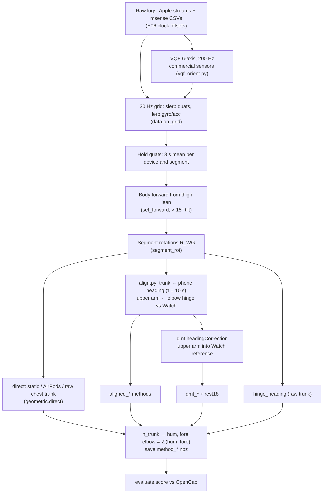

# Geometric (orientation-only) arm methods

How the model-free methods in E07 and E08 turn sensor orientations into arm directions. Nothing here is
trained. Every number below is read from the code, with `path:line` citations, so you can rebuild each
method from this page.

Abbreviations: IMU = inertial measurement unit (accelerometer + gyroscope, sometimes magnetometer).
VQF = Versatile Quaternion-based Filter. MARG = magnetic, angular rate and gravity (9-axis) filter.
DoF = degree of freedom. HF = high-frequency (the Watch's 200 Hz stream). GT = ground truth (OpenCap).
MAE = median absolute error (our "MAE" is a median, see [Scoring](#7-scoring)).

---

## 1. Summary

| Method (saved name) | Trunk from | Upper arm from | Forearm from | Heading fix | Run in |
|---|---|---|---|---|---|
| `watch_static_trunk` ("Watch orientation, trunk fixed") | the body frame of the Calibrate hold, never turns | none | Watch | none | E07, E08 |
| `watch_airpods_trunk` ("AirPods as trunk") | AirPods (head) | none | Watch | none | E07, E08 |
| `direct_trunk_upper_watch` ("raw headings") | chest sensor 2F5A | upper-arm sensor 1D03 | Watch | none (VQF headings drift) | E07 |
| `direct_trunk_upper_cwrist` | chest 2F5A | upper arm 1D03 | wrist sensor D0E5 | none | E07 |
| `direct_static_upper_watch` | static hold frame | upper arm 1D03 | Watch | none | E07 |
| `hinge_trunk_upper_watch` | chest 2F5A (raw) | upper arm, heading from elbow hinge (`geometric.hinge_heading`) | Watch | upper arm only | E07 |
| `aligned_trunk_upper_watch` ("constraint-aligned") | chest, heading pulled to phone | upper arm, heading from elbow hinge (`align.py`) | Watch | trunk + upper arm | E07 |
| `aligned_phone_as_trunk_upper_watch` | phone (thigh) | aligned upper arm | Watch | as above | E07 |
| `aligned_trunk_watch` | aligned chest | none | Watch | trunk | E07 |
| `qmt_trunk_upper_watch` ("qmt heading correction") | aligned chest | upper arm, heading from qmt `headingCorrection` | Watch | trunk (ours) + upper arm (qmt) | E07 |
| `qmt_trunk_upper_watch_rest18` ("hanging elbow = 18°") | same | same | same | same, elbow + 18° | E07 |
| `upper_bound_mounting_fit` | chest, heading fitted to OpenCap | upper arm, fitted to OpenCap | Watch, fitted to OpenCap | oracle (uses GT) | E07 |
| `zz_oracle_opencap` | OpenCap itself | | | | E07 (sanity check, must score 0) |

The constraint methods (`constraint_*`) reuse the same frames but add a joint model. They have their
own page: [`joint_constraints.md`](joint_constraints.md).

### Ours vs external

| Part | Source | Version | License | Where |
|---|---|---|---|---|
| Frames, calibration, `direct`, `hinge_heading`, `align.py` (trunk complementary filter, upper-arm hinge grid search), rest-angle fix, scoring | **ours** | repo | repo | `experiments/E07_pose_methods/` |
| Apple orientation (iPhone, Watch, AirPods) | Apple Core Motion device motion, `xMagneticNorthZVertical` frame (Apple's own sensor fusion, closed source) | iOS / watchOS of the devices | proprietary | requested in `Apps/MotionStreamer/Shared/MotionFormat.swift:28-32` |
| Commercial sensor orientation | **VQF** offline, called through `qmt.oriEstOfflineVQF`, 6-axis (no magnetometer) | `vqf` 2.0.1, `qmt` 0.2.4 | MIT (both) | `experiments/E07_pose_methods/vqf_orient.py:17-34` |
| Upper-arm heading correction for `qmt_*` | **qmt** `headingCorrection`, 2-DoF "euler" constraint | `qmt` 0.2.4 | MIT | `experiments/E07_pose_methods/qmt_heading.py:43-59` |
| 9-axis Madgwick MARG filter (`marg.py`) | ours, re-implementation of Madgwick et al. 2011 | repo | repo | `experiments/E07_pose_methods/marg.py` (tested, **not used** by any scored method; see [§3.2](#32-orientation-filters-for-the-commercial-sensors)) |

Package facts (from `.venv/lib/python3.9/site-packages/*.dist-info/METADATA`): `qmt` 0.2.4,
"Quaternion-based Inertial Motion Tracking Toolbox", Daniel Laidig, MIT,
<https://github.com/dlaidig/qmt>; `vqf` 2.0.1, Daniel Laidig, MIT, <https://github.com/dlaidig/vqf>.
`qmt` requires `vqf>=2.0.0`.

Citations:
- qmt heading correction, 2-DoF joints: D. Laidig, D. Lehmann, M.-A. Bégin, T. Seel, "Magnetometer-free
  Realtime Inertial Motion Tracking by Exploitation of Kinematic Constraints in 2-DoF Joints", EMBC 2019,
  pp. 1233-1238, doi:10.1109/EMBC.2019.8857535. Extension: Laidig, Weygers, Seel, "Self-Calibrating
  Magnetometer-Free Inertial Motion Tracking of 2-DoF Joints", *Sensors* 22(24):9850, 2022.
- Elbow hinge idea used by `align.py` / `hinge_heading`: D. Laidig, P. Müller, T. Seel, "Automatic
  anatomical calibration for IMU-based elbow angle measurement in disturbed magnetic fields", *Current
  Directions in Biomedical Engineering* 3(2):167-170, 2017, doi:10.1515/cdbme-2017-0035.
- VQF: D. Laidig, T. Seel, "VQF: Highly accurate IMU orientation estimation with bias estimation and
  magnetic disturbance rejection", *Information Fusion* 91:187-204, 2023.
- Madgwick: S. Madgwick, A. Harrison, R. Vaidyanathan, "Estimation of IMU and MARG orientation using a
  gradient descent algorithm", ICORR 2011.

---

## 2. Inputs

### 2.1 Devices and streams

| Device | Placement | Plays segment | Stream used | Rate | Notes |
|---|---|---|---|---|---|
| iPhone 16 | right front trouser pocket, screen towards the leg | thigh; defines body "forward" and the body frame | Core Motion device motion (quaternion, rotation rate, user acceleration, gravity) | ~33.5 Hz delivered (`docs/research/device-research.md:12`) | |
| Apple Watch | right wrist | **forearm** | device motion | ~66 Hz delivered | Apple keeps its heading (magnetometer fused by Apple) |
| Apple Watch HF | right wrist | none (swing detection only) | `CMBatchedSensorManager` device motion + accelerometer | 200 Hz + ~800 Hz | `data.py` `build` |
| AirPods | head | trunk, in `watch_airpods_trunk` only | headphone motion | ~50 Hz | |
| msense 2F5A | chest | trunk | raw acc + gyro (+ mag) → VQF | ~199 Hz IMU, 50 Hz mag (measured on the 10/28 IMU1 log) | 10/28 only |
| msense 1D03 | right upper arm | upper arm | same | same | 10/28 only |
| msense D0E5 | right wrist | forearm (`*_cwrist` variant) | same | same | 10/28 only |

The commercial sensors were **not worn on 11/05**, so E08 can only run the Apple-only variants
(`experiments/E08_janys_1105/frame_methods.py:1-2`).

Sensor names: `COMMERCIAL = {"trunk": "msense_2F5A", "upper_arm": "msense_1D03", "cwrist": "msense_D0E5"}`
(`experiments/E07_pose_methods/data.py:30`).

### 2.2 Datasets

| | E07 (10/28) | E08 (11/05) |
|---|---|---|
| Players | Janys (`janys-IMU1`), Tom (`tom-IMU4`) (`data.py:29`) | Janys only |
| Data | 8.1 min / 12.6 min of play blocks with every sensor | 35.8 min with OpenCap in 97 segments of ~25 s, 264 ball contacts |
| Ground truth | OpenCap, 2 phone cameras, 60 fps | OpenCap, 3 cameras (HRNet), 30 fps |
| Builder | `experiments/E07_pose_methods/data.py` | `experiments/E08_janys_1105/data.py` |
| Calibrate hold per segment | the hold that starts the E06 block | the latest hold before each segment (six holds, every 8-10 min) (`E08 data.py:100-105`) |

### 2.3 Resampling to a common grid

Every stream is put on one **30 Hz** grid (`FS = 30.0`, `data.py:28`) by `on_grid` (`data.py:38-52`):
- Quaternions: spherical linear interpolation (`scipy` `Slerp`), clamped to the stream's time range.
- Rotation rate, user acceleration, gravity: linear interpolation per axis.
- `valid` = a source sample within 50 ms of the grid time.

Commercial sensors first go through VQF at a uniform 200 Hz grid (see [§3.2](#32-orientation-filters-for-the-commercial-sensors)), then through `on_grid`.

### 2.4 The Calibrate hold

The player stands straight for **3 s**, arms hanging at the sides, phone in the pocket. The app records a
`calibrate` event. For each segment `k`, each device's hold orientation is the rotation mean over the
3 s (30 Hz samples) (`data.py:142-159`; E08: `E08 data.py:106-113`):

$$\bar q_{\text{dev},k} = \operatorname{mean}\{q_\text{dev}(t) : t \in [h_k, h_k + 3\,\text{s})\}$$

`Rotation.mean()` is the quaternion average (principal eigenvector of $\sum q q^\top$).

What the hold is used for:
1. **Body frame:** from the phone ([§2.6](#26-body-frame-basis-b)).
2. **Sensor-to-segment calibration:** every segment is assumed to be aligned with the body frame during
   the hold (standing, arms hanging straight down, palms in) (`common.py:13-15`).

### 2.5 Reference frames

| Symbol | Frame | Axes |
|---|---|---|
| $W$ | Apple world (`xMagneticNorthZVertical`) | x magnetic north, y west, z up |
| $S$ | a sensor's own axes | device-defined |
| $V$ | VQF's earth frame for a commercial sensor (6-axis) | z up, **heading arbitrary** (the start heading of the filter) |
| $B$ | body frame at the hold | columns: forward, up, right |
| $G$ | a segment frame | equal to $B$ during the hold |
| $T$ | trunk frame (OpenSim convention) | x forward, y up, z right |

All rotation matrices are written $R_{AB}$ = "rotates B-coordinates into A-coordinates" (A ← B).
A quaternion from Core Motion gives $R_{WS}$ (`pipeline/preprocessing/calibration.py:5-7`).
Quaternions are stored scalar-last (`x, y, z, w`, scipy convention). qmt and VQF use scalar-first,
so the code reorders `[:, [3, 0, 1, 2]]` going in and `[:, [1, 2, 3, 0]]` coming out
(`qmt_heading.py:46-47,60`, `vqf_orient.py:34`).

### 2.6 Body frame basis $B$

`body_basis` (`common.py:49-60`) builds world ← body with columns (forward, up, right):

$$\hat u = (0,0,1),\quad \hat f = \frac{f - \hat u (f\cdot\hat u)}{\lVert\cdot\rVert},\quad \hat r = \hat f \times \hat u,\quad R_{WB} = [\hat f\ \ \hat u\ \ \hat r]$$

Forward $f$ comes from one of two rules (`set_forward`, `common.py:31-46`):
- **"screen"** (pipeline rule): $f = -R_{WS,\text{phone}}(\text{hold})\,(0,0,1)$, minus the screen normal,
  because the screen faces the leg. It fails when the phone sits turned in the pocket (wrong by ~110°
  for Tom on 10/28, E07 README).
- **"thigh"** (used by every method here): the thigh's long axis in the phone frame is world-down at
  the hold, $a = R_{WS}(\bar q_\text{hold})^\top (0,0,-1)$. Over the whole segment
  $v(t) = R_{WS}(t)\,a$ is the hip → knee direction in the world. On frames where the thigh is tilted
  more than **15°** from vertical (ready stance, crouches, lunges, where the knee goes forward), sum
  the horizontal parts: $h = \sum_{\text{tilt}>15°} (v_x, v_y)$, forward heading $\psi = \operatorname{atan2}(h_y, h_x)$,
  so $f = (\cos\psi, \sin\psi, 0)$. One $\psi$ per segment, stored in the module-global `FORWARD`
  dictionary keyed by `(player, segment)`. On 10/28 Janys's two segments got $\psi$ = −90° and −88°.

### 2.7 Sensor-to-segment calibration and the frame chain

`segment_rot` (`common.py:63-73`) gives world ← segment for one device:

$$R_{WG}(t) = R_{WS}(t)\;\underbrace{R_{WS}(\bar q_\text{hold})^\top R_{WB}}_{R_{SG}\ \text{(sensor} \leftarrow \text{segment)}}$$

At the hold, $R_{WG} = R_{WB}$: the segment is the body frame. Each segment's long axis pointing distally
is its segment-frame $-y$ = `DOWN = (0, -1, 0)` (`common.py:25`).

The arm direction in the trunk frame (`in_trunk`, `common.py:86-89`):

$$v_T(t) = \frac{R_{WG,\text{trunk}}(t)^\top\, R_{WG,\text{seg}}(t)\,(0,-1,0)^\top}{\lVert\cdot\rVert}$$

The trunk rotation $R_{WG,\text{trunk}}$ is one of:
- `static_trunk` (`common.py:76-83`): $R_{WB}$ of the segment's hold, for every frame. The trunk is
  assumed never to turn or lean.
- `segment_rot(d, "airpods")`: the head stands in for the trunk.
- `segment_rot(d, "trunk")`: the chest sensor, raw VQF.
- `align.py`'s `trunk_R`: the chest sensor with its heading pulled to the phone ([§3.3](#33-heading-consistency-without-magnetometers-alignpy)).



For a commercial sensor the VQF world $V$ differs from Apple's $W$ by an unknown turn about vertical,
$R_{WV} = R_z(y_0)$. The correct segment rotation is then (`align.seg_rot_offset`, `align.py:36-43`):

$$R_{WG}(t) = R_z(y_0)\,R_{VS}(t)\,R_{VS}(\text{hold})^\top R_z(y_0)^\top R_{WB}$$

`segment_rot` alone drops the $R_z(y_0)$ conjugation. This is harmless for pure turns about vertical
(they commute with $R_z$) but not for tilts, so `align.py` searches for $y_0$ ([§3.3](#33-heading-consistency-without-magnetometers-alignpy)).



### 2.8 Ground-truth targets

From OpenCap body rotations $R_{\text{OC},b}$ (`data.arm_targets`, `data.py:67-72`):
$\text{hum} = R_\text{torso}^\top(-R_{\text{humerus\_r}}\,\hat y)$, $\text{fore} = R_\text{torso}^\top(-R_{\text{radius\_r}}\,\hat y)$.
Elevation $= \arccos(-\text{hum}_y)$ (0 = hanging), plane $= \operatorname{atan2}(\text{hum}_z, \text{hum}_x)$
(`data.py:75-79`). Elbow and pronation are OpenCap's `elbow_flex_r` and `pro_sup_r`.

---

## 3. Algorithm, step by step



### 3.1 Direct orientation (`geometric.direct`)

`direct(d, trunk, upper, fore)` (`geometric.py:22-27`):
1. $R_t$ = `static_trunk(d)` if `trunk is None`, else `segment_rot(d, trunk)`.
2. $R_f$ = `segment_rot(d, fore)`; `fore` = `in_trunk(R_t, R_f)`.
3. `hum` = `in_trunk(R_t, segment_rot(d, upper))` if an upper-arm sensor is given, else NaN.
4. Elbow = angle between `hum` and `fore` (`common.elbow_from_dirs`, `common.py:96-97`):
   $\theta = \arccos(\text{hum}\cdot\text{fore})$; 0° = straight. Without an upper arm the elbow is NaN.

Variants are listed in `geometric.run` (`geometric.py:112-122`). The two Apple-only ones:
- **Watch orientation, trunk fixed** (`watch_static_trunk`): `direct(d, None, None, "watch")`.
  Forearm = Watch long axis in the hold's body frame. Exact, if the trunk did not turn or lean since
  the hold.
- **AirPods as trunk** (`watch_airpods_trunk`): `direct(d, "airpods", None, "watch")`. The head's
  rotation since the hold stands in for the trunk's.

E08 calls the same function unchanged (`experiments/E08_janys_1105/frame_methods.py:54-59`), with
`d["player"] = "janys_1105"` so the forward cache is per 11/05 segment (`frame_methods.py:34,47-51`).

### 3.2 Orientation filters for the commercial sensors

**VQF, used** (`vqf_orient.py:17-57`, called from `data.py:134,154`):
1. Resample raw gyro (rad/s) and accelerometer (m/s²) linearly to a uniform **200 Hz** grid
   (`FS_VQF = 200.0`, `vqf_orient.py:14,22-24`).
2. Start **60 s before** the hold so the filter settles (`vqf_orient.py:42`).
3. `qmt.oriEstOfflineVQF(gyr, acc, mag=None, params={"Ts": 1/200})` (`vqf_orient.py:31-33`): offline
   (forward-backward) VQF, 6-axis, every other VQF parameter at its default. Output: sensor → VQF earth.
4. Gyro bias = mean gyro over the hold, subtracted from the stored rate (`vqf_orient.py:46,54`).
5. Gravity and user acceleration in Apple's sign convention:
   $g_S = R_{VS}^\top(0,0,-1)$, $a_\text{user} = -a/9.80665 - g_S$ (`vqf_orient.py:45,52`).

Why 6-axis: tested on 10/28 against OpenCap (fit the mounting in each segment's first minute, then watch
the error grow). VQF without magnetometer drifts least on the upper arm (14-28° over 5 min); with
the magnetometer the court's disturbed field makes it worse (60-120°); E06's Madgwick filter (field used
once per hold) drifts 20-160° on the wrist. No filter holds the trunk's heading (`vqf_orient.py:3-8`).

**Madgwick MARG, not used** (`marg.py`): a 9-axis Madgwick gradient-descent filter, gain
$\beta = 0.05$ (`marg.py:12`), initialised from the hold's mean gravity and field (`marg.py:110-111`),
gyro bias from the hold, field samples only within 50 ms (`marg.py:105-109`), gravity-only update when
there is no field sample. Earth frame x north, y west, z up. Nothing imports it; it is the tested
alternative that lost to 6-axis VQF. The E06 filter it replaced: 6-axis Madgwick, $\beta = 0.033$, one
heading turn to magnetic north from 30 s of field after each hold
(`experiments/E06_side_by_side/commercial.py:1-11,25-26`).

Madgwick update per sample (`marg.py:22-91`), with $q = (q_1,q_2,q_3,q_4)$ scalar-first:

$$\dot q = \tfrac12\, q \otimes (0, \omega) - \beta\,\frac{J^\top f}{\lVert J^\top f\rVert},\qquad q \leftarrow \frac{q + \dot q\,\Delta t}{\lVert\cdot\rVert}$$

$f$ stacks the gravity error (3 rows) and, when a field sample exists, the field error (3 rows, with
earth field $(b_x, 0, b_z)$ re-estimated each step); $J$ is its Jacobian.

### 3.3 Heading consistency without magnetometers (`align.py`)

Problem: 6-axis VQF holds tilt but the heading drifts **15-20°/min** and starts at an arbitrary value
(`align.py:3-4`). Two physical constraints fix it, per segment `k`:

**Trunk: complementary filter to the phone** (`align_trunk`, `align.py:63-76`)
1. For each frame offset $y_0 \in \{-180°, -170°, \dots, 170°\}$ (step **10°**):
   1. $R_t = $ `seg_rot_offset(d, "trunk", y0, m)` ([§2.7](#27-sensor-to-segment-calibration-and-the-frame-chain)).
   2. Heading of a rotation = heading of its forward (x) axis: $\psi(R) = \operatorname{atan2}(R_{10}, R_{00})$ (`align.py:46-48`).
   3. Error $e(t) = \operatorname{wrap}(\psi(R_p) - \psi(R_t))$ against the phone's segment rotation $R_p$
      (thigh, Apple heading).
   4. Low-pass on the unit circle (`lowpass_angle`, `align.py:51-60`): filter $z = e^{ie}$ with a
      first-order IIR $y_n = k z_n + (1-k) y_{n-1}$, $k = 1/(\tau f_s) = 1/(10 \cdot 30)$, applied forward and
      backward (`scipy.signal.filtfilt`, zero phase), then $c(t) = \arg y$.
   5. Corrected trunk $R_c = R_z(c(t))\,R_t$.
   6. Cost = median angle between the forward axes of $R_c$ and $R_p$.
2. Keep the $y_0$ with the lowest cost.

Idea: the trunk and the thigh face the same way on average, though the trunk turns through every
stroke. Drift slower than ~10 s is taken from the phone; faster turns from the chest sensor.

**Upper arm: elbow hinge against the Watch** (`align_upper`, `align.py:89-124`)

The elbow only flexes (about the upper arm's medio-lateral axis, segment $z$ = right at the hold) and
twists (about the forearm's long axis). It cannot bend sideways. The side bend is the forearm long axis's
component along the upper arm's flexion axis (`align.py:79-81`):

$$\beta_\text{side} = \arcsin\big( (R_u\,\hat z) \cdot (R_w\,\hat y) \big)$$

where $R_u$, $R_w$ are world ← segment for upper arm and Watch, $\hat y$ = segment up axis. Steps:
1. For each frame offset $y_0 \in \{-180°, -165°, \dots, 165°\}$ (step **15°**): $R_u$ = `seg_rot_offset(d, "upper_arm", y0, m)`.
2. Windows of **10 s**, centres every **2 s** (`WINDOW_S, STEP_S = 10.0, 2.0`, `align.py:25`).
3. In each window keep frames with the elbow bent more than **30°** (angle between the two segments'
   $\hat y$ axes, `align.py:84-86`); skip the window if fewer than 30 frames remain.
4. For each yaw $\delta \in \{-90°, -85°, \dots, 90°\}$ (step **5°**) the cost is
   $\operatorname{median}_t |\arcsin((R_z(\delta) R_u \hat z)\cdot(R_w \hat y))|$, computed for all $\delta$ at once
   in closed form (`align.py:102-107`). Keep the best $\delta$ per window.
5. Total cost over windows picks $y_0$.
6. Unwrap the per-window $\delta$, median filter over **5 windows**, interpolate to every frame
   (clamped at the ends): $c_u(t)$. Output $R_z(c_u(t))\,R_u$ (`align.py:121-124`).

Why only bent frames: with a straight arm both long axes coincide and any heading fits.

Output `results/<player>/aligned.npz` (`align.py:127-149`): `trunk_R`, `upper_R`, `watch_R`, `phone_R`
(world ← segment) and the corrections `trunk_corr`, `upper_corr`, `trunk_y0`, `upper_y0` (degrees).
Runtime: 2.6 s for Janys's 8.1 min (M3 Pro, measured).

**Older variant `hinge_heading`** (`geometric.py:39-65`): the same per-window search on the raw
`segment_rot` upper arm (no $y_0$ search, no trunk fix), yaw grid −90..90° step **3°**, windows need
≥60 frames and ≥30 bent frames. Saved as `hinge_trunk_upper_watch` with the raw chest trunk. The
docstring of `side_bend` says "x-component", the code uses the z (right) component, which is the
correct out-of-plane part (`geometric.py:30-36`).

### 3.4 qmt heading correction (`qmt_heading.py`)

External: `qmt.headingCorrection` (qmt 0.2.4, Laidig et al. 2019). It estimates a heading offset
$\delta(t)$ between two segments joined by a 2-DoF joint, by Gauss-Newton on a constraint over a sliding
window, and returns the second segment's orientation in the first segment's reference.

Call per segment `k` (`qmt_heading.py:27-63`):

| Argument | Value |
|---|---|
| `gyr1`, `quat1` | Watch rotation rate (rad/s) and quaternion (Apple world), 30 Hz, scalar-first |
| `gyr2`, `quat2` | upper-arm sensor (VQF world) |
| `t` | `arange(n) / 30` (qmt needs equidistant time) |
| `joint[0]` (axis fixed in segment 1) | forearm long axis in the Watch sensor frame: $R_{WS,w}(\text{hold})^\top (0,0,-1)$ (world-down at the hold, arm hanging) |
| `joint[1]` (axis fixed in segment 2) | flexion axis = body right in the upper-arm sensor frame: $(R_z(y_0^u) R_{VS,u}(\text{hold}))^\top \hat r$, with $y_0^u$ from `align.py` |
| `jointInfo` | `None` (only for 3-DoF) |
| `estSettings` | `windowTime=8.0`, `estimationRate=1.0` Hz, `dataRate=5.0` Hz, `alignment="center"`, `enableStillness=False`, `constraint="euler"` |
| qmt defaults kept | `tauDelta=5.0` s, `tauBias=5.0` s, `ratingMin=0.4`, `optimizerSteps=5`, `useRomConstraints=False` (`qmt/functions/heading_correction.py`, `defaults` dict) |

Then (`qmt_heading.py:60-64`):
1. `quat2Corr` → $R_c(t)$: upper-arm sensor in the Watch's (Apple) world.
2. Sensor-to-segment from the **first frame of the segment**, not the hold: $R_{SG} = R_c(0)^\top R_{WB}$.
   E07 segments start 3 s after the hold, so the arm is assumed to still hang there.
3. `hum` = `in_trunk(trunk_R_aligned, R_c R_SG)`; `fore` = `in_trunk(trunk_R_aligned, watch_R)`.
4. Saved as `qmt_trunk_upper_watch`.

Runtime: 1.5 s for a 5.4 min segment (M3 Pro, measured).

### 3.5 Rest elbow angle (the 18° fix)

Every model-free method sets the elbow to 0° at the hold, because both arm segments are taken as
aligned with the body there. OpenCap sees a relaxed hanging arm bent about **18°** for both players.
So all model-free methods read the elbow 17-19° straighter than OpenCap (E07 README). The fix adds one
fixed constant, not fitted per person (`qmt_heading.py:16,66-76`):

$$\theta_\text{elbow} = \angle(\text{hum}, \text{fore}) + 18°$$

Saved as `qmt_trunk_upper_watch_rest18`; only the elbow changes. On 10/28 it moves the elbow bias from
−16..−19° to −1..+2°.

### 3.6 Oracle upper bound (`oracle_yaw`)

`oracle_yaw` (`geometric.py:71-103`) fits one heading offset per segment and sensor (grid −180..178°,
step 2°) to OpenCap over the segment's first **60 s**, and scores only the rest (`valid=~fit`). It stands
in for a better mounting calibration (for example an arm raise at Calibrate). It uses ground truth and is
not a deployable method.

---

## 4. Outputs

Each method writes `results/<player>/method_<name>.npz` on the 30 Hz grid (`common.py:3-9,100-105`;
E08: `frame_methods.py:38-44`):

| Field | Shape | Meaning |
|---|---|---|
| `hum` | (n, 3) | right upper arm long axis (shoulder → elbow), unit, trunk frame (x fwd, y up, z right) |
| `fore` | (n, 3) | right forearm long axis (elbow → wrist), unit, trunk frame |
| `elbow` | (n,) | elbow flexion in degrees; NaN where the method gives none |
| `valid` | (n,) | bool; default = `fore` finite |
| `yaw` | (n,) | only `hinge_*`: upper-arm heading correction, degrees |

Derived in scoring: shoulder elevation $\arccos(-\text{hum}_y)$, plane $\operatorname{atan2}(\text{hum}_z,\text{hum}_x)$,
forearm inclination $\arccos(-\text{fore}_y)$ (heading-free).

What each method cannot give:

| Method | Upper arm | Elbow | Elevation | Forearm |
|---|---|---|---|---|
| `watch_static_trunk`, `watch_airpods_trunk`, `aligned_trunk_watch` | no (NaN) | no | no | yes |
| `direct_*`, `hinge_*`, `aligned_*_upper_*`, `qmt_*` | yes | yes | yes | yes |

No method gives forearm pronation; it is scored only by OpenCap's `pro_sup_r`, not here.

---

## 5. How to run

Environment: `.venv` (Python 3.9.6), `numpy` 1.23.0, `scipy` 1.8.0 (pinned in `requirements.txt`),
`qmt` 0.2.4 and `vqf` 2.0.1 (installed in `.venv` but **not listed in `requirements.txt`**: install with
`.venv/bin/pip install qmt==0.2.4`, which pulls `vqf`). CPU only. Run from the repo root.

E07 (10/28), in this order (each step reads the previous step's files):

```bash
.venv/bin/python -m experiments.E07_pose_methods.data          # results/<player>/dataset.npz (needs E06 results + data/external/20261028)
.venv/bin/python -m experiments.E07_pose_methods.align         # results/<player>/aligned.npz
.venv/bin/python -m experiments.E07_pose_methods.geometric     # direct_*, watch_*, hinge_*, aligned_*, upper_bound_*, zz_oracle
.venv/bin/python -m experiments.E07_pose_methods.qmt_heading   # qmt_trunk_upper_watch[_rest18]
.venv/bin/python -m experiments.E07_pose_methods.evaluate      # results/scores.json
.venv/bin/python -m experiments.E07_pose_methods.figures       # results/summary.md, figures/
```

`geometric` needs `aligned.npz`, so run `align` first. `data` needs E06's `meta.json` (clock lag,
segments, hold times) and the OpenCap file `data/external/20261028/aligned_hrnet3/<player>/opencap_gt.npz`.

E08 (11/05), Apple-only variants:

```bash
.venv/bin/python -m experiments.E08_janys_1105.data                       # results/janys/dataset.npz
.venv/bin/python -m experiments.E08_janys_1105.frame_methods geometric    # watch_static_trunk, watch_airpods_trunk
.venv/bin/python -m experiments.E08_janys_1105.evaluate                   # results/scores_all.json
```

Runtime (M3 Pro): `align` 2.6 s and qmt 1.5 s per 5 min segment on 10/28; every geometric method runs in
seconds. E08's full `frame_methods` takes ~30 min, almost all of it OpenSense and the published models.

---

## 6. Results

Median absolute error vs OpenCap in degrees. Swings = ±0.5 s around each ball contact
detected from the Watch ([`shared_pipeline.md` §6](shared_pipeline.md#6-swing-detection-ball-contacts)).

### E07, 10/28 (mean of two players, Janys / Tom in brackets; `experiments/E07_pose_methods/results/summary.md`)

| Method | Elbow | Shoulder elev. | Forearm incl. | Forearm dir. | Upper-arm dir. |
|---|---|---|---|---|---|
| **Swings** | | | | | |
| Watch, trunk fixed | – | – | 15 (15 / 14) | 37 (45 / 29) | – |
| Chest + upper arm + Watch, raw headings | 46 (72 / 21) | 15 (20 / 10) | 13 (12 / 13) | 79 (71 / 88) | 78 (101 / 55) |
| same, constraint-aligned | 20 (22 / 18) | 16 (21 / 12) | 17 (21 / 14) | 52 (59 / 45) | 63 (83 / 43) |
| same, qmt heading | 19 (20 / 18) | 17 (21 / 12) | 17 (21 / 14) | 52 (59 / 45) | 64 (81 / 46) |
| same, rest 18° | **12** (16 / 8) | 17 | 17 | 52 | 64 |
| **Whole blocks** | | | | | |
| Watch, trunk fixed | – | – | 19 (24 / 14) | 39 (49 / 29) | – |
| Chest + upper arm + Watch, raw headings | 25 (34 / 17) | 9 (11 / 8) | 14 (17 / 11) | 67 (70 / 63) | 34 (44 / 24) |
| same, constraint-aligned | 19 (20 / 18) | 10 (10 / 10) | 15 (19 / 11) | 56 (65 / 46) | 31 (34 / 28) |
| same, qmt heading | 19 (19 / 18) | 10 (10 / 10) | 15 (19 / 11) | 56 (65 / 46) | 30 (32 / 27) |
| same, rest 18° | **7** (7 / 7) | 10 | 15 | 56 | 30 |

Variants not in the summary table (from `results/scores.json`, swings, Janys / Tom): AirPods as trunk,
forearm incl. 15 / 13, forearm dir. 47 / 31; `hinge_trunk_upper_watch` elbow 87 / 25;
`upper_bound_mounting_fit` elbow 47 / 18, elevation 17 / 10. Elbow correlation with OpenCap: qmt
r = 0.87 / 0.86 (whole block), aligned 0.78 / 0.80, raw −0.20 / 0.56.

### E08, Janys 11/05 (`experiments/E08_janys_1105/results/scores_all.json`; in brackets Janys 10/28)

| Method | Forearm incl. (swing) | Forearm dir. (swing) | Forearm incl. (all) | Forearm dir. (all) |
|---|---|---|---|---|
| Watch, trunk fixed | 24 (15) | 64 (45) | 28 (24) | 56 (49) |
| Watch, AirPods as trunk | 26 (15) | 69 (47) | 27 (27) | 58 (47) |

Swing minutes scored: 4.4 on 11/05, vs 0.8 (Janys) and 1.5 (Tom) on 10/28.

Figures: `experiments/E07_pose_methods/figures/errors_swing.png`, `traces_janys.png`, `traces_tom.png`;
`experiments/E08_janys_1105/figures/methods_swing.png`, `methods_all.png`.

---

## 7. Scoring

`evaluate.score` (`experiments/E07_pose_methods/evaluate.py:16-54`), used unchanged by E08:
- Mask = OpenCap valid & method valid; "swing" adds `in_swing`. Fewer than 30 frames → not scored.
- Direction errors: median angle between unit vectors. Inclination, elevation, elbow: median absolute
  difference. Plane: only where OpenCap elevation > 30° (`PLANE_MIN_ELEV`, `evaluate.py:13`).
- Also stored: elbow bias (median signed error) and Pearson r.

---

## 8. Limitations

- **Heading drift.** The commercial sensors run 6-axis: heading drifts 15-20°/min. `align.py` and qmt fix
  the elbow (relative heading of upper arm vs Watch) but not the arm's direction relative to the trunk:
  forearm direction stays 45-59° off in E07 swings, 56-78° on 11/05.
- **Magnetic disturbance.** The court's field is too disturbed for the commercial magnetometers (VQF
  9-axis 60-120° drift); the Madgwick MARG filter was not adopted. Apple's own fusion keeps the Watch
  and phone heading within 15-20° of OpenCap's forearm.
- **Static trunk.** `watch_static_trunk` assumes the trunk never turns or leans after the hold. Janys
  leaned more on 11/05 (median 21° vs 19°), part of why forearm inclination got worse (24° vs 15°).
- **AirPods as trunk** assumes the head turns with the trunk. Players watch the ball, so it does not
  help (26° vs 24° on 11/05).
- **Body forward** comes from the thigh's lean while it is tilted more than 15°. It is a weak cue: a
  segment with little crouching gives a noisy heading. The screen rule was ~110° off for Tom.
- **Straighter elbow.** The hold is taken as a straight arm, so every model-free elbow reads 17-19°
  straighter than OpenCap. The fixed +18° removes the bias but is a population constant from two players.
- **qmt calibration frame.** `qmt_heading` takes the sensor-to-segment rotation from the first frame of
  the segment, not from the hold.
- **Upper arm needs a sensor.** Without the 1D03 upper-arm sensor (11/05) no geometric method gives the
  elbow or elevation; only the constraint method guesses them ([`joint_constraints.md`](joint_constraints.md)).
- **Global state.** `FORWARD` is a module-level dictionary filled by `set_forward`; every run must call
  `set_forward` with the right player key first, or `body_basis` silently falls back to the screen rule.
- **Stale docstring.** `common.py:11-12` says commercial sensors are "turned to magnetic north by E06's
  heading step"; the dataset actually uses 6-axis VQF with an arbitrary heading (`data.py:134`), which is
  why `align.py` searches $y_0$.
- **Ground truth.** OpenCap's own error (~15°), wrong-person tracking on some 11/05 segments
  (b_s040, c_s000), and two players over two dates bound all numbers.
