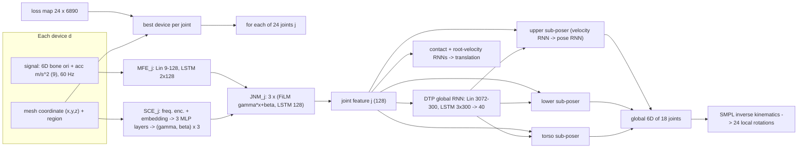
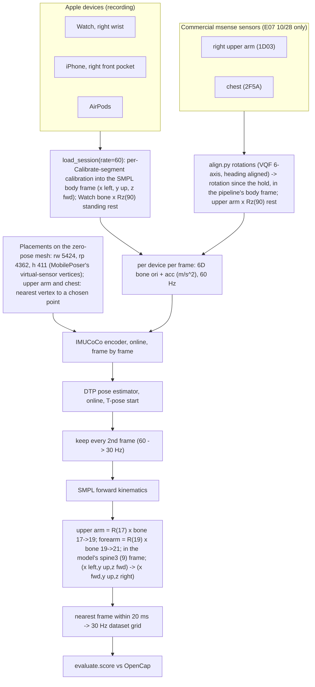

# IMUCoCo: pretrained pose estimation from IMUs placed anywhere on the body

> **Source**
>
> | | |
> |---|---|
> | Paper | H. Zhou, R. Arakawa, Y. Agarwal, M. Goel, *IMUCoCo: Enabling Flexible On-Body IMU Placement for Human Pose Estimation and Activity Recognition*, UIST 2025 (ACM, pp. 1–16) ([doi 10.1145/3746059.3747695](https://doi.org/10.1145/3746059.3747695), [arXiv 2508.01894](https://arxiv.org/abs/2508.01894)) |
> | Repo | https://github.com/cmusmashlab/IMUCoCo |
> | Commit used | `d7dd17c` (04/10/2026, "released imucoco datasets, har; ..."), pinned in `tools/setup_third_party.sh`, checked out at `third_party/IMUCoCo/`. No local changes. |
> | Weights | `third_party/IMUCoCo/saved_checkpoints/imucoco_best.pth` (IMUCoCo encoder, 90 MB), `poser_dtp_best.pth` (pose estimator, 134 MB), `all_error_loss_map.pth` (device-to-joint loss map, 0.7 MB), downloaded from `https://synergylabs.org/haozhe/<file>` as in their README. Not in git. |
> | Body model | `third_party/IMUCoCo/smpl/SMPL_MALE.pkl`, a symlink to MobilePoser's `basicmodel_m.pkl` (SMPL male) |
> | License | GPL-3.0 (`third_party/IMUCoCo/LICENSE`). SMPL has its own non-commercial license. |
> | Training | **Pretrained by the authors. We did not retrain or fine-tune it.** |
> | Our methods | `imucoco_rw_rp_h` (Watch + phone + AirPods), `imucoco_rw_rp_h_upperarm_chest` (+ commercial upper-arm and chest sensors), `imucoco_rw_upperarm_chest` (Watch + upper arm + chest), in `experiments/E07_pose_methods/learned_published.py` via `experiments/E02_imucoco_comparison/imucoco_runner.py` |

Abbreviations: IMU = inertial measurement unit; SMPL = Skinned Multi-Person Linear body model (24
joints, 6890 mesh vertices); AMASS = Archive of Motion Capture as Surface Shapes; DIP-IMU = Deep
Inertial Poser real-IMU dataset; XSens = Xsens suit datasets (AnDy, UNIPD, Emokine, CIP, Virginia
Natural Motion); LSTM = long short-term memory network; FiLM = feature-wise linear modulation
(scale gamma and shift beta); 6D = 6D rotation representation; MSE = mean squared error; DTP =
the downstream pose estimator (`models/dtp.py`, built on DynaIP); rw / rp / h = right wrist /
right pocket / head; trunk frame = x forward, y up, z to the body's right (OpenSim convention).

---

## 1. How the original model works (the authors')

### 1.1 Idea

Most sparse-IMU pose models have fixed sensor slots. IMUCoCo instead takes **any number of IMUs at
any point on the body surface**. Each sensor is described by its **coordinate on the zero-pose
SMPL mesh** plus a body-region category. IMUCoCo turns each sensor's signal into a 128-number
feature for each of the 24 SMPL joints ("joint features"). A separate pose network (DTP) reads the
24 joint features and outputs the full-body pose and translation.

### 1.2 Inputs

Per device and frame, 9 numbers (`experiments/E02_imucoco_comparison/imucoco_runner.py:110`):

- orientation: the bone orientation in the SMPL global frame (x left, y up, z forward), as 6D:
  the first two columns of the 3x3 matrix, flattened;
- acceleration: m/s² in the same frame, **not** scaled (unlike MobilePoser's /30).

Rate: **60 Hz**. Their synthetic acceleration is a second difference of vertex positions times
60² = 3600 (`third_party/IMUCoCo/data_generation.py:102`).

Per device, once: its position on the zero-pose mesh (x, y, z) plus a region category.

### 1.3 Architecture

Sizes from `imucoco_runner._load` (`imucoco_runner.py:54`) and the model code
`third_party/IMUCoCo/models/imucoco.py`.

**Device-to-joint assignment** (`imucoco.py:731`): for each of the 24 joints, the device whose
nearest mesh vertex has the lowest error in the precomputed loss map
(`all_error_loss_map.pth`, 24 x 6890) drives that joint. One device can drive many joints.

**IMUCoCo encoder** (one copy per joint, 24 in all):

| Part | Line | Layers |
|---|---|---|
| Sensor Coordinate Encoder (SCE) | `imucoco.py:115`, `:324` | coordinate standardised, sin/cos frequency encoding (4 bands x 3 axes x 2 = 24) + category embedding (40) -> 3 MLP layers Linear(→256) + ReLU; each layer's output split into (gamma, beta), 128 each = the "placement code" |
| Motion Feature Encoder (MFE) | `imucoco.py:64`, `:334` | Linear 9 -> 128, 2-layer LSTM 128 (causal) |
| Joint Node Modulator (JNM) | `imucoco.py:206`, `:338` | 3 x [FiLM: `gamma * x + beta` with that layer's placement code, then 1-layer LSTM 128] |
| Kinematic regressors (training only) | `imucoco.py:277` | per joint: Linear 128 -> 32 -> out for joint velocity (3), root velocity (3), position (3), global orientation (6), local orientation (6) |
| Pose regressor (training only) | `imucoco.py:352` | Linear 24·128 -> 768 -> 144 (24 joints x 6D) |

**DTP pose estimator** (`third_party/IMUCoCo/models/dtp.py:98`), built with `n_hidden=300,
n_glb=40, num_layer=3` (`imucoco_runner.py:69`). All LSTMs are unidirectional:

| Part | Line | Layers |
|---|---|---|
| Global context | `dtp.py:105` | RNN: Linear 24·128 -> 300, 3-layer LSTM 300, Linear -> 40 |
| Upper-body sub-poser | `dtp.py:107`, `:124` | input = joint features of joints [0,18,19,16,17,13,14,20,21,22,23] + global context. rnn1 -> velocities of joints 20, 21; rnn2 -> global 6D of joints [18,19,16,17,13,14]. Each rnn: Linear -> 300, 3-layer LSTM 300 with an MLP that builds the initial state from initial values (`RNNWithInit`, `dtp.py:49`) |
| Lower-body and torso sub-posers | `dtp.py:111`, `:115` | same pattern for legs [4,5,7,8,1,2] and torso [15,12,9,6,3,0] |
| Foot contact | `dtp.py:133` | RNN, hidden 150, 2 layers -> 2 logits |
| Root velocity | `dtp.py:134` | RNNWithInit, hidden 300, 2 layers -> 3 |
| Output | `dtp.py:355` | global 6D -> matrices -> SMPL inverse kinematics -> 24 local rotations; translation from contact-weighted velocities (thresholds 0.3–0.6, `dtp.py:137`) |



### 1.4 How the authors trained it

| Stage | Data | Settings | Loss |
|---|---|---|---|
| Synthetic data | AMASS, DIP-IMU (train subjects), XSens datasets; virtual IMUs at the 24 joints and at all 6890 mesh vertices, 60 Hz; acceleration = smoothed second difference (span 4) x 3600 (`data_generation.py:102`); orientation = bone (segment) global rotation | full-body synthesis needs ~8 TB (README) | — |
| Phase 1: joint warm-up | virtual IMUs placed at the joints | 250 epochs, batch 256, Adam lr 1e-3 (`train_imucoco.py:20`, `imucoco.py:370`) | 0.5 · pose MSE (24 x 6D) + 0.5 · kinematic loss (`imucoco.py:552`) |
| z_ref cache | the phase-1 model's joint features on all sequences | — | — |
| Phase 2: mesh | virtual IMUs on mesh vertices; 384 vertices per joint per step from a hop-distance sampler; sequences of 300 frames | 180 epochs, batch 6, Adam lr 3e-4 with cosine annealing (`train_imucoco.py:21`, `imucoco.py:371`) | 0.3 · kinematic + 0.35 · cosine alignment of the joint feature to z_ref + 0.35 · pose MSE (`imucoco.py:598`) |
| Loss map | the trained encoder evaluated per (joint, vertex) | `generate_imucoco_loss_map.py`, 1000 sequences | — |
| DTP pose estimator | AMASS, DIP-IMU train, XSens; IMUCoCo frozen (`evaluate_imucoco_hpe.py:70`) | 50 epochs, batch 32, Adam lr 1e-3, cosine (`evaluate_imucoco_hpe.py:30`, `:98`) | global 6D pose MSE + joint velocity MSE + joint position MSE + 1e-3 · jerk (`dtp.py:171`); translation: contact BCE + root-velocity MSE (`dtp.py:209`) |

Kinematic loss weights (`imucoco.py:355`): 0.25 joint velocity, 0.09 root velocity, 0.36
position, 0.15 global orientation, 0.15 local orientation, each an MSE.

Calibration (authors' live demo): devices flat on a table for "floor alignment", then a
**T-pose** for bone alignment; acceleration offset removed at the T-pose
(`third_party/IMUCoCo/live_demo.py:997`, `:1040`). The DTP state starts from the T-pose
(`live_demo.py:1542`).

Reported accuracy (paper, as summarised in `docs/research/model-comparison.md`): on the
wrist + thigh pocket + ear set, 27.6° vs MobilePoser 31.8°; TotalCapture with 6 IMUs, 14.0°
global angular error.

---

## 2. Running specs on our end

| Item | Value |
|---|---|
| Environment | `.venv`, Python 3.9.6, torch 2.1.2, numpy 1.23.0, scipy 1.8.0, macOS arm64. Authors tested Python 3.10.13 / torch 2.9.0 (CUDA); 2.1.2 runs the online path (`torch.func.functional_call`, `vmap`) |
| Device | CPU (`map_location="cpu"`, `imucoco_runner.py:78`) |
| Loading | Built as in `live_demo.start_inference()`: `online_mode=True`, offline weights converted to the online LSTM cells by their `load_offline_state_dict_to_online_model`; checkpoints loaded with `weights_only=True` (tensors only) (`imucoco_runner.py:37`) |
| Working directory | `third_party/IMUCoCo/` while loading (relative paths); restored afterwards (`imucoco_runner.py:43`, `:89`) |
| Rate | 60 Hz input (`load_session(..., rate=60)`, `learned_published.py:191`); output every 2nd frame -> 30 Hz (`imucoco_runner.py:124`) |
| Sequences | Frame by frame (online, causal); recurrent states reset at the start of each segment; DTP initialised to the T-pose with zero velocity (`imucoco_runner.py:103`, `:112`) |
| Runtime (measured 11/10) | ~150 frames/s at 60 Hz for 3 devices (30 s of data in 12 s), i.e. ~2.5x real time; model load 2 s |
| Outputs | `results/<player>/method_imucoco_<name>.npz` (arm vectors) and `pose_imucoco_<name>.npz` (full SMPL output) (`learned_published.py:219`) |

Commands:

```bash
tools/setup_third_party.sh       # clone at d7dd17c; then download the 3 checkpoints and link SMPL
.venv/bin/python -m experiments.E07_pose_methods.learned_published   # MobilePoser + IMUCoCo, 10/28
.venv/bin/python -m experiments.E07_pose_methods.learned_published --skip-mobileposer   # IMUCoCo only
.venv/bin/python -m experiments.E07_pose_methods.evaluate
.venv/bin/python -m experiments.E08_janys_1105.frame_methods published   # 11/05 rerun
.venv/bin/python -m experiments.E08_janys_1105.evaluate
```

---

## 3. Our adaptations, step by step

### 3.1 Pipeline overview



### 3.2 Device combinations and placements

| Our method | Devices (order fed) | Run on |
|---|---|---|
| `imucoco_rw_rp_h` | Watch, iPhone, AirPods | 10/28 (both players), 11/05 |
| `imucoco_rw_rp_h_upperarm_chest` | + commercial right upper arm, chest | 10/28 only |
| `imucoco_rw_upperarm_chest` | Watch, upper arm, chest | 10/28 only |

Defined at `experiments/E07_pose_methods/learned_published.py:202`. Segments missing a device are
dropped for that combination (`learned_published.py:212`).

Placements on the zero-pose mesh:

- Apple devices use the vertices MobilePoser's virtual sensors use, so both models see the same
  placements: right wrist 5424, right pocket 4362, head 411 (`imucoco_runner.py:26`).
- Commercial upper arm: the vertex nearest to the mid-shaft of the right upper arm, 5 cm up (the
  deltoid side in the T-pose) -> vertex 6282. Chest: nearest to the midpoint of spine3 and neck,
  12 cm forward -> vertex 3496 (`mesh_vertices`, `learned_published.py:108`).

Resulting device-to-joint assignment for `rw_rp_h` (read from the model on 11/10): the Watch
drives the right shoulder, elbow, wrist and hand (joints 17, 19, 21, 23); the pocket phone drives
the pelvis, legs and lower spine (0–5, 7, 8, 10, 11); the AirPods drive the upper spine, neck, head,
both collars and the **whole left arm** (6, 9, 12–16, 18, 20, 22).

### 3.3 Step 1: calibration and frames (Apple devices)

Same calibration as MobilePoser (see `mobileposer.md` section 3.4), only at 60 Hz:

- Segments from each Calibrate hold (`pipeline/pose/render_session.py:45`); the Watch is renamed
  from `"wrist"` to `"right_wrist"` where needed (`learned_published.py:126`).
- Apple world (x magnetic north, z up) -> body frame M (x left, y up, z forward) with `R_MI` from
  the pocket phone's screen normal at the hold (`pipeline/preprocessing/calibration.py:90`).
- Bone orientation `ori = R_MI R_IS(t) device2bone`, identity at the hold
  (`calibration.py:153`); the Watch gets the fixed standing-rest turn `Rz(+90°)` so the hanging
  arm matches SMPL's T-pose convention (`calibration.py:46`, `experiments/common/session.py:110`).
- AirPods: own forward axis (+y), player assumed to look ahead (`session.py:106`).
- Acceleration: `R_MI R_IS(t) (−9.81 · userAcceleration) − hold offset`, m/s²
  (`calibration.py:154`). Apple's userAcceleration is in g with the opposite sign of the physical
  acceleration.
- Resampled to 60 Hz: slerp / linear (`pipeline/preprocessing/resample.py:24`). Our phone stream
  delivers ~33 Hz, so its 60 Hz samples are interpolated.

### 3.4 Step 2: commercial sensors (E07 only)

`add_commercial` (`learned_published.py:57`) adds the msense upper-arm and chest sensors to a copy
of the 60 Hz session:

- Their world rotations come from `align.py` (VQF 6-axis orientation, headings made consistent
  without magnetometers).
- Rotation since the hold, `delta = R_seg(t) B^T`, is expressed in the pipeline's body frame and
  given the rest pose: `ori = R_MI delta R_MI^T rest`, with `Rz(90°)` for the upper arm and
  identity for the chest (`learned_published.py:91`).
- Acceleration: `R_sensor(t) (−9.81 · acc)` rotated into the body frame; no hold offset removed
  (`learned_published.py:93`).
- Samples are matched to the session's 60 Hz times by nearest index on the 30 Hz grid
  (`learned_published.py:89`), so these two sensors are effectively 30 Hz, repeated.
- Segments are trimmed to where the commercial data exist (`learned_published.py:99`).

### 3.5 Step 3: input tensor and inference

- Per segment: stack devices in order, 6D = first two columns of `ori` flattened, concatenated
  with `acc` -> (T, D, 9) (`imucoco_runner.py:106`).
- Placement codes computed once from the mesh coordinates (`imucoco_runner.py:99`).
- For every 60 Hz frame: `coco.inference_time_forward_mesh_online` then `poser.forward_online`,
  carrying the hidden states (`imucoco_runner.py:115`). This mirrors their live demo.
- E07 trims the 60 Hz session to the span of the scored blocks ±1 s before running
  (`learned_published.py:196`), so in a segment that starts before the block the recurrent state
  starts at the block, not at the Calibrate hold. E08 keeps whole segments that overlap the test
  data (`experiments/E08_janys_1105/frame_methods.py:125`).

### 3.6 Step 4: outputs -> our arm vectors

- Keep every 2nd pose (60 -> 30 Hz) and run SMPL forward kinematics (`imucoco_runner.py:124`).
- `arm_vectors` with the IMUCoCo body's zero-pose joints (`learned_published.py:32`, `:217`):
  upper arm = global rotation of joint 17 applied to the rest bone 17 -> 19; forearm = joint 19
  applied to 19 -> 21; both in the model's own spine3 (joint 9) frame, mapped to
  (x fwd, y up, z right).
- `on_grid`: nearest model frame within 20 ms, else NaN (`learned_published.py:45`).
- Elbow flexion = angle between the two vectors (`experiments/E07_pose_methods/common.py:96`).

### 3.7 Patches to their code

None. Our runner imports `models.imucoco.IMUCoCo`, `models.dtp.Poser`, `utils.imu_config` and
`path_config` from the checkout unchanged. We only add placements for the commercial sensors to
our own `SENSOR_VERTEX` dict (`learned_published.py:189`).

### 3.8 E08 rerun (11/05)

`experiments/E08_janys_1105/frame_methods.py:120` runs `imucoco_rw_rp_h` only (no commercial
upper-arm or chest sensors were worn on 11/05).

---

## 4. Limitations and why it may underperform on tennis

1. **Training motion.** Synthetic AMASS / XSens / DIP motion has few fast racket strokes; the
   priors pull the arm toward everyday poses.
2. **One sensor per arm segment at most.** With `rw_rp_h`, the Watch alone drives the right
   shoulder and elbow joints; elevation is a guess from the forearm.
3. **The AirPods drive the left arm and upper spine.** Head motion (tracking the ball) is read as
   trunk and left-arm motion, which also moves the spine3 frame we measure the arm in.
4. **Placement is not calibration.** Adding the upper-arm and chest sensors did not help (E07):
   IMUCoCo knows where they sit on the mesh, but their orientation still depends on our hold-based
   bone alignment, and the commercial headings come from magnetometer-free alignment.
5. **T-pose start.** The DTP state starts in a T-pose while our player stands with arms hanging,
   and our calibration is standing, not T-pose (fixed 90° rest instead).
6. **Elbow reads straight.** Elbow bias is −15° to −24° over whole blocks: the model keeps the
   elbow straighter than OpenCap (which sees ~18° of bend even when hanging).
7. **Rates.** 60 Hz from a ~33 Hz phone and ~66 Hz Watch stream (interpolated); the commercial
   sensors enter at 30 Hz repeated.
8. **Heading.** Forward from the pocket phone's screen normal (~110° off for Tom in E07).
9. **Causal.** Online inference (no future frames), unlike our MobilePoser runs.
10. **Version gap.** Authors used torch 2.9; we run torch 2.1.2. It loads and runs, but outputs were
    not cross-checked against their environment.

---

## 5. Our results

Median absolute error vs OpenCap, degrees; "swing" = ±0.5 s around each ball contact detected
from the Watch (`experiments/E07_pose_methods/evaluate.py:16`). Elbow bias = median(model − OpenCap).

### 5.1 E07, 10/28 (`experiments/E07_pose_methods/results/scores.json`)

| Method | Player | Part | Elbow | Elbow bias | Elbow r | Shoulder elev. | Forearm incl. | Forearm dir. | Upper-arm dir. |
|---|---|---|---|---|---|---|---|---|---|
| rw_rp_h | Janys | swing | 25 | 0 | 0.41 | 24 | 10 | 29 | 41 |
| rw_rp_h | Tom | swing | 36 | −34 | 0.59 | 31 | 13 | 38 | 61 |
| rw_rp_h | Janys | all | 22 | −17 | 0.63 | 9 | 20 | 30 | 20 |
| rw_rp_h | Tom | all | 20 | −15 | 0.59 | 18 | 19 | 46 | 33 |
| rw_rp_h + upper arm + chest | Janys | swing | 23 | −4 | 0.41 | 23 | 13 | 30 | 48 |
| rw_rp_h + upper arm + chest | Tom | swing | 36 | −35 | 0.49 | 26 | 15 | 63 | 78 |
| rw_rp_h + upper arm + chest | Janys | all | 24 | −19 | 0.58 | 12 | 22 | 42 | 27 |
| rw_rp_h + upper arm + chest | Tom | all | 23 | −20 | 0.55 | 18 | 16 | 64 | 34 |
| rw + upper arm + chest | Janys | swing | 23 | −4 | 0.41 | 26 | 16 | 33 | 50 |
| rw + upper arm + chest | Tom | swing | 35 | −34 | 0.48 | 27 | 14 | 66 | 80 |
| rw + upper arm + chest | Janys | all | 23 | −18 | 0.58 | 13 | 21 | 42 | 28 |
| rw + upper arm + chest | Tom | all | 23 | −20 | 0.55 | 17 | 16 | 66 | 34 |

Mean of the two players, swings (`results/summary.md`): `rw_rp_h` elbow 31, elevation 28, forearm
inclination 12, forearm direction 34 (the best published model on forearm direction). Adding the
commercial sensors: elbow 30, elevation 25, forearm direction 47.

### 5.2 E08, Janys 11/05 (`experiments/E08_janys_1105/results/scores_all.json`)

| Method | Part | Minutes | Elbow | Elbow bias | Elbow r | Shoulder elev. | Forearm incl. | Forearm dir. | Upper-arm dir. |
|---|---|---|---|---|---|---|---|---|---|
| rw_rp_h | swing | 4.4 | 25 | −9 | 0.21 | 34 | 15 | 66 | 83 |
| rw_rp_h | all | 35.3 | 29 | −24 | 0.44 | 17 | 27 | 61 | 38 |

Compared with Janys 10/28 (swings): elbow 25 -> 25, elevation 24 -> 34, forearm inclination
10 -> 15, forearm direction 29 -> 66. Still the best published model on forearm inclination on
11/05; our GRU trained on Janys 10/28 gets elbow 14, elevation 11, forearm inclination 10, forearm
direction 23 on the same swings.
