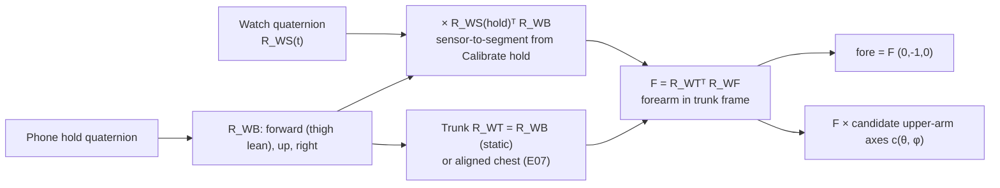
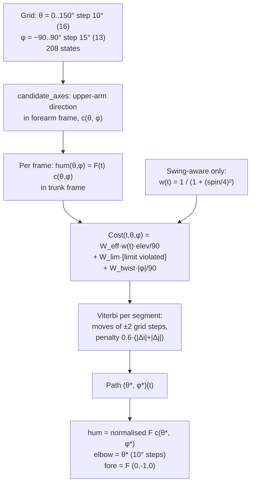

# Joint-constraint arm method (Watch only)

How `experiments/E07_pose_methods/constraint.py` guesses the whole right arm (upper arm, elbow,
forearm) from the Apple Watch alone, using joint anatomy and priors instead of training. E08 calls the
same functions on 11/05 (`experiments/E08_janys_1105/frame_methods.py:62-82`).

Abbreviations: IMU = inertial measurement unit. DoF = degree of freedom. HMM = hidden Markov model.
Viterbi = dynamic-programming search for the lowest-cost path through a grid of states over time.
GT = ground truth (OpenCap). MAE = median absolute error.

Frames, the Calibrate hold and the sensor-to-segment calibration are shared with the geometric methods.
They are explained in [`geometric.md` §2](geometric.md#2-inputs); this page only repeats what it needs.

---

## 1. Summary

The Watch gives the forearm's full 3D orientation. Model the elbow as a **hinge (flexion $\theta$) plus
forearm twist ($\phi$)**. Then the upper arm is the forearm's long axis turned back about the hinge axis
by $\theta$, and the hinge axis's position in the Watch frame depends on $\phi$. Two unknowns per frame.
For every frame and every $(\theta, \phi)$ on a grid, a cost scores joint limits, effort ("the arm hangs
unless held up") and twist. A Viterbi pass adds smoothness over time and picks one path.

| | |
|---|---|
| Idea | ArmTrak: S. Shen, H. Wang, R. Roy Choudhury, "I am a Smartwatch and I can Track my User's Arm", MobiSys 2016 |
| What we kept | joint anatomy (hinge + twist), a discretised state space, Viterbi over time |
| What we dropped | ArmTrak's accelerometer-driven HMM observation model and its position (wrist/elbow location) states; we use orientation only |
| Code | ours, all of it (`constraint.py`, 122 lines). No external library beyond `numpy` 1.23.0 and `scipy` 1.8.0 |
| Learning | none; weights set by hand |
| Sensors | Watch only (trunk = the hold's body frame), or Watch + the aligned commercial chest sensor (E07 only) |

Variants:

| Saved name | Trunk | Effort weight | Run in |
|---|---|---|---|
| `constraint_watch_static_trunk` ("Joint limits + effort, Watch only") | hold body frame, never turns (`static_trunk`) | 1 every frame | E07, E08 |
| `constraint_watch_swing` ("Joint limits, swing-aware, Watch only") | hold body frame | fades with Watch rotation speed | E07, E08 |
| `constraint_watch_aligned_trunk` | chest sensor 2F5A, heading pulled to the phone (`align.py`) | 1 | E07 only (no chest sensor on 11/05) |

Definitions: `constraint.py:101-105` (E07), `frame_methods.py:72` (E08).

---

## 2. Inputs

| Input | Source | Rate | Use |
|---|---|---|---|
| Watch quaternion `watch_quat` | Apple Watch device motion, right wrist, `xMagneticNorthZVertical` world (x north, y west, z up) | ~66 Hz delivered, slerped to the 30 Hz grid | forearm orientation |
| Watch rotation rate `watch_gyro` | same, rad/s, linearly interpolated to 30 Hz | 30 Hz | swing-aware effort fade only |
| Phone hold quaternion `phone_hold_quat` | iPhone in the right pocket, 3 s mean at each Calibrate hold | one per segment | body frame (forward from the thigh's lean) |
| Watch hold quaternion `watch_hold_quat` | 3 s mean at the hold | one per segment | sensor-to-segment calibration |
| Chest `trunk_R` (aligned variant) | `results/<player>/aligned.npz` from `align.py` | 30 Hz | trunk rotation |

### 2.1 Frames and the forearm rotation in the trunk frame

Axes: trunk/body/segment frames all use x forward, y up, z right (OpenSim). Rotation $R_{AB}$ maps
B-coordinates to A-coordinates.

1. Body basis at the hold, $R_{WB} = [\hat f\ \hat u\ \hat r]$ (`common.body_basis`, `common.py:49-60`), with
   forward $\hat f$ from the thigh's mean horizontal lean while tilted more than 15° (`common.set_forward`,
   `common.py:31-46`).
2. Watch segment rotation (`common.segment_rot`, `common.py:63-73`):
   $R_{WF}(t) = R_{WS}(t)\,R_{WS}(\text{hold})^\top R_{WB}$. At the hold the forearm frame equals the body
   frame: forearm hanging straight down, palm facing the thigh.
3. Trunk: $R_{WT}(t) = R_{WB}$ for the static variants (`common.static_trunk`, `common.py:76-83`), or the
   aligned chest `trunk_R`.
4. Forearm in the trunk frame (`constraint.py:106`): $F(t) = R_{WT}(t)^\top R_{WF}(t)$.



---

## 3. Algorithm



### 3.1 State grid

`constraint.py:23-25`:

| Parameter | Value | Code |
|---|---|---|
| Elbow flexion $\theta$ | 0°, 10°, …, 150° (16 values) | `THETA = np.radians(np.arange(0, 151, 10))` |
| Forearm twist $\phi$ | −90°, −75°, …, 90° (13 values) | `PHI = np.radians(np.arange(-90, 91, 15))` |
| States per frame | 16 × 13 = 208 | |

$\theta = 0$ is a straight arm (as at the hold), $\phi = 0$ is the twist at the hold (palm in).

### 3.2 Candidate upper-arm directions (`candidate_axes`, `constraint.py:28-38`)

In the forearm (Watch-segment) frame, the forearm long axis is $d = (0,-1,0)$ (distal). The hinge
(flexion) axis at twist $\phi$ is the segment's right axis $z$ turned about the long axis $y$ by $-\phi$:

$$a(\phi) = (\sin(-\phi),\ 0,\ \cos(-\phi))$$

The upper arm's long axis (shoulder → elbow) is $d$ rotated about $a$ by $-\theta$ (Rodrigues formula):

$$c(\theta,\phi) = d\cos\theta' + (a\times d)\sin\theta' + a\,(a\cdot d)(1-\cos\theta'),\qquad \theta' = -\theta$$

With $\phi = 0$ this gives $c = (-\sin\theta, -\cos\theta, 0)$: a forearm pointing forward with a hanging
upper arm is $\theta = 90°$. The table is computed once, shape (16, 13, 3).

### 3.3 Per-frame cost (`frame_costs`, `constraint.py:41-55`)

For each frame $t$: $h(t,\theta,\phi) = F(t)\,c(\theta,\phi)$, the candidate upper arm in the trunk frame.
Shoulder elevation (0 = hanging): $e = \arccos(-h_y)$ in degrees.

Joint limits (indicator $L$, true = forbidden):

| Limit | Condition on $h$ (trunk frame, unit vector) | Meaning |
|---|---|---|
| Into the trunk | $h_z < -0.35$ **and** $h_x < 0.4$ | upper arm points left across or through the chest without being well forward |
| Behind | $h_x < -0.7$ | upper arm far behind the body (more than ~44° behind the frontal plane) |
| Overhead | $e > 170°$ | above 170° elevation |

Cost:

$$C(t,\theta,\phi) = W_\text{eff}\,w(t)\,\frac{e}{90} + W_\text{lim}\,L + W_\text{twist}\,\frac{|\phi|_{\deg}}{90}$$

| Weight | Value | Effect |
|---|---|---|
| $W_\text{eff}$ (`W_EFFORT`) | 1.0 | hanging arm costs 0, horizontal 1, overhead 2 |
| $W_\text{lim}$ (`W_LIMIT`) | 10.0 | a forbidden pose costs 10 (soft, but larger than every other term) |
| $W_\text{twist}$ (`W_TWIST`) | 0.5 | full ±90° twist costs 0.5 |
| $W_\text{smooth}$ (`W_SMOOTH`) | 0.6 | per grid step moved between frames (Viterbi) |
| $w(t)$ | 1 (plain) or the swing fade | effort weight per frame |

All weights are hand-set (`constraint.py:25`); none was tuned on OpenCap.

### 3.4 Smoothness and Viterbi (`viterbi`, `constraint.py:58-83`)

Allowed moves from frame $k-1$ to $k$: $\Delta i, \Delta j \in \{-2,\dots,2\}$ grid steps in $(\theta, \phi)$, i.e. at
most 20° of elbow and 30° of twist per frame (600°/s and 900°/s at 30 Hz). Larger jumps are impossible
(cost $10^9$). Transition penalty $W_\text{smooth}(|\Delta i| + |\Delta j|)$.

Recursion:

$$A_0 = C_0,\qquad A_k(i,j) = C_k(i,j) + \min_{|\Delta i|,|\Delta j|\le 2}\big[A_{k-1}(i-\Delta i, j-\Delta j) + 0.6(|\Delta i|+|\Delta j|)\big]$$

The best final state is $\arg\min A_{n-1}$; the path is recovered by backtracking the stored moves (`int8`
back-pointers). Viterbi runs **separately per segment** (`seg`), so each segment starts fresh: two
segments per player on 10/28, 97 segments of ~25 s on 11/05.

### 3.5 Swing-aware variant (`constraint.py:96-100`; E08 `frame_methods.py:69-70`)

The effort prior pulls the arm down. During a swing the arm is held up on purpose, so the prior is
faded while the Watch turns fast:

$$s(t) = \operatorname{mean}_{15\ \text{frames}}\lVert\omega_\text{watch}\rVert\ \ (\text{rad/s, 0.5 s moving mean, } \texttt{uniform\_filter1d}),\qquad w(t) = \frac{1}{1 + (s/4)^2}$$

| Watch speed $s$ | $w$ |
|---|---|
| 0 rad/s (still) | 1.0 |
| 4 rad/s | 0.5 |
| 8 rad/s | 0.2 |
| 15 rad/s (the swing-detection threshold) | 0.07 |

Everything else is unchanged.

### 3.6 Outputs per frame (`constraint.py:111-116`)

- `hum` = $F(t)\,c(\theta^*,\phi^*)$, normalised.
- `elbow` = $\theta^*$ in degrees (quantised to **10°**).
- `fore` = `in_trunk(R_WT, R_WF)` = $F(t)(0,-1,0)$, identical to the geometric `watch_static_trunk`
  forearm (or `aligned_trunk_watch` for the aligned variant). The constraint changes nothing about the forearm.
- $\phi^*$ is not saved. No forearm pronation output.

---

## 4. Outputs

`results/<player>/method_<name>.npz` (E07) or `experiments/E08_janys_1105/results/janys/method_<name>.npz`
(E08), 30 Hz grid:

| Field | Shape | Meaning |
|---|---|---|
| `hum` | (n, 3) | right upper arm long axis, unit, trunk frame (x fwd, y up, z right) |
| `fore` | (n, 3) | right forearm long axis, unit, trunk frame |
| `elbow` | (n,) | $\theta^*$, degrees, 0-150 in 10° steps |
| `valid` | (n,) | `fore` finite |

Shoulder elevation and plane are derived from `hum` at scoring time (`data.elevation_plane`).

Unlike the Watch-only geometric methods, this method always returns an upper arm and an elbow. But they
come from priors, not from a measurement: the Watch's orientation is consistent with every $(\theta,\phi)$
that the limits allow.

---

## 5. How to run

Environment: `.venv` (Python 3.9.6), `numpy` 1.23.0, `scipy` 1.8.0. CPU only. From the repo root:

```bash
# E07 (10/28); the aligned variant needs align.py's output first
.venv/bin/python -m experiments.E07_pose_methods.data
.venv/bin/python -m experiments.E07_pose_methods.align
.venv/bin/python -m experiments.E07_pose_methods.constraint      # 3 variants x 2 players
.venv/bin/python -m experiments.E07_pose_methods.evaluate

# E08 (Janys 11/05): plain and swing-aware, static trunk only
.venv/bin/python -m experiments.E08_janys_1105.data
.venv/bin/python -m experiments.E08_janys_1105.frame_methods constraint
.venv/bin/python -m experiments.E08_janys_1105.evaluate
```

Runtime (M3 Pro, measured): 3.1 s per variant for Janys's 8.1 min (14,600 frames). Cost grows linearly
with frames (25 shifted 16 × 13 array updates per frame), so 11/05's 35.8 min takes roughly 15 s per variant.
Memory: the `hum` candidate array is n × 208 × 3 floats (~70 MB for 14,600 frames).

To rebuild from scratch you need only: the per-frame Watch quaternion and rotation rate on a uniform
grid, the phone's and Watch's mean quaternion over a 3 s standing hold, and §2.1-§3.5 above.

---

## 6. Results

Median absolute error vs OpenCap in degrees. Swings = ±0.5 s around each Watch rotation-speed peak above
15 rad/s.

### E07, 10/28 (mean of two players, Janys / Tom; `experiments/E07_pose_methods/results/summary.md` and `scores.json`)

| Variant | Part | Elbow | Elbow bias | Shoulder elev. | Forearm incl. | Forearm dir. | Upper-arm dir. |
|---|---|---|---|---|---|---|---|
| Plain, static trunk | swings | 27 (38 / 15) | +36 / −1 | 40 (55 / 25) | 15 (15 / 15) | 38 (44 / 31) | 63 (87 / 38) |
| Swing-aware | swings | 28 (38 / 18) | +34 / −12 | 35 (49 / 20) | 15 | 38 | 62 (84 / 39) |
| Aligned chest trunk | swings | 26 (35 / 18) | +31 / +9 | 41 (57 / 25) | 18 (21 / 14) | 52 (60 / 44) | 66 (90 / 41) |
| Plain, static trunk | whole block | 24 (30 / 18) | −23 / −15 | 12 (14 / 10) | 19 (24 / 14) | 39 (49 / 29) | 26 (28 / 24) |
| Swing-aware | whole block | 24 (31 / 18) | −23 / −16 | 12 (14 / 10) | 19 | 39 | 29 (33 / 26) |
| Aligned chest trunk | whole block | 21 (27 / 15) | −17 / −8 | 14 (15 / 12) | 15 (19 / 11) | 56 (65 / 46) | 27 (29 / 25) |

Elbow correlation with OpenCap (whole block): plain 0.24 / 0.73, swing-aware 0.21 / 0.68.

### E08, Janys 11/05 (`experiments/E08_janys_1105/results/scores_all.json`; in brackets Janys 10/28)

| Variant | Part | Elbow | Elbow bias | Shoulder elev. | Forearm incl. | Forearm dir. | Upper-arm dir. |
|---|---|---|---|---|---|---|---|
| Plain | swings | 34 (38) | +22 | 47 (55) | 24 (15) | 65 (44) | 75 (87) |
| Swing-aware | swings | 34 (38) | +20 | 41 (49) | 24 (15) | 65 (44) | 71 (84) |
| Plain | all | 32 (30) | −26 | 15 (14) | 28 (24) | 56 (49) | 33 (28) |
| Swing-aware | all | 32 (31) | −26 | 16 (14) | 28 (24) | 56 (49) | 36 (33) |

For comparison on 11/05 swings: our GRU trained on Janys 10/28 (Watch only) gets elbow 14°, elevation 10°
(E08 README).

Figures: `experiments/E07_pose_methods/figures/errors_swing.png`, `per_swing_elbow.png`;
`experiments/E08_janys_1105/figures/methods_swing.png`.

---

## 7. Limitations

- **The upper arm is not observed.** The Watch fixes the forearm; the upper arm and elbow come from the
  effort and twist priors. When the arm is raised, the prior still prefers a hanging upper arm, so the
  method bends the elbow instead: in swings elevation is 40-55° off for Janys and the elbow is read
  ~22-36° too bent. Over whole blocks (mostly ready stance) the elbow is read 15-26° too straight.
- **Swing-aware helps only a little**: elevation in swings 40 → 35° (E07), 47 → 41° (E08); the elbow
  does not improve. With the prior faded there is nothing else to pick the right $(\theta,\phi)$.
- **No accelerometer.** ArmTrak's HMM used the Watch's acceleration to tell positions apart; dropping it
  leaves an orientation-only, under-determined problem.
- **Coarse grid.** Elbow in 10° steps, twist in 15° steps; the elbow MAE floor is ~2.5° from rounding alone.
- **Trunk assumed fixed** (static variants): no trunk rotation or lean after the hold. The forearm
  direction error (38-65°) is the same as the geometric `watch_static_trunk`.
- **Hold = straight arm, palm in.** Same zero-pose assumption as the geometric methods; OpenCap sees a
  hanging elbow ~18° bent. No rest-angle correction is applied here.
- **Hand-set weights and limits**, from two players; the limit box is crude (no shoulder-angle limits
  besides the three tests in §3.3).
- **Speed cap.** At most 20° of elbow change per 33 ms frame; very fast elbow extension in a serve can
  exceed that and lag.
- **Ground truth.** OpenCap's error (~15°) and the noisier 11/05 reconstruction bound every number.
