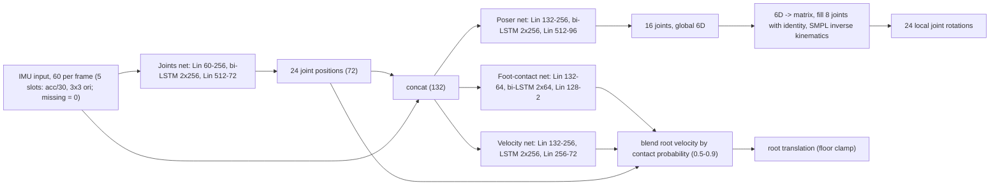
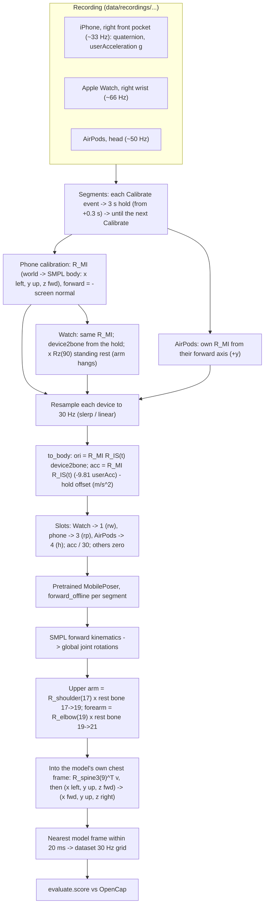

# MobilePoser: pretrained full-body pose from phone, watch and earbuds

> **Source**
>
> | | |
> |---|---|
> | Paper | V. Xu, C. Gao, H. Hoffmann, K. Ahuja, *MobilePoser: Real-Time Full-Body Pose Estimation and 3D Human Translation from IMUs in Mobile Consumer Devices*, UIST 2024 (ACM, Article 70) ([doi 10.1145/3654777.3676461](https://doi.org/10.1145/3654777.3676461), [arXiv 2504.12492](https://arxiv.org/abs/2504.12492)) |
> | Repo | https://github.com/SPICExLAB/MobilePoser |
> | Commit used | `513e76a` (03/23/2026, "Renewed model weights link"), pinned in `tools/setup_third_party.sh`, checked out at `third_party/MobilePoser/` |
> | Our patch | `third_party/patches/mobileposer.patch` (3 small changes, section 3.8) |
> | Weights | `third_party/MobilePoser/mobileposer/checkpoints/weights.pth` (26.7 MB), the authors' released checkpoint from the README's Box link. Not in git; downloaded by hand. |
> | Body model | SMPL male, `third_party/MobilePoser/mobileposer/smpl/basicmodel_m.pkl` (register at smpl.is.tue.mpg.de) |
> | License | CC BY-NC-SA 4.0 (`third_party/MobilePoser/LICENSE`); commercial use needs a separate license from Northwestern. SMPL has its own non-commercial license. |
> | Training | **Pretrained by the authors. We did not retrain or fine-tune it.** (Our own E00 only reproduced their evaluation.) |
> | Our methods | `mobileposer_rw_rp_h` (Watch + phone + AirPods) and `mobileposer_rw_rp` (Watch + phone), in `experiments/E07_pose_methods/learned_published.py` via `experiments/common/mobileposer_runner.py` |

Abbreviations: IMU = inertial measurement unit; SMPL = Skinned Multi-Person Linear body model (24
joints); AMASS = Archive of Motion Capture as Surface Shapes (large mocap collection in SMPL
format); DIP-IMU = the Deep Inertial Poser real-IMU dataset; LSTM = long short-term memory network;
bi-LSTM = bidirectional LSTM; 6D = 6D rotation representation (first two matrix columns); lw / rw
/ lp / rp / h = left wrist / right wrist / left pocket / right pocket / head; trunk frame = x
forward, y up, z to the body's right (OpenSim convention).

---

## 1. How the original model works (the authors')

### 1.1 Inputs and outputs

- **Five sensor slots:** 0 left wrist, 1 right wrist, 2 left pocket (thigh), 3 right pocket, 4
  head (`third_party/MobilePoser/mobileposer/config.py:46`). Missing slots are set to zero.
- Per slot: acceleration (3, m/s² divided by 30) and orientation (3x3 rotation matrix), both in
  the SMPL global frame (x = body's left, y = up, z = forward). Input vector per frame: 5 x 3
  accelerations, then 5 x 9 orientations = **60 values** (`config.py:47`).
- The orientation fed in training is the **global rotation of the SMPL joint the device rides
  on**: elbow joints 18 / 19 (= forearm segment) for the wrists, hips 1 / 2 (= thigh) for the
  pockets, joint 15 for the head (`third_party/MobilePoser/mobileposer/process.py:19`). So it is a
  bone orientation that is the identity in the SMPL T-pose, not the raw sensor orientation.
- **Rate: 30 Hz** in the code (`process.py:15`, `config.py:89`). The paper reports 60 Hz
  on-device; the released training pipeline downsamples to 30 Hz.
- **Outputs:** local rotations of all 24 SMPL joints, joint positions, foot contacts, root
  translation.

### 1.2 Architecture

Four modules, each built from the same block `RNN` (`third_party/MobilePoser/mobileposer/models/rnn.py:9`):
Linear(input -> hidden) + ReLU + dropout 0.4 -> 2-layer LSTM -> Linear(-> output).
Layer sizes read from `weights.pth`:

| Module (file) | Input | Linear 1 | LSTM | Linear 2 -> output |
|---|---|---|---|---|
| Joints (`models/joints.py:29`) | 60 IMU | 60 -> 256 | 2 layers, 256, **bidirectional** | 512 -> 72 (24 joint positions x 3) |
| Poser (`models/poser.py:32`) | 72 joints + 60 IMU = 132 | 132 -> 256 | 2 layers, 256, bidirectional | 512 -> 96 (16 joints x 6D global rotation) |
| Foot contact (`models/footcontact.py:28`) | 132 | 132 -> 64 | 2 layers, 64, bidirectional | 128 -> 2 (left, right contact logits) |
| Velocity (`models/velocity.py:29`) | 132 | 132 -> 256 | 2 layers, 256, unidirectional | 256 -> 72 (per-joint velocity; root used) |

- The poser predicts global 6D rotations for the 16 "reduced" joints
  `[0,1,2,3,4,5,6,9,12,13,14,15,16,17,18,19]` (`config.py:134`); these include the right shoulder
  (17), right elbow (19) and spine3 (9). The other 8 joints (wrists, hands, feet, ...) are set to
  identity (`models/net.py:95`).
- Global rotations are turned into local ones with SMPL inverse kinematics (`net.py:38`).
- Translation: a blend of the velocity network's root velocity and a foot-contact velocity
  (the supporting foot stays put), weighted by contact probability between 0.5 and 0.9
  (`net.py:92`, `net.py:146`), then floor penetration is removed (`net.py:150`).
- Optional physics optimiser (from PIP) only when the `PHYSICS` environment variable is set
  (`net.py:66`). We do not set it.



Because the joints, poser and foot-contact LSTMs are bidirectional, **offline** inference
(`forward_offline`, `net.py:124`) looks at the whole sequence, past and future. The online path
(`net.py:176`) instead re-runs a 45-frame window (40 past, 5 future; `config.py:52`).

### 1.3 How the authors trained it

| Item | Value (code unless noted) |
|---|---|
| Base data | AMASS, 20 sub-datasets (`config.py:117`), ~40 h (paper). Sequences at 120 / 60 Hz downsampled to 30 Hz (`process.py:67`) |
| Frame alignment | AMASS rotated into the DIP frame (`process.py:92`) |
| Synthetic IMU | Orientation = global rotation of joints `[18, 19, 1, 2, 15, 0]`; acceleration = second difference of mesh vertices `[1961, 5424, 876, 4362, 411, 3021]` (left wrist, right wrist, left thigh, right thigh, head, pelvis) with a smoothing span of 4 frames, times 30² (`process.py:18`, `process.py:23`) |
| Foot-contact labels | foot moves < 0.008 m per frame (`process.py:38`) |
| Device combinations | Every training window is repeated once per combination, other slots zeroed (`data.py:69`). 12 combinations in code (`config.py:60`): `lw_rp_h, rw_rp_h, lw_lp_h, rw_lp_h, lw_lp, lw_rp, rw_lp, rw_rp, lp_h, rp_h, lp, rp`. Every one includes a pocket phone. |
| Windows | 125 frames (`config.py:126`), 90 / 10 random train / validation split (`data.py:151`) |
| Noise | Gaussian noise σ = 0.04 m on the joint positions fed to the poser and foot-contact nets, σ = 0.025 to the velocity net (`poser.py:80`, `footcontact.py:57`, `velocity.py:64`) |
| Training order | Each module trained separately on ground-truth joint positions (teacher forcing), then combined (`combine_weights.py`) |
| Fine-tuning | DIP-IMU and IMUPoser real data (paper; `finetune.sh`). The README does not say which fine-tune, if any, `weights.pth` contains. |
| Hyperparameters | Batch 256, 60 epochs, lr 1e-3 (`config.py:6`); fine-tune: batch 32, 15 epochs, lr 5e-5 (`config.py:16`). Paper: 80 epochs, gradient clipping at norm 1, one A40 GPU, ~1 day. |
| Optimiser | Joints: AdamW (`joints.py:114`); poser: Adam (`poser.py:147`) |

Loss functions (all from the code):

| Module | Loss |
|---|---|
| Joints | MSE(joint positions) + 1e-5 x L1 norm of the second difference (smoothness) (`joints.py:68`) |
| Poser | MSE(6D global rotations of the 16 joints) + 1e-5 x L1 jerk (third difference) + MSE(joint positions after forward kinematics of the predicted pose) (`poser.py:89`) |
| Foot contact | binary cross-entropy with logits (`footcontact.py:31`) |
| Velocity | sum of MSE over chunks of 1, 3 and 9 frames (cumulative velocity error) (`velocity.py:74`) |

Calibration (authors): stand in a **T-pose** so device orientations can be aligned to the SMPL
bones.

Reported accuracy (paper): average joint vertex error 11.9 cm (base), 11.7 cm (DIP fine-tune),
11.3 cm (IMUPoser fine-tune); 24% / 14% / 9% better than IMUPoser with 1 / 2 / 3 devices.

Discrepancies between paper and code we noticed: 60 Hz vs 30 Hz, 18 vs 16 predicted joints, 24
vs 12 device combinations, 80 vs 60 epochs. We follow the code and the shipped weights.

---

## 2. Running specs on our end

| Item | Value |
|---|---|
| Environment | `.venv`, Python 3.9.6, torch 2.1.2, lightning 2.1.2, numpy 1.23.0, scipy 1.8.0, macOS arm64 |
| Install | `.venv/bin/pip install -e third_party/MobilePoser --config-settings editable_mode=compat` (`third_party/README.md`) |
| Device | CPU. `model_config.device` is CUDA if available, else CPU (`config.py:43`); MPS is not used. 4 threads (`experiments/common/mobileposer_runner.py:39`) |
| Working directory | Must be `third_party/MobilePoser/mobileposer/` (paths are relative); the runner `chdir`s there (`mobileposer_runner.py:34`) and the callers `chdir` back (`learned_published.py:184`) |
| Rate | 30 Hz (`load_session(..., rate=30)`, `learned_published.py:165`) |
| Sequences | One sequence per Calibrate segment (Calibrate to next Calibrate), model reset between them (`mobileposer_runner.py:65`, `:77`) |
| Mode | Offline: `forward_offline` over the whole segment (bidirectional, sees the future) (`mobileposer_runner.py:79`); no physics |
| Runtime (measured 11/10) | 22 s for Janys 10/28's full session (8 segments, 81,517 frames = 45 min, `rw_rp_h`), plus 4 s to load and calibrate the session |
| Outputs | `results/<player>/method_mobileposer_<combo>.npz` (arm vectors on the 30 Hz grid) and `pose_mobileposer_<combo>.npz` (full SMPL pose, global rotations, joints, translation) (`learned_published.py:174`) |

Commands:

```bash
tools/setup_third_party.sh                                        # clone at 513e76a, apply the patch
.venv/bin/python -m experiments.E07_pose_methods.learned_published   # MobilePoser + IMUCoCo, 10/28
.venv/bin/python -m experiments.E07_pose_methods.evaluate
.venv/bin/python -m experiments.E08_janys_1105.frame_methods published   # 11/05 rerun
.venv/bin/python -m experiments.E08_janys_1105.evaluate
```

---

## 3. Our adaptations, step by step

### 3.1 Pipeline overview



### 3.2 Device combinations

| Our method | Combo | Our devices -> MobilePoser slot | Trained combo? |
|---|---|---|---|
| `mobileposer_rw_rp_h` | `rw_rp_h` | Watch -> 1, iPhone -> 3, AirPods -> 4 | yes |
| `mobileposer_rw_rp` | `rw_rp` | Watch -> 1, iPhone -> 3 | yes |

Loop at `experiments/E07_pose_methods/learned_published.py:167`; slot numbers from
`pipeline/preprocessing/motion_io.py:15`; names from `mobileposer_runner.combo_name`
(`mobileposer_runner.py:47`). Watch-only (`rw`) is not run: it is not a trained combination
(every trained one has a pocket phone).

### 3.3 Step 1: segments and calibration holds

- `segments` (`pipeline/pose/render_session.py:45`): each Calibrate event gives a hold window
  (+0.3 s to +3 s) and a segment from the hold's end to the next Calibrate (or Stop − 1 s).
- `load_session` (`experiments/common/session.py:73`) calibrates each device per segment and keeps
  devices that cover ≥ 90% of the segment (`session.py:117`, `render_session.py:34`).
- Janys's merged sessions store the Watch as `"wrist"`; `_right_wrist_alias` renames it to
  `"right_wrist"` so the loader keeps it (`learned_published.py:126`).

### 3.4 Step 2: frames (Apple world -> SMPL body frame)

From `pipeline/preprocessing/calibration.py`:

- Apple world frame I: `xMagneticNorthZVertical` (x magnetic north, z up). The attitude quaternion
  is R_IS (device S -> world I) (`calibration.py:5`).
- Body frame M = SMPL/MobilePoser frame: x = player's left, y = up, z = forward
  (`calibration.py:8`).
- Phone: `R_MI` rows = (left, up, forward); forward = horizontal part of minus the screen normal
  (screen faces the leg), averaged over the hold (`calibration.py:90`).
- `device2bone = (R_MI R_IS_hold)^T`, so each bone is the identity at the hold
  (`calibration.py:111`).
- Watch: same `R_MI` as the phone (same Apple world frame, clocks mapped by `boot_to_unix`)
  (`pipeline/live/live_viewer.py:178`, `session.py:100`).
- **T-pose vs standing:** MobilePoser's identity bone is the T-pose (arm out to the side). We
  calibrate standing with arms hanging, so the wrist bone gets a fixed 90° turn about the forward
  axis, `Rz(+90°)` for the right wrist (`calibration.py:46`, applied at `session.py:110`). The
  forearm is assumed straight down and untwisted during the hold.
- AirPods: their reference frame has an arbitrary heading, so they get their own `R_MI` from their
  forward axis (+y), assuming the player looks straight ahead in the hold (`calibration.py:87`,
  `session.py:106`).
- Per frame: `ori = R_MI R_IS(t) device2bone` (`calibration.py:153`).

### 3.5 Step 3: units

- Apple `userAcceleration` is in g and is minus the physical acceleration, so
  `acc = R_MI R_IS(t) (−9.81 · userAcc) − offset`, in m/s², body frame (`calibration.py:154`).
  The offset is the mean over the hold (should be ~0).
- MobilePoser's scaling: `acc / 30` (`amass.acc_scale`) in `model_input`
  (`pipeline/pose/replay.py:47`).

### 3.6 Step 4: resampling and sequence handling

- Each device stream is resampled to a 30 Hz grid: slerp for quaternions, linear for vectors,
  grid points inside gaps > 0.25 s marked invalid (`pipeline/preprocessing/resample.py:24`).
  The invalid flags are not passed to the model; gaps are interpolated.
- All devices in a segment are cut to the shortest (`session.py:121`).
- One `forward_offline` call per segment, with `m.reset()` first (`mobileposer_runner.py:77`).
  Segments are 8–10 min on 11/05 and several minutes on 10/28; the bidirectional nets see the
  whole segment.

### 3.7 Step 5: outputs -> our arm vectors

- `forward_kinematics(pose)` gives global joint rotations `glb` (`mobileposer_runner.py:81`).
- `arm_vectors` (`learned_published.py:32`):
  - upper arm = `glb[17]` (right shoulder) applied to the zero-pose bone 17 -> 19 (shoulder ->
    elbow);
  - forearm = `glb[19]` (right elbow) applied to the zero-pose bone 19 -> 21 (elbow -> wrist);
  - both expressed in the model's **own spine3 (joint 9) frame**: `glb[9]^T v`, then
    `SMPL_TO_OSIM` maps (x left, y up, z fwd) to (x fwd, y up, z right)
    (`learned_published.py:24`, `:41`).
  So the "trunk" is the model's predicted chest, not a frame from our sensors.
- `on_grid`: each dataset grid frame takes the nearest model frame if within 20 ms, else NaN
  (`learned_published.py:45`).
- Elbow flexion = angle between the two vectors (`experiments/E07_pose_methods/common.py:96`).

### 3.8 Patches to their code

`third_party/patches/mobileposer.patch`, applied by `tools/setup_third_party.sh`:

1. `config.py`: IMUPoser raw-data path set to the local `data/raw/IMUPoser` (E00 only).
2. `models/net.py` `reset()`: also clears the velocity LSTM state and the last foot positions, so
   they do not carry over from one segment to the next (`net.py:86`, `:90`).
3. `models/net.py` `forward_online`: applies sigmoid to the contact logits before weighting, as the
   offline path does (`net.py:199`). We use the offline path, so this does not affect our runs.

Patches 2 and 3 only change translation; the arm pose is unaffected.

### 3.9 E08 rerun (11/05)

`experiments/E08_janys_1105/frame_methods.py:93` repeats the same calls on session
`20261105-124805-P01`: `load_session(rate=30)`, `mp.run` for `rw_rp_h` and `rw_rp`,
`arm_vectors`, `on_grid`.

---

## 4. Limitations and why it may underperform on tennis

1. **Synthetic training motion.** AMASS has walking, daily activities, some sport, but few fast,
   overhead racket strokes. The model favours plausible everyday poses over the extreme shoulder
   positions of a serve or forehand.
2. **No upper-arm sensor.** With only the forearm (Watch) on the arm, shoulder elevation must be
   inferred from priors. In E07 swings, elevation error was 62° for Janys.
3. **30 Hz, smoothed acceleration.** The training accelerations come from vertex positions
   smoothed over 4 frames at 30 Hz; real swing accelerations (tens of g) are far outside that range.
   Our 30 Hz input also blurs swing peaks.
4. **Calibration mismatch.** The model expects a T-pose calibration; we calibrate standing and add
   a fixed 90° rest rotation. Any forearm twist or bend in the hold becomes an offset. OpenCap sees
   the hanging elbow bent (~18°, E07).
5. **Heading.** Forward comes from the pocket phone's screen; it was ~110° off for Tom in E07.
   AirPods use their own forward, which assumes the player looks straight ahead.
6. **Pocket phone drives the root.** Every trained combination includes the pocket phone, which
   tracks the thigh, not the trunk; large lunges and split steps move the whole body estimate.
7. **Non-causal.** Offline bidirectional inference uses future frames; it is not what a live app
   would get (the online path would be different and probably worse).
8. **Single body shape.** SMPL male zero shape for every player.
9. **Weights provenance.** The README does not state whether `weights.pth` is the base or a
   fine-tuned model.

---

## 5. Our results

Median absolute error vs OpenCap, degrees; "swing" = ±0.5 s around each Watch rotation-speed
peak (`experiments/E07_pose_methods/evaluate.py:16`). Elbow bias = median(model − OpenCap).

### 5.1 E07, 10/28 (`experiments/E07_pose_methods/results/scores.json`)

| Method | Player | Part | Elbow | Elbow bias | Elbow r | Shoulder elev. | Forearm incl. | Forearm dir. | Upper-arm dir. |
|---|---|---|---|---|---|---|---|---|---|
| rw_rp_h | Janys | swing | 33 | +31 | 0.15 | 62 | 23 | 40 | 73 |
| rw_rp_h | Tom | swing | 22 | +16 | 0.60 | 16 | 20 | 41 | 34 |
| rw_rp_h | Janys | all | 21 | −10 | 0.37 | 13 | 27 | 36 | 26 |
| rw_rp_h | Tom | all | 19 | +11 | 0.61 | 11 | 20 | 38 | 21 |
| rw_rp | Janys | swing | 33 | +31 | 0.11 | 63 | 22 | 39 | 74 |
| rw_rp | Tom | swing | 23 | +17 | 0.56 | 16 | 25 | 51 | 40 |
| rw_rp | Janys | all | 20 | −8 | 0.36 | 14 | 26 | 34 | 27 |
| rw_rp | Tom | all | 21 | +11 | 0.58 | 14 | 22 | 43 | 25 |

Mean of the two players, swings (`results/summary.md`): `rw_rp_h` elbow 27, elevation 39, forearm
inclination 22, forearm direction 40. Over whole blocks it is reasonable (elevation 12), but in
swings it misses the raised arm, worst for Janys. AirPods add little (`rw_rp_h` vs `rw_rp`).

### 5.2 E08, Janys 11/05 (`experiments/E08_janys_1105/results/scores_all.json`)

| Method | Part | Minutes | Elbow | Elbow bias | Elbow r | Shoulder elev. | Forearm incl. | Forearm dir. | Upper-arm dir. |
|---|---|---|---|---|---|---|---|---|---|
| rw_rp_h | swing | 4.6 | 25 | +7 | 0.18 | 48 | 36 | 73 | 71 |
| rw_rp_h | all | 35.3 | 26 | −14 | 0.31 | 15 | 34 | 51 | 33 |
| rw_rp | swing | 4.6 | 24 | +5 | 0.21 | 48 | 37 | 76 | 72 |
| rw_rp | all | 35.3 | 27 | −15 | 0.30 | 15 | 34 | 53 | 32 |

Compared with Janys 10/28 (swings): elbow 33 -> 25, elevation 62 -> 48, forearm inclination
23 -> 36, forearm direction 40 -> 73. Our GRU trained on Janys 10/28 gets elbow 14, elevation 11,
forearm direction 23 on the same 11/05 swings.
