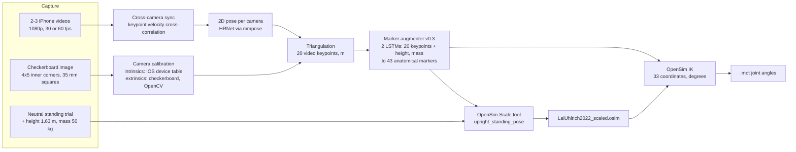
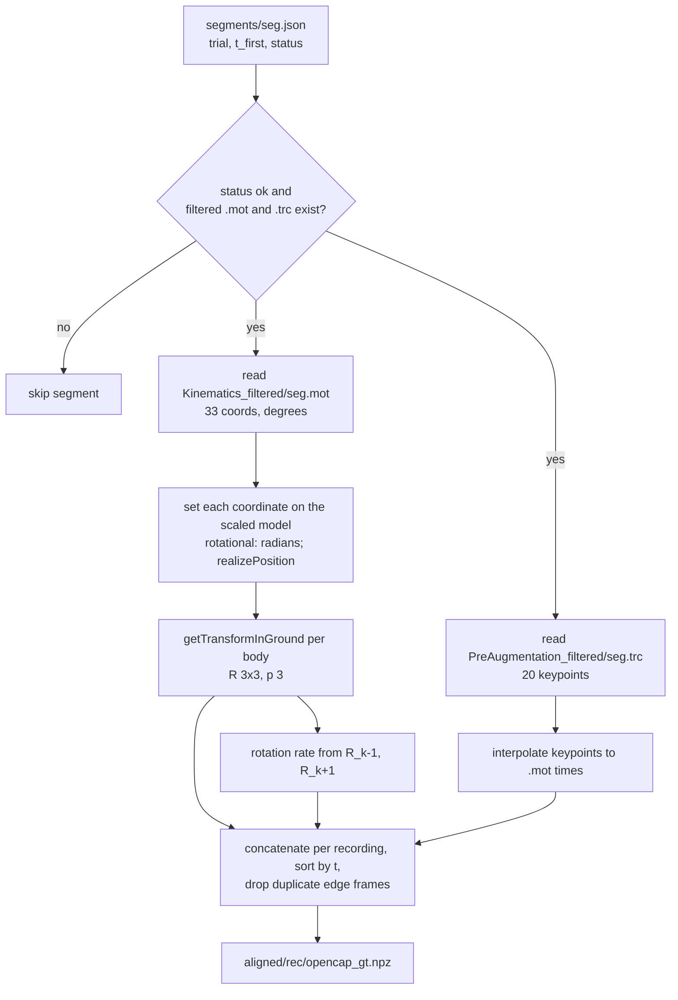
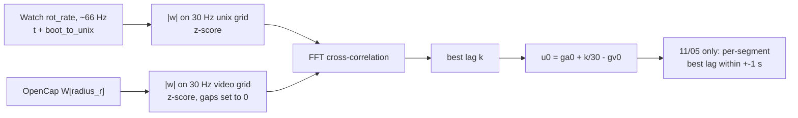
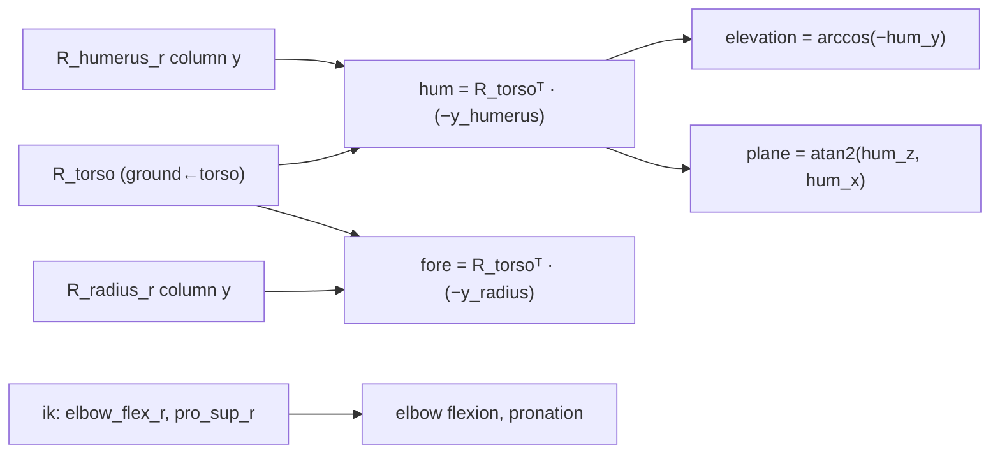

# OpenCap as the reference ("ground truth")

Every arm-pose method in E06, E07 and E08 is scored against OpenCap. This page says what OpenCap
is, how our two reconstructions (10/28 and 11/05) were made, what we do with its outputs, and
how wrong it can be. Steps shared by all methods (recording, clocks, the 30 Hz grid, swings,
metrics) are in [`shared_pipeline.md`](shared_pipeline.md).

**Abbreviations.** IMU = inertial measurement unit. IK = inverse kinematics (joint angles that
best fit measured markers). LSTM = long short-term memory network. DLT = direct linear transform
(a 3×4 camera matrix fitted from 3D↔2D point pairs). RANSAC = random sample consensus (a fit that
ignores outliers). FFT = fast Fourier transform. GT = ground truth.

## 1. What OpenCap is (pre-existing tool; we only run it)

| Item | Value |
|---|---|
| What | Markerless motion capture from 2+ smartphone videos: 2D pose → 3D keypoints → anatomical markers → OpenSim model joint angles |
| Paper | Uhlrich SD, Falisse A, Kidziński Ł, Muccini J, Ko M, Chaudhari AS, Hicks JL, Delp SL. *OpenCap: Human movement dynamics from smartphone videos.* PLoS Comput Biol 19(10): e1011462, 2023. doi:10.1371/journal.pcbi.1011462 |
| Code | https://github.com/stanfordnmbl/opencap-core (Apache-2.0 license); web app https://www.opencap.ai |
| Paper's accuracy | 4.5° mean absolute error over 18 rotational degrees of freedom vs marker-based mocap (range 1.7–10.3°), lab movements, 2 iPhones at ±45°, 60 Hz video |
| Model | `LaiUhlrich2022` OpenSim model (Lai et al. full-body model, 33 degrees of freedom), scaled to the subject |
| Who ran it for us | 10/28: the team (OpenCap cloud session for calibration + neutral; tennis trials processed into `aligned_hrnet3`). 11/05: jtchen, locally (`D:/pose/opencap/...`, per `data/external/20261105/opencap_jtchen/README.md:3`) |

### 1.1 OpenCap's own pipeline



Facts about the stages that come from the paper (not from our code): 2D pose by OpenPose or
HRNet; intrinsics preloaded per iOS device, extrinsics from one checkerboard image; cross-camera
sync by cross-correlating keypoint velocities; the augmenter is two LSTMs (arm: 7 keypoints → 8
markers; body: 15 keypoints → 35 markers; both also take height and mass), trained on ~108 h of
marker mocap, test RMSE 8.0 mm (body) and 15.2 mm (arm). OpenCap's processing normally runs in
its cloud.

### 1.2 Our two sessions

| | 10/28 (Janys, Tom) | 11/05 (Janys) |
|---|---|---|
| Source of settings | `data/external/20261028/opencap/OpenCapData_d94b…/sessionMetadata.yaml` | `data/external/20261105/opencap_jtchen/sessionMetadata.yaml` (same as `~/Downloads/sessionMetadata.yaml`) |
| Cameras | 2: Cam0, Cam1 = `iPhone13,3` (iPhone 12 Pro), recorded in the OpenCap app | 3: Cam0–Cam2 = `iPhone_cameraapp_1080p` (iPhone camera app, 1080p), processed by jtchen |
| Pose model | `hrnet` | `hrnet` |
| Frame rate of output | 59.94 fps (`opencap_gt.npz` `fps`) | 29.97 fps (`fps = 30000/1001`, `experiments/E08_janys_1105/opencap_gt.py:116`) |
| Checkerboard | 4×5 corners, 35 mm, placement `Perpendicular` | 4×5 corners, 35 mm, placement `Lying` |
| Augmenter / model / scaling | v0.3 LSTM / LaiUhlrich2022 / `upright_standing_pose` | same |
| Subject entered | Janys, 1.63 m, 50 kg | Janys, 1.63 m, 50 kg |
| Filter frequency | `default` | `default` (plus jtchen's `filter_keypoints.py` on the keypoints, `opencap_jtchen/README.md:11`) |
| Trials / segments | 3 trials `janys`, `tom`, `tom3`; the janys trial is 54 segments `j_s000…` | 3 recordings r1245, r1309, r1334; 100 reconstructed segments of ~25 s (`a_`, `b_`, `c_sNNN`) |
| Delivered as | `data/external/20261028/aligned_hrnet3/<trial>/opencap_gt.npz` (already body rotations) | `.trc` keypoints + `.mot` IK per segment + scaled model; we build `opencap_gt.npz` ourselves (§3) |

The official 10/28 cloud download holds only the `neutral` trial (`Videos/Cam0/InputMedia/neutral`,
`MarkerData/neutral.trc`) and the scaled model; the tennis trials in `aligned_hrnet3` were
processed outside it.

## 2. The ground-truth file (`opencap_gt.npz`)

Both dates end in the same layout, so E07 code reads either.

| Key | Shape | Meaning |
|---|---|---|
| `t` | (n,) | seconds on the video clock (Cam0); not yet unix |
| `seg` | (n,) | segment name |
| `ik` | (n, 33) | OpenSim coordinates (`ik_names`), degrees (E07 converts if radians: `experiments/E07_pose_methods/data.py:105`) |
| `mk` | (n, 20, 3) | video keypoints in ground, m (`mk_names`: Neck, RShoulder, … RHeel) |
| `R` | (n, 14, 3, 3) | ground ← body rotation of 14 bodies (`body_names`: pelvis, torso, humerus/radius/hand ×2, femur/tibia/calcn ×2) |
| `P` | (n, 14, 3) | body origin in ground, m |
| `W` | (n, 14, 3) | body-frame rotation rate, rad/s |
| `fps` | () | frame rate |

OpenSim ground frame: **x forward, y up, z right**. Each body's long axis is its **+y, pointing
proximally**, so "toward the hand" is −y.

## 3. 11/05: rebuilding body rotations (`experiments/E08_janys_1105/opencap_gt.py`)

jtchen delivered joint angles, not body rotations. We pose the scaled model frame by frame.
Runs in the OpenSim 4.6 environment (`~/micromamba-envs/opensim`, recipe at
`experiments/E07_pose_methods/opensense.py:6-10`).



| Step | Detail | Code |
|---|---|---|
| Model | `OpenSimData/Model/LaiUhlrich2022_scaled.osim` | `opencap_gt.py:86` |
| Segment filter | skip if `status != "ok"` or files missing | `opencap_gt.py:93` |
| Time | $t = t_\text{first} + t_\text{mot}$ (Cam0 clock of that recording) | `opencap_gt.py:97` |
| Posing | `Coordinate.setValue(state, value)`, degrees → radians for rotational coordinates, then `realizePosition` | `opencap_gt.py:53-58` |
| Body pose | `body.getTransformInGround(state)` → $R$, $p$ | `opencap_gt.py:59-64` |
| Rotation rate | central difference: $D = R_{k-1}^\top R_{k+1}$, $\theta = \arccos\frac{\operatorname{tr}D-1}{2}$, axis from the skew part of $D$, $\omega_k = \text{axis}\cdot\theta/(t_{k+1}-t_{k-1})$; ends copied | `opencap_gt.py:68-82` |
| Keypoints | linear interpolation of each `.trc` coordinate to the `.mot` times | `opencap_gt.py:100-102` |
| Overlaps | sort by $t$; where two segments overlap the first frame wins | `opencap_gt.py:107-112` |

Adaptation: this reproduces the 10/28 file layout, so E07's `arm_targets` and alignment run on
11/05 unchanged.

## 4. Putting OpenCap on our clock

OpenCap time is "seconds into the video". Our sensors are on the unix clock
([`shared_pipeline.md` §3](shared_pipeline.md#3-clocks)). The offset $u_0$ (unix = video time +
$u_0$) is found by matching **rotation speed of OpenCap's right forearm** (`radius_r`) to the
**Apple Watch's** rotation speed: both see the same forearm, and rotation speed needs no frame
alignment.



With $a$ the Watch speed on grid $g_a$ and $b$ the OpenCap speed on grid $g_v$ (both 30 Hz,
z-scored), the correlation is $c[k] = \sum_i a[i+k]\,b[i]$ and

$$u_0 = g_a[0] + \frac{k^*}{30} - g_v[0],\qquad k^* = \arg\max_k c[k].$$

| | 10/28 | 11/05 |
|---|---|---|
| Code | `experiments/E06_side_by_side/make_video.py:53-80` (`opencap_series`), called by E07 at `experiments/E07_pose_methods/data.py:100-102` | `experiments/E08_janys_1105/align.py:46-96` |
| Gaps | samples in gaps > 0.2 s set to 0 after z-scoring (`make_video.py:64-66`) | samples > 0.05 s from an OpenCap frame set to 0; z-score over covered samples only (`align.py:55-58`) |
| Normalised peak | not normalised | $c$ divided by $\sqrt{\sum a^2 \sum b^2}$ (`align.py:41`); runner-up = best value > 2 s from the peak |
| Check | E06: offset steady within ±0.07 s minute by minute (`experiments/E06_side_by_side/README.md:31-33`) | per segment, best lag in ±30 frames around $u_0$ (`align.py:66-78`) |
| Result | — | peaks 0.20 / 0.35 / 0.31 vs runner-up ≤ 0.08; per-segment lag median 0 to −33 ms, IQR 8–100 ms (`data/external/20261105/aligned/*/alignment.json`) |
| Output | $u_0$ recomputed each time it is needed | `aligned/<rec>/alignment.json` → `unix0` |

The 10/28 folder also holds `video_t_to_unix.npy` and `alignment.json` from the team (a
"sound clock" alignment to the commercial pods). We do not use them; we re-derive $u_0$ against
the Watch so that both dates use one method.

## 5. Turning OpenCap into scoring targets (`arm_targets`)

`experiments/E07_pose_methods/data.py:67-79`. All targets are in the **trunk frame** = OpenSim's
`torso` body frame (x forward, y up, z right).



| Target | Formula | Line |
|---|---|---|
| Upper-arm direction $\hat h$ | $\hat h = R_\text{torso}^\top(-R_\text{humerus}\,\hat y)$, normalised (shoulder → elbow) | `data.py:70` |
| Forearm direction $\hat f$ | $\hat f = R_\text{torso}^\top(-R_\text{radius}\,\hat y)$, normalised (elbow → wrist) | `data.py:71` |
| Shoulder elevation | $\arccos(-\hat h_y)$ in degrees; 0 = arm hanging, 90 = horizontal | `data.py:77` |
| Plane of elevation | $\operatorname{atan2}(\hat h_z, \hat h_x)$; 0 = forward, 90 = sideways | `data.py:78` |
| Elbow flexion | OpenSim `elbow_flex_r` (degrees) | `data.py:170`; 11/05 `experiments/E08_janys_1105/data.py:83` |
| Pronation | OpenSim `pro_sup_r` (kept, not scored) | `data.py:171` |

OpenCap is sampled onto our 30 Hz grid by **nearest frame** (no interpolation). A grid frame
has valid GT (`gt_valid`) when:

| | Rule | Line |
|---|---|---|
| 10/28 (59.94 fps) | nearest OpenCap frame within 0.02 s, and that frame has a neighbour < 0.2 s away | `experiments/E07_pose_methods/data.py:162-166` |
| 11/05 (29.97 fps) | nearest frame of the same segment within 0.04 s | `experiments/E08_janys_1105/data.py:66-70` |

## 6. Cameras for the comparison videos

These do not change any score; they put OpenCap's skeleton on a third camera for viewing.

| | 10/28 phone1 (`experiments/E06_side_by_side/camera.py`) | 11/05 IMG_0021 (`experiments/E08_janys_1105/camera.py`) |
|---|---|---|
| Camera | phone1 on a stand by the net, not one of OpenCap's cameras | iPhone behind Janys, 70 min, 60 fps; jtchen's calibration of it not shared |
| Clip → unix | sound: onset envelopes (10 ms RMS dB rise, 100 Hz) of the clip vs the commercial logger's timestamped audio, FFT cross-correlation, then the logger's offset from our clock (`sync.py:35-72`, `camera.py:37-46`) | right-wrist speed in the image (Apple Vision 2D, 10 Hz) vs OpenCap's RWrist marker speed, FFT cross-correlation, then refined ±1.5 s in 1/30 s steps by share of keypoints within 25 px (`camera.py:101-158`) |
| 2D points | player's feet and head top from a moving blob against the median frame, one pair every 4 s; head top = Neck + 0.27 m (`camera.py:30, 81-121`) | Vision body keypoints of the tallest person per frame (`camera.py:36-56`, `vision2d.swift`) |
| Fit | DLT on 8-point RANSAC samples, 25 px inlier threshold, 3000 tries (`camera.py:49-73`) | Hartley-normalised DLT, 12-point RANSAC, 25 px, 400 tries per offset then 3000 (`camera.py:72-87, 130-160`) |
| Result | median 7.2 px on 269/390 points (`experiments/E06_side_by_side/README.md:37-40`) | median 8 px; offset peak 0.144 vs ≤ 0.074; agrees with clip creation time 12:47:14 to < 1 s (`experiments/E08_janys_1105/README.md:43-48`) |

Gotcha: IMG_0021 is stored rotated 180°; Vision must be told, or the keypoints come out upside
down (`experiments/E08_janys_1105/README.md:49`).

## 7. Known errors and limits

| Problem | Evidence | Effect on our numbers |
|---|---|---|
| **Follows the wrong person** | 10/28 Janys trial ≈ 1400 s: skeleton on Tom (`experiments/E06_side_by_side/README.md:91-92`); 11/05 b_s040, c_s000 first tracked another person, re-run (`opencap_jtchen/README.md:16`, old outputs in `segments/_pre14-37/`) | Error spikes for every method at once; kept in the scores |
| **~15° working error** | Project estimate (`experiments/E07_pose_methods/README.md:69`); the Watch's own orientation stays 15–20° from OpenCap's forearm (`experiments/E07_pose_methods/vqf_orient.py:7-8`). The paper's 4.5° is for lab movements, not tennis outdoors | No method can be shown better than roughly this |
| **Model-free elbow offset** | OpenCap sees the hanging arm bent ~18°; IMU methods assume it straight (`experiments/E07_pose_methods/README.md:55-57`) | A fixed 18° rest angle removes the bias |
| **11/05 noisier** | Watch vs OpenCap forearm tilt: 4° on 10/28, 7° on 11/05 (swings 6° vs 10°, r 0.94 vs 0.86) (`experiments/E08_janys_1105/README.md:81-84`) | Methods look worse on 11/05 partly because of the GT |
| **Bad 11/05 segments** | off by 20–70°: b_s000, c_s005, c_s020 (`E08 README:83-84`); all models jump together on a_s012, b_s040, b_s041, c_s000, c_s005 (`E08 README:118-120`); `filter_report.csv`: b_s000 has 41 frames with 35 outlier points | Kept in the scores, as on 10/28 |
| **Different setups** | 10/28: 2 cameras, 60 fps, long trials; 11/05: 3 cameras, 30 fps, ~25 s segments (`E08 README:124-125`) | Part of the 10/28 → 11/05 gap may be the GT, not the day |
| **Coverage** | GT on 79 % / 70 % of the 10/28 block frames (`E07 README:7-9`); 64 % of Janys's `dataset_full` frames | Scores use GT-valid frames only |
| **Rotation-rate noise** | OpenCap forearm vs any IMU: r ≈ 0.57–0.68, while two wrist IMUs agree at 0.95–0.98 (`E06 README:72-86`) | Use angles, not rotation speed, to judge methods |
| **Heading is relative** | OpenCap's ground frame is set by the checkerboard, unrelated to magnetic north | All targets are trunk-relative to avoid this |

## 8. How to rebuild

```bash
# 11/05 only: OpenCap joint angles -> body rotations (OpenSim env)
~/micromamba-envs/opensim/bin/python experiments/E08_janys_1105/opencap_gt.py
# 11/05: video clock -> unix
.venv/bin/python -m experiments.E08_janys_1105.align
# targets on the 30 Hz grid
.venv/bin/python -m experiments.E07_pose_methods.data            # 10/28 blocks (needs E06 run.py first)
.venv/bin/python -m experiments.E07_pose_methods.data --full     # 10/28 every covered segment
.venv/bin/python -m experiments.E08_janys_1105.data              # 11/05
# optional: camera fits for the videos
.venv/bin/python -m experiments.E06_side_by_side.camera
.venv/bin/python -m experiments.E08_janys_1105.camera
```

## Not determined from the repo

- Who processed the 10/28 tennis trials into `aligned_hrnet3` and with which opencap-core
  version; whether the Tom trials used Janys's scaled model (the session's subject is Janys).
- The numeric cut-off behind OpenCap's `filterfrequency: default`, and what jtchen's
  `filter_keypoints.py` does beyond the outlier counts in `filter_report.csv`.
- How jtchen synced the three 11/05 cameras (each segment JSON has `lag` and
  `sync_shift_frames`, but the method is not in the repo).
