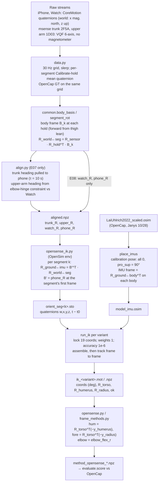
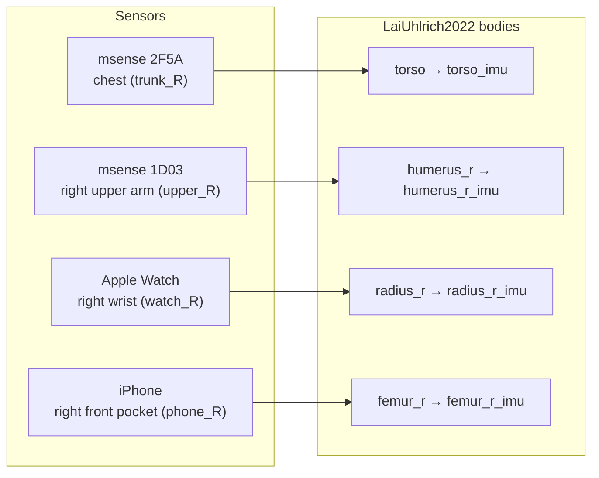

# OpenSense IMU inverse kinematics (E07, E08)

This page explains how we run OpenSim's OpenSense IMU inverse kinematics on our sensors. OpenSim does the
solving. We prepare the inputs and read out the results. The page is detailed enough that someone new
to the project can rebuild the method.

**Abbreviations.** IMU = inertial measurement unit. IK = inverse kinematics: finding joint angles that
make a model match measurements. `.osim` = OpenSim model file. `.sto` = OpenSim storage (table) file.
`.mot` = OpenSim motion file (one coordinate per column). DOF = degree of freedom. GT = ground truth.
MAE = median absolute error (in this project it is the median, not the mean). Body frame / ground frame
= OpenSim's convention: x forward, y up, z to the body's right.

**Code.**
- `experiments/E07_pose_methods/opensense_ik.py`: the IK itself. It runs inside the OpenSim environment.
- `experiments/E07_pose_methods/opensense.py`: the driver in `.venv`. It also turns the IK output into
  the arm vectors that every E07 method saves.
- `experiments/E08_janys_1105/opensense_run.py`, `frame_methods.py`: the 11/05 rerun.

---

## 1. Source box: what we call and do not write

| Item | Value |
|---|---|
| Software | OpenSim 4.6 with the OpenSense workflow (Python bindings, `import opensim`) |
| Installed build | `version 4.6-2026-04-01-ba89560bc`, built 04/02/2026 (from `opensim.GetVersionAndDate()`) |
| Package | conda package `opensim-4.6-py311np24`, channel `opensim-org`, platform osx-arm64 |
| Citation | Al Borno M, O'Day J, Ibarra V, Dunne J, Seth A, Habib A, Ong C, Hicks J, Uhlrich S, Delp S. *OpenSense: An open-source toolbox for inertial-measurement-unit-based measurement of lower extremity kinematics over long durations.* J NeuroEng Rehabil 19, 22 (2022). doi:10.1186/s12984-022-01001-x |
| License | OpenSim is Apache 2.0 |
| What we call | `osim.Model`, `PhysicalOffsetFrame`, `TimeSeriesTableQuaternion`, `OpenSenseUtilities.convertQuaternionsToRotations`, `OrientationWeightSet`, `OrientationsReference`, `InverseKinematicsSolver` (`opensense_ik.py:92-145`) |
| What we skip | `IMUPlacer` and `IMUInverseKinematicsTool` (we do their jobs ourselves; see §3.3 and §2.3) |
| Model | `LaiUhlrich2022_scaled.osim`, scaled by OpenCap for **Janys, 10/28** |
| Model path | `data/external/20261028/opencap/OpenCapData_d94b2489-31c0-44f0-8f3f-8eab9f3dcce0/OpenSimData/Model/LaiUhlrich2022_scaled.osim` (`opensense_ik.py:22-25`) |

### 1.1 Environment

OpenSim cannot be installed in the project's ML environment `.venv` (Python 3.9). It lives in its own
micromamba environment (`opensense.py:7-10`):

```bash
# 1. micromamba binary (osx-arm64)
mkdir -p ~/micromamba-bin
curl -Ls https://micro.mamba.pm/api/micromamba/osx-arm64/latest | tar -xvj -C ~/micromamba-bin bin/micromamba
# 2. the OpenSim env
MAMBA_ROOT_PREFIX=~/micromamba ~/micromamba-bin/bin/micromamba create -y -p ~/micromamba-envs/opensim \
    -c opensim-org -c conda-forge python=3.11 opensim=4.6 numpy=2.4 scipy
```

Installed versions found on the machine: Python 3.11.18, numpy 2.4.6, scipy 1.17.1, opensim 4.6.
The driver finds the interpreter at `~/micromamba-envs/opensim/bin/python` (`opensense.py:42`,
`frame_methods.py:35`).

`opensense_ik.py` imports only numpy, scipy and opensim (`opensense_ik.py:13-18`). It imports nothing
from the project, so it runs under Python 3.11 (`opensense_ik.py:5-6`).

### 1.2 The model and how OpenCap scaled it

OpenCap (Uhlrich et al., *OpenCap: Human movement dynamics from smartphone videos*, PLOS Comput Biol
2023) estimates motion from phone videos. It scales the musculoskeletal model `LaiUhlrich2022` to the
subject. We did not scale it. We use the file OpenCap returned.

From `sessionMetadata.yaml` of that OpenCap session:

| Field | Value |
|---|---|
| subjectID | Janys |
| height_m / mass_kg | 1.63 / 50.0 |
| openSimModel | LaiUhlrich2022 |
| scalingsetup | `upright_standing_pose` (scaled from a static standing trial) |
| posemodel | hrnet; marker augmenter LSTM v0.3 |
| cameras | 2 × iPhone13,3 |

The model has 22 bodies and 35 coordinates, 2 of which are `_beta` patella coordinates. These are the
joints our IK uses (read from the `.osim`):

| Joint (type) | Parent → child | Coordinates | Range (model units) | In our IK |
|---|---|---|---|---|
| `ground_pelvis` (Custom) | ground → pelvis | pelvis_tilt, pelvis_list | ±90° | free |
| | | pelvis_rotation | ±100 rad | free |
| | | pelvis_tx, ty, tz | ±100 / ±30 / ±100 m | **locked** |
| `hip_r` (Custom) | pelvis → femur_r | hip_flexion_r | −30° … 120° | free |
| | | hip_adduction_r | −50° … 30° | free |
| | | hip_rotation_r | ±40° | free |
| `back` (Custom) | pelvis → torso | lumbar_extension, bending, rotation | ±90° each | free |
| `acromial_r` (Custom) | torso → humerus_r | arm_flex_r, arm_add_r, arm_rot_r | ±10 rad each (≈ ±573°, so no real limit) | free |
| `elbow_r` (Pin) | humerus_r → ulna_r | elbow_flex_r | 0° … 150° | free |
| `radioulnar_r` (Pin) | ulna_r → radius_r | pro_sup_r | 0° … 119.7° (0 = palm forward) | free |
| `radius_hand_r` (Weld) | radius_r → hand_r | none | | no wrist DOF |
| right knee, ankle, subtalar, mtp; all left leg; all left arm | | | | **locked** (`opensense_ik.py:48-68`) |

All coordinates are `clamped = true`, so the solver keeps them in range. A `CoordinateCouplerConstraint`
ties each `knee_angle_*_beta` to its knee angle. That leaves **14 free DOF**: 3 pelvis rotations, 3 right
hip, 3 lumbar, 3 right shoulder, the elbow and pronation/supination.

---

## 2. The IK problem

### 2.1 Objective

For each frame $t$, OpenSim's `InverseKinematicsSolver` with an `OrientationsReference` and no markers
solves

$$
q^*(t) = \arg\min_{q} \sum_{i \in S} w_i \, \theta_i(q, t)^2,
\qquad
\theta_i(q,t) = \angle\!\left( \big(R^{G}_{i,\text{obs}}(t)\big)^{\!\top} R^{G}_{i}(q) \right)
$$

subject to $q_{\min} \le q \le q_{\max}$ for clamped coordinates, locked coordinates held fixed, and the
knee coupler constraints.

- $S$ is the set of IMUs in the variant (§3.6).
- $R^{G}_{i,\text{obs}}(t)$ is the measured orientation of IMU $i$ in ground (from our `.sto`).
- $R^{G}_{i}(q) = R^{G}_{b(i)}(q)\, R^{b(i)}_{i}$ is the model's IMU frame: the pose of the body it sits on
  times the fixed placement rotation from §3.3.
- $\angle(\cdot)$ is the angle of the axis-angle form of the residual rotation, so $\theta_i$ is in radians.
- All weights are $w_i = 1$ (`opensense_ik.py:137-139`).

There are no marker or coordinate-tracking terms. We pass an empty `MarkersReference` and an empty
`SimTKArrayCoordinateReference` (`opensense_ik.py:142-144`).

### 2.2 Solver settings

| Setting | Value | Where |
|---|---|---|
| Accuracy | $10^{-6}$ | `opensense_ik.py:145` |
| Constraint weight | not set, so the constructor default (`SimTK::Infinity`): constraints are met exactly, not penalised | `opensense_ik.py:142` |
| Orientation weights | 1.0 per IMU | `opensense_ik.py:137-139` |
| Start pose | calibration pose (§3.4) | `opensense_ik.py:129` |
| First frame | `solver.assemble(s)` | `opensense_ik.py:155-156` |
| Later frames | `solver.track(s)`, warm-started from the previous frame's solution | `opensense_ik.py:158-165` |
| On failure | frame marked invalid (`ok=False`, NaN); the next frame calls `assemble` again | `opensense_ik.py:166-169` |
| Frame rate | 30 Hz, the dataset grid (`data.py:28`) | `.sto` header `DataRate=30` |
| Time keys | taken from the converted rotation table (`rot_table.getIndependentColumn()`), so the solver finds an exact match | `opensense_ik.py:147` |

### 2.3 What we reproduce from `IMUInverseKinematicsTool`

The tool normally does three things, which we do by hand:
1. It rotates sensor data into OpenSim's y-up ground with `sensor_to_opensim_rotations`, usually
   $R_x(-90^\circ)$ for z-up data.
2. It aligns heading.
3. It runs the solver.

We replace steps 1 and 2 with one rotation per segment (§3.2). We call the solver ourselves so that we
control assembly, failures and the bodies we read out (`opensense.py:25-27`).

---

## 3. Our adaptations, step by step

### 3.0 Pipeline



### 3.1 From sensor quaternions to segment rotations (shared with all E07 methods)

1. **Resample.** Each device's quaternions go onto a 30 Hz grid by slerp. Other fields are linearly
   interpolated. A frame is valid if a real sample lies within 50 ms (`data.py:38-52`).
2. **World frame.** Every quaternion rotates sensor axes into one world frame: x magnetic north, z up
   (`common.py:11-13`). The iPhone and Watch use Apple CoreMotion's fused orientation. The commercial
   msense sensors (trunk 2F5A, upper arm 1D03) use VQF without the magnetometer, started 1 min before
   each hold (`data.py:5-6`, `data.py:133-136`).
3. **Calibrate hold.** At each "Calibrate" event the player stands still for 3 s with arms hanging and
   palms facing the thighs. The hold orientation of every device is the mean rotation over those 3 s
   (`data.py:142-159`).
4. **Body frame at the hold, $B_k$** (`common.py:49-60`). The columns are forward, up and right in world
   coordinates. Up is world z. Forward is the horizontal mean lean of the thigh's long axis while it
   tilts more than 15° (the "thigh" rule, `common.py:31-46`), set per segment. Right = forward × up.
5. **Segment rotation** (`common.py:63-73`):
   $$R^{W}_{\text{seg}}(t) = R^{W}_{S}(t)\,\big(R^{W}_{S,\text{hold}}\big)^{\!\top} B_k .$$
   By construction, the segment frame equals the body frame during the hold: x forward, y up, z right.
   For the forearm and upper arm, y points proximally (up the hanging arm), the same as OpenSim's body y.
6. **Heading fixes for the commercial sensors (E07 only, `align.py`).** These sensors have no
   magnetometer, so their heading drifts 15–20°/min.
   - Trunk: a complementary filter pulls the trunk's heading toward the pocket phone's, with a 10 s time
     constant (`align.py:63-76`).
   - Upper arm: every 2 s, over a 10 s window, the heading is chosen that minimises sideways elbow bend
     against the Watch, using only frames where the elbow is bent more than 30° (`align.py:89-124`).
   - Output is `aligned.npz` with `trunk_R`, `upper_R`, `watch_R`, `phone_R` (world ← segment)
     (`align.py:137-149`).

Because of this correction, the upper-arm IMU is not identity at the start of a segment. In
`janys/opensense/orient_seg0.sto` its first quaternion is (0.799, 0, 0.602, 0), a 74° turn about the
vertical. The trunk, Watch and phone start within 1° of identity.

### 3.2 Into OpenSim's ground frame (`opensense_ik.py:200-212`)

OpenSim's ground is y-up, but our world is z-up. We do not use the usual $R_x(-90^\circ)$ turn plus a
heading offset. Instead, each segment $k$ gets its own ground: the body frame at its hold. In practice,
the code takes the pocket phone's segment rotation at the segment's first frame:

$$B' = R^{W}_{\text{phone seg}}(t_{0,k}), \qquad R^{G}_{i,\text{obs}}(t) = B'^{\top}\, R^{W}_{\text{seg}(i)}(t).$$

- On 10/28 the first frame is 3.0 s after the hold starts, right at its end (`from_s = hold_s + 3.0`
  in E06's `meta.json`). The phone has barely moved, so $B' \approx B_k$, which is pure heading. The
  femur IMU is exactly identity at $t_0$.
- $B'$'s columns are (forward, up, right) in world coordinates, so $B'^{\top}$ maps world vectors into
  (x forward, y up, z right). That is OpenSim's ground. This one rotation replaces both the z-up → y-up
  turn and IMUPlacer's base heading (`opensense.py:17-21`).
- Each segment's time restarts at 0 ($t - t_0$, `opensense_ik.py:202`). Each segment is solved
  separately.

### 3.3 Placing the IMUs on the model (`place_imus`, `opensense_ik.py:89-105`)

We do not run `IMUPlacer`. Our segment rotations are defined to equal ground at the hold, so we put the
model in the hold pose $q_{\text{cal}}$ and attach each IMU frame so that it equals ground there:

$$R^{b}_{i} = \big(R^{G}_{b}(q_{\text{cal}})\big)^{\!\top} \quad\Rightarrow\quad R^{G}_{i}(q_{\text{cal}}) = I.$$

Each IMU is a `PhysicalOffsetFrame` named `<body>_imu`, with zero translation, added to its body
(`opensense_ik.py:96-102`). The model is saved as `model_imu.osim`.



| IMU frame | `aligned.npz` key | Body | Device | Line |
|---|---|---|---|---|
| `torso_imu` | `trunk_R` | torso | msense 2F5A, chest | `opensense_ik.py:29` |
| `humerus_r_imu` | `upper_R` | humerus_r | msense 1D03, right upper arm | `opensense_ik.py:30` |
| `radius_r_imu` | `watch_R` | radius_r | Apple Watch, right wrist | `opensense_ik.py:31` |
| `femur_r_imu` | `phone_R` | femur_r | iPhone, right front pocket | `opensense_ik.py:32` |

- The Watch goes on `radius_r`, not `hand_r`. The wrist is welded in this model, so the two have the
  same orientation, and `radius_r` carries pronation/supination.
- The phone goes on `femur_r`, not on the pelvis, because it sits in the thigh pocket.

### 3.4 Calibration pose (`opensense_ik.py:44-46`, `set_pose` `75-86`)

| Coordinate | Value | Why |
|---|---|---|
| all coordinates | model default (0, except `pelvis_ty` = 0.93 m) | standing, arms hanging, elbow straight |
| `pro_sup_r`, `pro_sup_l` | 90° | at the hold, palms face the thighs; the model's 0 is palms forward |
| `*_beta` | skipped (set by the coupler) | `opensense_ik.py:79-80` |

The model is then assembled (`model.assemble`). IK starts from this pose at every segment and variant
(`opensense_ik.py:129`).

The hanging elbow is 0° here. OpenCap reads the hanging arm as about 18° bent, which explains most of
the elbow bias in §5.

### 3.5 `.sto` orientation file format (`write_sto`, `opensense_ik.py:108-122`)

```
DataRate=30.000000
DataType=Quaternion
version=3
OpenSimVersion=4.6
endheader
time	torso_imu	humerus_r_imu	radius_r_imu	femur_r_imu
0.000000	0.99998546,0.00390682,-0.00004792,-0.00371642	0.79869803,...	...	1.00000000,0.00000000,0.00000000,0.00000000
```

- Tab-separated. Each IMU cell is `w,x,y,z` with 8 decimals.
- SciPy returns `x,y,z,w`, so the code reorders it (`opensense_ik.py:209-210`).
- All four IMU columns are always written. Each variant removes the columns it does not use before
  solving (`opensense_ik.py:133-136`).
- The file is read back with `osim.TimeSeriesTableQuaternion` and converted to rotations with
  `OpenSenseUtilities.convertQuaternionsToRotations` (`opensense_ik.py:121`, `140`).

### 3.6 Variants (`opensense_ik.py:34-43`, `opensense.py:44-48`)

| Variant | IMUs used | Observed DOF | Free DOF | Run on |
|---|---|---|---|---|
| `opensense_trunk_upper_watch_phone` | torso, humerus_r, radius_r, femur_r | 12 | 14 | E07 |
| `opensense_trunk_watch_phone` | torso, radius_r, femur_r | 9 | 14 | E07 |
| `opensense_watch_phone` | radius_r, femur_r | 6 | 14 | E07, E08 |

When observed DOF are fewer than free DOF, the problem is underdetermined. The unobserved part (for
example lumbar and shoulder with Watch + phone) stays wherever the warm-started tracking leaves it.

### 3.7 Locked coordinates (`opensense_ik.py:47-68`, `130-131`)

Locked: pelvis translation (orientations cannot fix it), the right knee and below, the whole left leg,
and the whole left arm. These are 19 coordinates, all held at the calibration-pose value.

### 3.8 Time ranges

| Run | Segments | Frames (30 Hz) | Ranges |
|---|---|---|---|
| E07 Janys 10/28 | 2 | 9,688 + 4,912 = 14,600 | 1239.5–1562.4 s and 1565.7–1729.4 s after session start |
| E07 Tom 10/28 | 2 | 17,295 + 5,406 = 22,701 | 140.8–717.3 s and 720.6–900.8 s |
| E08 Janys 11/05 | 97 (one per OpenCap segment, about 25 s) | 64,382 | each OpenCap segment inside the Watch recording (`E08 data.py:44-58`) |

### 3.9 Outputs to arm directions in the trunk frame

After each frame, the code reads the ground rotations of `torso`, `humerus_r` and `radius_r`
(`opensense_ik.py:170-177`). The arm axes point distally, so they are minus each body's y axis:

$$\mathbf{h} = \frac{R_{\text{torso}}^{\top}\,(-R_{\text{humerus}}\,\hat{y})}{\|\cdot\|},\qquad
\mathbf{f} = \frac{R_{\text{torso}}^{\top}\,(-R_{\text{radius}}\,\hat{y})}{\|\cdot\|}.$$

- Code: `opensense.py:63-64` and `frame_methods.py:145-146`.
- OpenCap's GT uses the same formula on OpenCap's bodies (`data.py:67-72`). The comparison does not
  depend on the model.
- `elbow` is `elbow_flex_r` in degrees (`opensense.py:66`).
- `valid` = IK ok and both vectors finite (`opensense.py:65`).
- All coordinates are kept as `coords` and `coord_names` (`opensense.py:67-76`).

**Scoring** (`evaluate.py:16-54`, shared by every method):
- Masks: OpenCap valid ∧ method valid, over the whole block and over swings. A swing is ±0.5 s around
  each Watch rotation-speed peak above 15 rad/s, with peaks at least 1.5 s apart (`data.py:31`, `55-64`).
- Metrics are median absolute errors:
  - forearm direction angle;
  - forearm inclination $\arccos(-f_y)$;
  - upper-arm direction;
  - shoulder elevation $\arccos(-h_y)$;
  - plane of elevation $\operatorname{atan2}(h_z, h_x)$, only when elevation is above 30°;
  - elbow MAE, bias and r.
- `opensense.py:78-90` also prints each arm coordinate's error against OpenCap's IK, wrapped to ±180°
  because the ±10 rad shoulder ranges can wind past 360°. These are printed only, not saved.

---

## 4. Running specs

| | E07 (10/28, both players) | E08 (Janys 11/05) |
|---|---|---|
| Prerequisite | `data`, `align` (see E07 README) | `opencap_gt`, `align`, `data` (see E08 README) |
| Command | `.venv/bin/python -m experiments.E07_pose_methods.opensense` | `.venv/bin/python -m experiments.E08_janys_1105.frame_methods opensense` |
| What it spawns | one `~/micromamba-envs/opensim/bin/python opensense_ik.py <player>` per player, in parallel (`opensense.py:95-97`) | writes `results/janys/aligned.npz` (Watch, phone only), then runs `opensense_run.py` (`frame_methods.py:138-141`) |
| Save-only rerun | `... opensense --save` (skips IK) | none |
| Variants | 3 | 1 (`opensense_watch_phone`) |
| Wall time (from file timestamps) | ≈ 11 min (Janys), ≈ 15 min (Tom), in parallel | ≈ 8 min |
| Machine | Apple-silicon Mac (osx-arm64), CPU only | same |
| IK frames ok | 100 % in every variant | 100 % |

**How E08 reuses E07's script.** `opensense_run.py:14-16` patches three module globals in
`opensense_ik.py`, then calls `ik.main("janys")`. Nothing else changes, including the 10/28 model.
- `RES` points to E08's results folder.
- `IMUS` keeps only `radius_r_imu` and `femur_r_imu`.
- `VARIANTS` keeps only `opensense_watch_phone`.

**Files written** to `experiments/<E07_pose_methods|E08_janys_1105>/results/<player>/opensense/`
(`opensense_ik.py:7-10`):

| File | Content | Size (E07 Janys / E08) |
|---|---|---|
| `model_imu.osim` | scaled model with the IMU frames | 0.9 MB |
| `orient_seg<k>.sto` | quaternions per segment, in ground | 1.9 + 0.9 MB / 97 files, 4–90 kB each |
| `ik_<variant>.mot` | all 35 coordinates (degrees; translations in m), `inDegrees=yes`, time from the first segment's start | 4.5 MB / 20 MB |
| `ik_<variant>.npz` | `coords`, `coord_names`, `ok`, `R_torso`, `R_humerus`, `R_radius` (ground, n×3×3) | 4.6 MB / 20 MB |

Then, in `results/<player>/`: `method_<variant>.npz` (`hum`, `fore`, `elbow`, `valid`, plus `coords`
and `coord_names` in E07). Results folders and `data/` are not committed.

---

## 5. Results

Median absolute error against OpenCap, in degrees. "Swings" means ±0.5 s around each swing.

### 5.1 E07, 10/28 (Janys / Tom), from `E07_pose_methods/results/summary.md`

| Variant | Part | Elbow | Shoulder elev. | Forearm incl. | Forearm dir. | Upper-arm dir. |
|---|---|---|---|---|---|---|
| chest + upper arm + Watch + phone | swings | 25 / 26 | 17 / 14 | 24 / 23 | 73 / 57 | 77 / 45 |
| | block | 20 / 22 | 11 / 12 | 19 / 15 | 76 / 54 | 35 / 31 |
| chest + Watch + phone | swings | 26 / 18 | 35 / 13 | 20 / 16 | 62 / 47 | 92 / 38 |
| | block | 31 / 23 | 29 / 21 | 18 / 13 | 68 / 50 | 58 / 36 |
| Watch + phone | swings | 27 / 16 | 53 / 18 | 34 / 25 | 70 / 58 | 77 / 33 |
| | block | 24 / 21 | 27 / 33 | 34 / 17 | 56 / 37 | 42 / 41 |

The chest + Watch + phone rows come from `results/scores.json`, because `summary.md` lists only the
4-sensor and Watch + phone variants.

- **The 4-sensor elbow reads too straight.** The block elbow bias is −19° (Janys) and −18° (Tom). The
  model takes the hanging elbow as 0°, but OpenCap sees about 18° (§3.4).
- **Elbow tracking is good only with all 4 sensors.** Block elbow r is 0.85 (Janys) and 0.48 (Tom).
  With fewer sensors, r is −0.11 to 0.64.
- **The upper-arm IMU pins elevation, and the elbow hits its 0° limit 11–12 % of the time.** With all 4
  sensors, elevation is within 11–17°. Without the upper-arm IMU it is 13–53° off.
- **Heading-dependent directions are poor everywhere** (forearm 47–76°), as for all model-free methods.
- **For comparison,** plain geometry on the same chest + upper arm + Watch, with the 18° rest angle,
  reaches elbow 11° in swings. OpenSense's joint limits do not beat geometry here.

### 5.2 E08, Janys 11/05, Watch + phone, from `E08_janys_1105/results/scores_all.json`

| Part | Elbow | Elev. | Forearm incl. | Forearm dir. | Upper-arm dir. | Elbow bias / r |
|---|---|---|---|---|---|---|
| swings (4.6 min) | 29 (10/28: 27) | 39 (53) | 32 (34) | 62 (70) | 82 (77) | +22° / 0.18 |
| all (35.8 min) | 27 (24) | 36 (27) | 33 (34) | 54 (56) | 59 (42) | −5° / 0.08 |

Two sensors cannot recover the arm. Elevation r is about 0, and the elbow barely correlates with
OpenCap. The trained GRU (Watch only) reaches elbow 14° and elevation 10° on the same swings (E08
README).

### 5.3 Limitations

1. **One model for everyone.** It is Janys's 10/28 scaled model (1.63 m, 50 kg), used for Tom on 10/28
   and for Janys on 11/05 (`opensense.py:14-15`, E08 README limits). Orientation-only IK depends little
   on segment lengths, but joint-frame offsets and the pelvis height come from her scaling.
2. **Underdetermined IK.** 14 free DOF against 6–12 observed. Whatever no sensor constrains (lumbar,
   shoulder rotation with fewer sensors) follows the warm start, not the body.
3. **No IMUPlacer, no heading optimisation.** Calibration assumes every segment equals the body frame
   at the hold. Any error in the hold posture, in the forward direction (thigh rule) or in the
   commercial sensors' heading correction goes straight into the joint angles.
4. **Straight-elbow calibration.** It causes the −18° to −19° elbow bias. We did not add a rest-angle
   offset to OpenSense, unlike the geometric method.
5. **E08 ground frame.** On 11/05, a segment's first frame is the start of an OpenCap segment, often
   minutes after the hold and during play (`E08 data.py:100-105`). There $B' = $ `phone_R`$(t_0)$ also
   contains the thigh's tilt at that moment, so ground may be tilted from gravity, not only turned.
   With pelvis rotations free, this mostly shifts the pelvis. Median |pelvis_tilt| is 18° on 11/05
   against 11–14° on 10/28, which fits this explanation, but we have not checked it. Using
   $B_k$ (`body_basis`) directly would remove the issue.
6. **Sensors.** The commercial chest and upper-arm sensors (no magnetometer: the court's field is too
   disturbed) were worn only on 10/28. On 11/05 only Watch + phone exist.
7. **Ground truth.** OpenCap has its own error, about 15°, and sometimes tracks the wrong person. The
   11/05 reconstruction (3 cameras, 30 fps) is noisier than 10/28's (E08 README).
8. **Small samples.** Two players and one session on 10/28; one player on 11/05.
