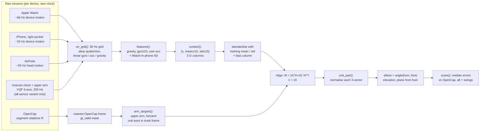
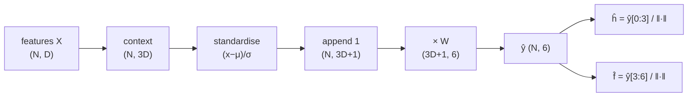

# Ridge regression arm model: method details

This document explains how our ridge regression arm model is built, trained and scored, so
that someone new to the project can rebuild it. Every value comes from the code; `path:line`
points to where it is set. The companion model is described in
[`bidirectional_gru.md`](bidirectional_gru.md). The two share inputs, targets, splits and
scoring; only the model and training (sections 4 and 5) differ.

Abbreviations (each defined once):

- **IMU**: inertial measurement unit (gyroscope + accelerometer, here with the device's own
  orientation filter).
- **OpenCap**: video motion capture from phone videos. It fits an OpenSim body model and gives
  segment rotations and joint angles. It is our ground truth.
- **GT**: ground truth (OpenCap).
- **GRU**: gated recurrent unit, a recurrent neural network layer.
- **6D**: a rotation written as the first two columns of its 3×3 matrix (6 numbers).
- **MAE**: in this project, the *median* absolute error in degrees (not the mean), see section 7.
- **xplayer**: train on the other player only. **personal**: also train on the test player's own
  minutes from the same session.

## 1. Purpose and summary

The model predicts the direction of the right upper arm and right forearm, in the trunk frame,
from the Apple Watch (right wrist), iPhone (right front pocket) and AirPods (head), 30 times per
second. From the two directions we get elbow flexion, shoulder elevation and the plane of
elevation.

It is our own model, written for this project; it does not come from a paper or library. It is
a linear baseline: one closed-form ridge regression from per-frame sensor features, plus their
mean and standard deviation over ±0.5 s, to 6 numbers (two 3D directions). The 6 outputs are
then each normalised to unit length. No magnetometer and no body "forward" direction are used,
so the inputs do not depend on heading. Code: `experiments/E07_pose_methods/learned_own.py`
(E07, 10/28 data) and `experiments/E08_janys_1105/run.py`, `cross.py` (E08, retraining on other
sessions with the same functions).

## 2. Pipeline overview



## 3. Inputs

### 3.1 Devices, streams and units

Each Apple device gives Core Motion "device motion": orientation quaternion, rotation rate,
user acceleration and gravity, all in the device's own frame
(`pipeline/preprocessing/motion_io.py:25-28`):

| Field | Shape | Unit | Meaning |
|---|---|---|---|
| `quat` | (N, 4) x, y, z, w | – | rotates device axes into the device's world frame (z up) |
| `rot_rate` | (N, 3) | rad/s | gyroscope, bias-corrected by Apple |
| `user_acc` | (N, 3) | g | acceleration without gravity; Apple sign (minus physical acceleration) |
| `gravity` | (N, 3) | g (unit length) | gravity direction in the device frame, pointing down |

Delivered rates (measured in E03, `docs/research/device-research.md:12`): iPhone 33.5 Hz, Watch
66.4 Hz, AirPods 50 Hz. The Watch's separate 200 Hz stream is used only to find swings
(section 6.4), not as a model input.

For the all-sensor variant only, the commercial msense sensors on the chest (`2F5A`) and right
upper arm (`1D03`) (`experiments/E07_pose_methods/data.py:30`) are turned into the same four
fields with the VQF filter without magnetometer at 200 Hz
(`experiments/E07_pose_methods/vqf_orient.py:37-57`): gravity is the world down vector rotated
into the sensor frame, user acceleration is $-a/g - \text{gravity}$ (Apple's sign), and the gyro
bias is the mean over the 3 s Calibrate hold.

### 3.2 Resampling to the 30 Hz grid

`on_grid()` (`experiments/E07_pose_methods/data.py:38-52`) puts every stream on one grid with
spacing $1/30$ s (`FS = 30.0`, `data.py:28`):

1. Sort the samples by time and drop repeated timestamps.
2. Clip grid times to the stream's time range.
3. Orientation: spherical linear interpolation (slerp) of the quaternions.
4. Rotation rate, user acceleration, gravity: linear interpolation per axis.
5. `valid` = a raw sample lies within 0.05 s of the grid time (stored, but the model does not
   use it).

On 10/28 the grid covers the E06 Calibrate segments (`data.py:122-125`): one segment per
Calibrate hold, from 3 s after the hold to the next hold, cut to OpenCap's time range and kept
only if longer than 30 s (`data.py:113-121`, `full=True`). On 11/05 each OpenCap segment
(~25 s) is one grid segment (`experiments/E08_janys_1105/data.py:49-78`).

### 3.3 Feature formulas

`features(d, devs, extra)` (`learned_own.py:35-45`). For every device $k$ in the variant, in
order Watch, phone, AirPods, at each frame $t$:

- gravity $\mathbf g_k(t) \in \mathbb R^3$ (g, unit length)
- scaled rotation rate $\boldsymbol\omega_k(t)/10$ (rad/s divided by 10, `learned_own.py:38`)
- user acceleration $\mathbf a_k(t) \in \mathbb R^3$ (g)

If the phone is in the variant, add the Watch's orientation relative to the phone
(`learned_own.py:39-42`):

$$R_{pw}(t) = R_p(t)^\top R_w(t), \qquad \text{6D}(R_{pw}) = [R_{00}, R_{01}, R_{10}, R_{11}, R_{20}, R_{21}]$$

where $R_p, R_w$ are the world-from-device rotation matrices of the phone and Watch. `r6()`
(`learned_own.py:31-32`) takes the first two columns and flattens them row by row. Both
quaternions live in the same Apple world frame, so the product does not depend on heading.

All-sensor variant (`all_sensor_features`, `learned_own.py:203-224`): the Watch + phone +
AirPods features plus 36 extra columns:

- 6D of $R_{trunk}^\top R_{upper}$, $R_{trunk}^\top R_{watch}$, $R_{upper}^\top R_{watch}$
  (from `align.py`'s heading-corrected segment rotations `trunk_R`, `upper_R`, `watch_R`);
- upper-arm sensor gravity, gyro/10, user acceleration;
- chest sensor gravity, gyro/10, user acceleration.

No unit conversion beyond gyro/10; the scale differences are removed by standardisation.

| Variant (`learned_own.py:23-27`) | Devices | Per-frame features $D$ | After context $3D$ | Ridge weights $(3D+1)\times 6$ |
|---|---|---|---|---|
| `watch` | Watch | 9 | 27 | 28 × 6 = 168 |
| `watch_phone` | Watch, phone | 18 + 6 = 24 | 72 | 73 × 6 = 438 |
| `watch_phone_airpods` | Watch, phone, AirPods | 27 + 6 = 33 | 99 | 100 × 6 = 600 |
| `allsensors` | + chest, upper arm | 33 + 36 = 69 | 207 | 208 × 6 = 1248 |

### 3.4 Context stacking

`context(X, seg, half=15)` (`learned_own.py:136-144`) adds, for every feature, its moving mean
and moving standard deviation over a 31-frame box window ($\pm 15$ frames $= \pm 0.5$ s):

$$m_t = \frac{1}{31}\sum_{j=-15}^{15} x_{t+j}, \qquad s_t = \sqrt{\max\Big(\frac{1}{31}\sum_{j=-15}^{15} x_{t+j}^2 - m_t^2,\ 0\Big)}$$

$$\tilde x_t = [\,x_t,\ m_t,\ s_t\,] \in \mathbb R^{3D}$$

It uses `scipy.ndimage.uniform_filter1d` with `mode="nearest"` (edge values repeated). Each
training set (one per session) gets its own `context()` call, so windows never mix sessions.

### 3.5 Normalisation

Inside `ridge_fit_predict` (`learned_own.py:147-153`), on the training rows that have valid GT
only:

$$\mu = \text{mean}(\tilde X_{tr}), \quad \sigma = \text{std}(\tilde X_{tr}) + 10^{-6}, \quad A = \Big[\frac{\tilde X_{tr}-\mu}{\sigma},\ \mathbf 1\Big]$$

The test rows use the same $\mu, \sigma$ from training. (The `mu`, `sd` computed in
`run_split`, `learned_own.py:185-186`, are only used by the GRU.)

## 4. Targets and outputs

### 4.1 What is predicted

Six numbers per frame (`targets()`, `learned_own.py:48-49`):
$y = [\,\mathbf h,\ \mathbf f\,]$ where $\mathbf h$ is the unit vector along the right upper arm
(shoulder → elbow) and $\mathbf f$ the unit vector along the right forearm (elbow → wrist), both in
OpenCap's trunk (torso) frame: x forward, y up, z to the body's right
(`experiments/E07_pose_methods/common.py:3-9`).

### 4.2 From OpenCap to targets

`arm_targets(R, bn)` (`data.py:67-72`). OpenCap gives each body's world rotation $R_b$. In the
OpenSim model a body's y axis points from the distal joint towards the proximal one, so the
distal direction is $-R_b\,\mathbf e_y$:

$$\mathbf h = \frac{R_{torso}^\top(-R_{humerus\_r}\,\mathbf e_y)}{\|\cdot\|}, \qquad \mathbf f = \frac{R_{torso}^\top(-R_{radius\_r}\,\mathbf e_y)}{\|\cdot\|}$$

The OpenCap frame nearest each grid time is used (`data.py:161-168`). A frame has valid GT
(`gt_valid`) if that OpenCap frame is within 0.02 s and OpenCap has no gap ≥ 0.2 s around it
(10/28, 60 fps OpenCap, `data.py:165-166`); on 11/05 (30 fps OpenCap) within 0.04 s
(`experiments/E08_janys_1105/data.py:70`).

### 4.3 From predictions to angles

The ridge output $\hat y$ has no length constraint. `unit_pair()` (`learned_own.py:156-160`)
normalises each half:
$\hat{\mathbf h} = \hat y_{0:3}/\|\hat y_{0:3}\|$, $\hat{\mathbf f} = \hat y_{3:6}/\|\hat y_{3:6}\|$.
Then:

| Quantity | Formula | Code |
|---|---|---|
| Elbow flexion | $\theta_e = \arccos(\hat{\mathbf h}\cdot\hat{\mathbf f})$ (0° = straight) | `common.py:96-97`, `common.py:100-101` |
| Shoulder elevation | $\arccos(-\hat h_y)$ (0° = arm hanging) | `data.py:75-79` |
| Plane of elevation | $\operatorname{atan2}(\hat h_z, \hat h_x)$ (0° forward, 90° sideways) | `data.py:78` |
| Forearm inclination | $\arccos(-\hat f_y)$ (heading-free) | `evaluate.py:30-31` |

The GT elbow is OpenCap's inverse-kinematics `elbow_flex_r` (`data.py:170`), not the angle
between the GT axes.

## 5. Model and training

### 5.1 Structure



Each frame is predicted on its own; the only temporal information is the ±0.5 s mean and std.

### 5.2 Loss and closed-form solution

With $A \in \mathbb R^{N\times(3D+1)}$ the standardised training rows (valid GT only) and
$Y \in \mathbb R^{N\times 6}$ the targets, ridge minimises squared error plus an L2 penalty:

$$\mathcal L(W) = \|AW - Y\|_F^2 + \lambda \|W\|_F^2, \qquad \lambda = 10$$

$$W^\star = (A^\top A + \lambda I)^{-1} A^\top Y$$

solved with `np.linalg.solve` (`learned_own.py:151`). The six outputs are independent least
squares problems sharing $A$. The identity also covers the bias column, so the bias is
penalised too. The loss is on the raw 6 numbers, not on angles; unit length is imposed only
afterwards.

### 5.3 Masking of invalid OpenCap frames

Rows with `gt_valid == False` are removed from $A$ and $Y$ before the fit
(`learned_own.py:189-191`, `run.py:36-39`). Context is computed before masking, so a valid row
can still use invalid neighbours as context. All test frames are predicted; scoring masks them
later.

### 5.4 Hyperparameters

| Setting | Value | Code |
|---|---|---|
| Grid rate | 30 Hz | `data.py:28` |
| Context half-width | 15 frames (±0.5 s), box window of 31 | `learned_own.py:136` |
| Context statistics | mean and std per feature | `learned_own.py:141-143` |
| Gyro scale | ÷ 10 | `learned_own.py:38` |
| Standardisation | training mean, std + 1e-6 | `learned_own.py:148` |
| Bias | column of ones, penalised | `learned_own.py:150-151` |
| λ (L2 strength) | 10.0 | `learned_own.py:147` |
| Solver | `np.linalg.solve` on normal equations | `learned_own.py:151` |
| Randomness | none (deterministic) | – |
| Runtime | 0.05-0.3 s per fit on CPU for the Apple variants (timed on 11/10, Janys + Tom 10/28, 46 640 valid rows) | – |

No hyperparameter search is in the code; λ and the context width are fixed.

## 6. Data and splits

### 6.1 Datasets

| Dataset | File | Grid minutes | Valid-GT minutes | Segments | Swings |
|---|---|---|---|---|---|
| Janys 10/28 block (all sensors) | `E07…/results/janys/dataset.npz` | 8.1 | 6.4 | 2 | 36 |
| Tom 10/28 block (all sensors) | `E07…/results/tom/dataset.npz` | 12.6 | 8.9 | 2 | 92 |
| Janys 10/28 full (Apple only) | `E07…/results/janys/dataset_full.npz` | 26.8 | 17.0 | 7 | 114 |
| Tom 10/28 full (Apple only) | `E07…/results/tom/dataset_full.npz` | 12.0 | 8.9 | 2 | 92 |
| Janys 11/05 (Apple only) | `E08…/results/janys/dataset.npz` | 35.8 | 35.8 | 97 | 278 |

(Counts read from the saved `.npz` files on 11/10.) "Block" = the E06 segments where the
commercial sensors were worn; "full" = every Calibrate segment OpenCap covers.

### 6.2 E07 splits on 10/28 (`run_split`, `learned_own.py:163-200`)

Test set: the test player's **block**. Players: `janys`, `tom` (`data.py:29`).

- **xplayer**: train on the other player's `dataset_full` only.
- **personal**: also add the test player's own `dataset_full` frames that are more than 10 s
  outside the block's time span (`split_mask`, `learned_own.py:52-56`). Skipped if under 1
  minute of valid GT remains (`learned_own.py:169-172`). For Tom the full dataset *is* the
  block, so his personal split is skipped (Tom shows "–" in the tables). For Janys it adds
  18.4 min of grid (10.5 min valid GT).
- **all sensors** (`run_all_sensors`, `learned_own.py:227-263`): commercial sensors exist only in
  the blocks, so xplayer trains on the other player's block; personal splits the test block in
  two folds at the median time, trains on the other half (minus ±10 s around the median) plus
  the other player's block, and predicts each half with the model that did not see it.

### 6.3 E08 training sets, tested on Janys 11/05 (`experiments/E08_janys_1105/run.py:27-75`)

| Name | Training data |
|---|---|
| `janys` | Janys 10/28 full |
| `both` | Janys + Tom 10/28 full |
| `tom` | Tom 10/28 full |
| `both+half` | Janys + Tom 10/28 full + the other half of 11/05 (two folds at the median time, 10 s gap) |

### 6.4 E08 cross-session splits (`experiments/E08_janys_1105/cross.py:32-38`)

Test sets are 10/28 `dataset_full` (Tom 8.9 valid min, Janys 17.0 valid min).

| Split | Train | Test |
|---|---|---|
| `j1028>tom` | Janys 10/28 | Tom 10/28 |
| `j1028+j1105>tom` | Janys 10/28 + Janys 11/05 | Tom 10/28 |
| `tom>j1028` | Tom 10/28 | Janys 10/28 |
| `j1105>j1028` | Janys 11/05 | Janys 10/28 |
| `j1105+tom>j1028` | Janys 11/05 + Tom 10/28 | Janys 10/28 |

### 6.5 Swings

Swings are peaks of the Watch's 200 Hz rotation speed above 15 rad/s, peaks closer than 1.5 s
merged; a frame is "in swing" if within ±0.5 s of a peak (`data.py:31`, `data.py:55-64`,
`data.py:175-186`). Swings are used only for scoring.

## 7. Evaluation

`score(d, m)` (`experiments/E07_pose_methods/evaluate.py:16-54`) over frames with valid GT and
a valid prediction, once over all frames and once over swing frames. All errors are medians:

| Metric key | Definition |
|---|---|
| `elbow_mae` | median $\lvert\hat\theta_e - \theta_e^{GT}\rvert$ |
| `elevation_mae` | median absolute elevation error |
| `forearm_incl_mae` | median absolute forearm inclination error |
| `forearm_dir_deg`, `upper_arm_dir_deg` | median angle between predicted and GT unit vectors |
| `plane_mae` | median wrapped plane error, only where GT elevation > 30° (`evaluate.py:13`) |
| `*_r` | Pearson correlation with GT |

### 7.1 E07 results, tested on the 10/28 blocks

Swings, median error in degrees, Janys / Tom (from `E07…/results/scores.json`; "–" = split
skipped):

| Ridge variant | Split | Elbow | Elevation | Forearm incl. | Forearm dir. | Upper-arm dir. |
|---|---|---|---|---|---|---|
| Watch | xplayer | 26 / 18 | 37 / 24 | 15 / 11 | 43 / 29 | 53 / 36 |
| Watch | personal | 16 / – | 15 / – | 9 / – | 22 / – | 28 / – |
| Watch+phone | xplayer | 30 / 16 | 36 / 25 | 14 / 11 | 34 / 27 | 55 / 34 |
| Watch+phone | personal | 16 / – | 15 / – | 8 / – | 18 / – | 24 / – |
| Watch+phone+AirPods | xplayer | 33 / 18 | 41 / 26 | 15 / 10 | 36 / 27 | 57 / 37 |
| Watch+phone+AirPods | personal | 15 / – | 14 / – | 8 / – | 17 / – | 24 / – |
| All sensors | xplayer | 21 / 29 | 33 / 79 | 24 / 24 | 43 / 66 | 46 / 102 |
| All sensors | personal (other half) | 12 / 9 | 10 / 7 | 8 / 6 | 17 / 14 | 20 / 13 |

Whole blocks, same order of rows, elbow / elevation (Janys / Tom): Watch xplayer 20/14, 8/8;
Watch+phone personal 11, 7 (Janys); all sensors personal 8/7, 6/6; all sensors xplayer 34/67,
92/122. For comparison the GRU, all sensors, personal reaches 10/8 elbow and 8/5 elevation in
swings (`E07…/results/summary.md`).

### 7.2 E08 results, tested on Janys 11/05

From `experiments/E08_janys_1105/results/summary.md`. Swings and all minutes, degrees:

| Ridge variant | Trained on | Elbow | Elevation | Forearm dir. | Elbow (all) | Elev. (all) |
|---|---|---|---|---|---|---|
| Watch | *E07 personal, tested on Janys 10/28* | 16 | 15 | 22 | 12 | 7 |
| Watch | Janys 10/28 | 17 | 15 | 34 | 11 | 8 |
| Watch | Janys + Tom 10/28 | 18 | 14 | 36 | 13 | 9 |
| Watch | Tom 10/28 | 24 | 31 | 54 | 20 | 9 |
| Watch | + half of 11/05 | 17 | 14 | 30 | 12 | 8 |
| Watch+phone | Janys 10/28 | 17 | 15 | 29 | 13 | 8 |
| Watch+phone | Janys + Tom 10/28 | 17 | 14 | 29 | 15 | 8 |
| Watch+phone | Tom 10/28 | 26 | 38 | 29 | 20 | 10 |
| Watch+phone | + half of 11/05 | 16 | 13 | 21 | 12 | 8 |
| Watch+phone+AirPods | Janys 10/28 | 18 | 15 | 30 | 12 | 8 |
| Watch+phone+AirPods | Janys + Tom 10/28 | 17 | 14 | 29 | 14 | 8 |
| Watch+phone+AirPods | Tom 10/28 | 27 | 44 | 30 | 20 | 10 |
| Watch+phone+AirPods | + half of 11/05 | 16 | 13 | 21 | 12 | 8 |

### 7.3 Cross-session results, tested on 10/28

From `experiments/E08_janys_1105/results/cross.json` (swings: 1.2 min Tom, 1.6 min Janys):

| Ridge variant | Test | Trained on | Elbow | Elevation | Forearm dir. | Elbow (all) | Elev. (all) |
|---|---|---|---|---|---|---|---|
| Watch | Tom 10/28 | Janys 10/28 | 18 | 24 | 29 | 14 | 8 |
| Watch | Tom 10/28 | Janys 10/28 + 11/05 | 16 | 21 | 29 | 15 | 7 |
| Watch | Janys 10/28 | Tom 10/28 | 27 | 38 | 43 | 20 | 9 |
| Watch | Janys 10/28 | Janys 11/05 | 19 | 20 | 24 | 11 | 9 |
| Watch | Janys 10/28 | Janys 11/05 + Tom 10/28 | 22 | 22 | 24 | 12 | 9 |
| Watch+phone | Tom 10/28 | Janys 10/28 | 16 | 25 | 27 | 15 | 9 |
| Watch+phone | Tom 10/28 | Janys 10/28 + 11/05 | 14 | 21 | 24 | 16 | 9 |
| Watch+phone | Janys 10/28 | Tom 10/28 | 27 | 37 | 37 | 20 | 9 |
| Watch+phone | Janys 10/28 | Janys 11/05 | 17 | 19 | 26 | 12 | 11 |
| Watch+phone | Janys 10/28 | Janys 11/05 + Tom 10/28 | 17 | 23 | 27 | 15 | 10 |
| Watch+phone+AirPods | Tom 10/28 | Janys 10/28 | 18 | 26 | 27 | 18 | 10 |
| Watch+phone+AirPods | Tom 10/28 | Janys 10/28 + 11/05 | 14 | 22 | 23 | 17 | 8 |
| Watch+phone+AirPods | Janys 10/28 | Tom 10/28 | 29 | 42 | 38 | 19 | 10 |
| Watch+phone+AirPods | Janys 10/28 | Janys 11/05 | 17 | 19 | 26 | 12 | 11 |
| Watch+phone+AirPods | Janys 10/28 | Janys 11/05 + Tom 10/28 | 16 | 23 | 27 | 15 | 10 |

Summary: ridge stays at 15-19° on the elbow in swings when trained on the same player, on any date;
another player's data costs about 10° on the elbow and 15-25° on elevation in swings. Adding a
second Janys day helps on Tom (elbow 18 → 14-16°). Adding Tom to Janys 11/05 does not help on
Janys 10/28.

## 8. Rebuild recipe

Environment: `.venv` with Python 3.9.6, numpy 1.23.0, scipy 1.8.0 (`requirements.txt`). Ridge
needs no torch. Run everything from the repo root.

Inputs that must exist (not in git): E06 results `experiments/E06_side_by_side/results/<label>/meta.json`;
OpenCap GT `data/external/20261028/aligned_hrnet3/<player>/opencap_gt.npz`; commercial IMU logs
`data/external/20261028/IMU1|IMU4/*_imu.csv`; the recording session folders named in
`meta.json` (with `watch_hf/`); for 11/05, `data/recordings/field/20261105-124805-P01` and
`data/external/20261105/aligned/<recording>/{opencap_gt.npz, alignment.json}`.

```bash
# 1. 10/28 datasets
.venv/bin/python -m experiments.E07_pose_methods.data          # results/<player>/dataset.npz (blocks)
.venv/bin/python -m experiments.E07_pose_methods.data --full   # results/<player>/dataset_full.npz
.venv/bin/python -m experiments.E07_pose_methods.align         # results/<player>/aligned.npz (all-sensor variant)

# 2. E07: train + predict ridge (xplayer and personal, 3 Apple variants), then all sensors
.venv/bin/python -m experiments.E07_pose_methods.learned_own ridge
.venv/bin/python -m experiments.E07_pose_methods.learned_own ridge --all-sensors
.venv/bin/python -m experiments.E07_pose_methods.evaluate      # results/scores.json
.venv/bin/python -m experiments.E07_pose_methods.figures       # results/summary.md, figures/

# 3. E08: 11/05 test set, retrain on the four training sets, cross-session
.venv/bin/python -m experiments.E08_janys_1105.data            # results/janys/dataset.npz
.venv/bin/python -m experiments.E08_janys_1105.run ridge       # results/scores.json
.venv/bin/python -m experiments.E08_janys_1105.cross ridge     # results/cross.json
.venv/bin/python -m experiments.E08_janys_1105.cross figures   # results/cross.md, figures/cross_*.png
.venv/bin/python -m experiments.E08_janys_1105.figures         # results/summary.md
```

Files produced: E07 writes `experiments/E07_pose_methods/results/<player>/method_own_ridge_<variant>_<split>.npz`;
E08 writes `experiments/E08_janys_1105/results/janys/method_ridge_<variant>_<train>.npz`. Each
holds `hum (n,3)`, `fore (n,3)`, `elbow (n,)` in degrees and `valid (n,)` on the test grid
(`common.py:100-105`). The weights $W$ are not saved; each run refits.

Minimal re-implementation (same steps as the code):

```python
X  = features(d, devs)                         # (N, D)
Xc = context(X, d["seg"])                      # (N, 3D)
Y  = targets(d)                                # (N, 6)
M  = d["gt_valid"]
mu, sd = Xc[M].mean(0), Xc[M].std(0) + 1e-6
A  = np.c_[(Xc[M] - mu) / sd, np.ones(M.sum())]
W  = np.linalg.solve(A.T @ A + 10.0 * np.eye(A.shape[1]), A.T @ Y[M])
P  = np.c_[(context(features(te, devs), te["seg"]) - mu) / sd, np.ones(len(te["t"]))] @ W
hum, fore = unit_pair(P)                       # unit vectors, trunk frame
elbow = np.degrees(np.arccos(np.clip((hum * fore).sum(1), -1, 1)))
```

## 9. Limitations and caveats

- **Two players, two dates.** About 20 min of Janys + Tom on 10/28 and 36 min of Janys on 11/05.
  Cross-player error stays 10-25° worse than same-player.
- **Personal splits are within one session**, minutes apart; they are a best case.
- **Linear, frame-wise.** The model cannot represent the swing's dynamics beyond the ±0.5 s
  mean and std, so in swings it is 3-12° worse than the GRU trained on the same data.
- **Loss is not angular.** The squared error on 6 raw numbers is minimised, then normalised; a
  short predicted vector can flip direction after normalisation.
- **Context crosses segment boundaries.** The `context()` docstring says "within the segment",
  but `seg` is not used (`learned_own.py:136-144`): the moving window runs across the boundary
  between two concatenated segments of the same session.
- **Bias is regularised** along with the weights (the identity covers the ones column).
- **Elbow mismatch.** The prediction's elbow is the angle between two axes; OpenCap's elbow is
  an IK joint angle. They are close but not identical.
- **GT quality.** OpenCap's own error is about 15° and it sometimes tracks the wrong person
  (E07 and E08 READMEs); those frames stay in the scores.
- **All-sensor variant fails across players** (elevation 79° for Tom): 20 min from two people
  is too little for 207 inputs.
