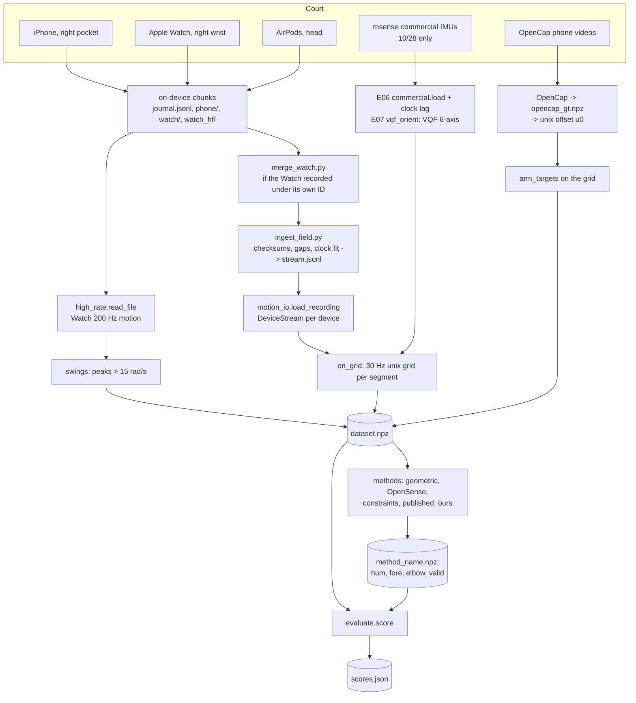
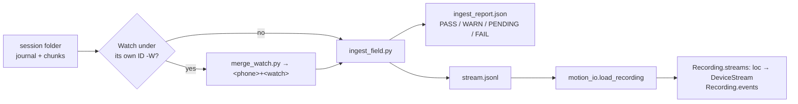
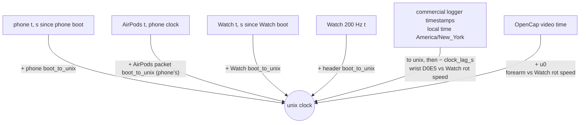
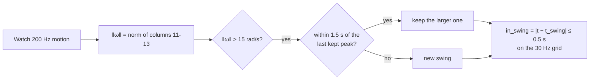
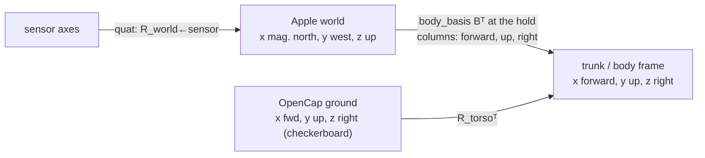
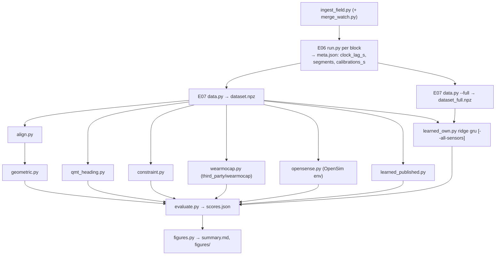
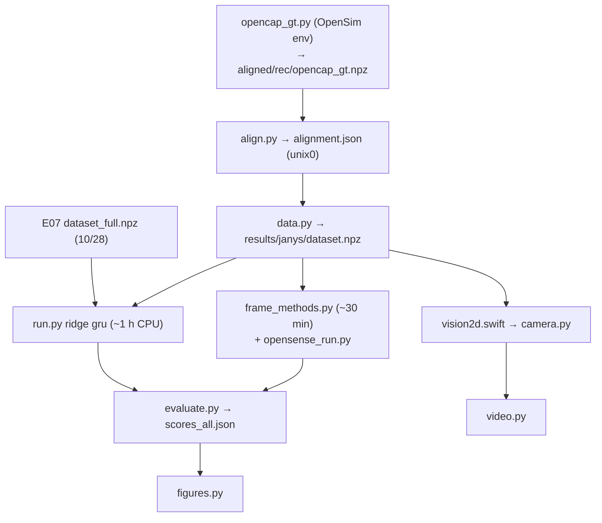

# Shared pipeline: from the court to a score

Every arm-pose method in E07 and E08 gets the same inputs and is scored the same way. This page
covers that common part: recording, ingest, clocks, the 30 Hz grid, Calibrate holds, swings,
frames, the score metrics, the datasets and the run order. The reference itself (OpenCap) is in
[`opencap_ground_truth.md`](opencap_ground_truth.md).

**Abbreviations.** IMU = inertial measurement unit. GT = ground truth (OpenCap). MAE = median
absolute error (here always a *median*, not a mean). FFT = fast Fourier transform. VQF = Laidig &
Seel's orientation filter. GRU = gated recurrent unit network. Hz = samples per second.

## 0. The whole flow



## 1. Recording

### 1.1 Devices

| Device | Placement | Stream | Requested / delivered rate | Reference frame | Source |
|---|---|---|---|---|---|
| iPhone 16 | right front trouser pocket, screen facing the leg (`pocket_screen: leg`) | `CMDeviceMotion` | 60 / **33.5 Hz** | `xMagneticNorthZVertical` (x magnetic north, z up) | `docs/research/device-research.md:11-12` |
| Apple Watch Series 8 (`Watch6,14`), watchOS 26.6 | right wrist (racket arm) | `CMDeviceMotion` in a workout session | 60 / **66.4 Hz** | `xMagneticNorthZVertical` | `device-research.md:10-12` |
| Apple Watch, high-rate | same | `CMBatchedSensorManager`: 800 Hz acceleration + **200 Hz** device motion | 200 Hz | same | `device-research.md:85`, `docs/plan/design.md:73-88` |
| AirPods | head | `CMHeadphoneMotionManager`, via the phone | **50 Hz** | `headphoneArbitrary` (heading arbitrary, resets on reconnect) | `device-research.md:12`, `apps/MotionStreamer/iOS/StreamController.swift:293` |
| msense (commercial, 10/28) | 2F5A trunk/chest, 1D03 right upper arm, D0E5 right wrist (with the Watch), 6955 / 01F7 racket butt | accel + gyro + magnetometer, own logger | ~200 Hz | none (we filter it ourselves) | `experiments/E06_side_by_side/README.md:6-16` |
| msense (11/05) | one sensor, 2DA6 | not used | – | – | `experiments/E08_janys_1105/README.md:127-128` |

The 11/05 session checks out the same way: phone 33.5 Hz, Watch 66.4 Hz, AirPods 50 Hz, 66.9 min
each, frames as above (loaded from `data/recordings/field/20261105-124805-P01`).

The phone's frame choice is in `apps/MotionStreamer/Shared/MotionFormat.swift:29-32`
(`xMagneticNorthZVertical` when available, else `xArbitraryCorrectedZVertical`).

### 1.2 Sample format

Each `imu` packet holds samples `[t, qx, qy, qz, qw, ax, ay, az, gx, gy, gz, rx, ry, rz]`
(`apps/MotionStreamer/README.md:37-40`):

| Field | Unit / meaning | Loader |
|---|---|---|
| `t` | `CMDeviceMotion.timestamp`, s since **that device** booted | `pipeline/preprocessing/motion_io.py:24` |
| `quat` | x, y, z, w; rotates device axes into the reference frame | `motion_io.py:25` |
| `user_acc` | g, device frame; Apple's sign = **minus** physical acceleration | `motion_io.py:26` |
| `gravity` | g, device frame, points down | `motion_io.py:27` |
| `rot_rate` | rad/s, device frame | `motion_io.py:28` |
| `boot_to_unix` | unix time of the device's boot: $\text{Date()} - \text{systemUptime}$ | `motion_io.py:29`, `apps/MotionStreamer/Shared/MotionFormat.swift:24`, `apps/MotionStreamer/Core/Sources/MotionStreamerCore/Ports/Ports.swift:14` |

High-rate Watch chunks (`watch_hf/*.bin`): one JSON header line, then little-endian records;
tag 1 = accel (t f64, 3×f32), tag 2 = motion (t f64, 13×f32: quat, user acc, gravity, rotation
rate) (`pipeline/ingest/high_rate.py:1-6, 26-45`). Rotation rate is therefore columns 11–13 of
the motion array.

### 1.3 Session protocol that matters for the analysis

- **Start** event: `t_phone` and `unix`; carries `pocket_screen`.
- **Calibrate**: stand tall, arms hanging, facing a landmark, hold still 3 s. The `calibrate`
  event's `t_phone` is when "now" is spoken; the window is $[t_\text{phone}+0.3,\ t_\text{phone}+3.3]$
  (`docs/plan/design.md:223`, `pipeline/pose/render_session.py:52`). Repeated every 8–10 min on
  11/05 (6 holds inside the covered span, `experiments/E08_janys_1105/README.md:33`).
- **Stop**.

## 2. Ingest



| Step | What it does | Code |
|---|---|---|
| Merge | copies the phone session to `<phone>+<watch>` and adds the Watch's own chunks (SHA-256 re-checked), skipping ones the phone already has | `pipeline/ingest/merge_watch.py:1-13` |
| Verify files | every journalled chunk exists with the right SHA-256; flags missing, extra, unclosed | `pipeline/ingest/ingest_field.py:55-87` |
| Stream quality | per device and segment: rate, gaps, gap causes from nearby events | `ingest_field.py:275-310`, `pipeline/ingest/quality.py` |
| Watch clock fit | from the 5 s sync pings: offset and drift (ppm) of the Watch clock vs the phone's; **reported only**, not applied to samples | `ingest_field.py:163-177` |
| High-rate check | chunk count and sample continuity | `ingest_field.py:222-256` |
| Write | all packets in order to `stream.jsonl` | `ingest_field.py:327-329` |
| Load | parse `imu` / `event` / `sync` packets; per location sort by `t`, drop duplicates ($\Delta t \le 10^{-6}$ s, retried packets); events sorted by `t_phone` | `pipeline/preprocessing/motion_io.py:60-104` |

Sessions used: 10/28 `20261028-104120-P01+20261028-104137-W(tennis-janys)` and
`20261028-113121-P01(tennis-tom)+…` (E06 README:6-7); 11/05 `20261105-124805-P01`.

## 3. Clocks

All analysis runs on **unix seconds**. Each source gets there differently.



| Source | Rule | Code | Size of the correction |
|---|---|---|---|
| Phone, AirPods | $t_\text{unix} = t + \text{boot\_to\_unix}$ | `experiments/E07_pose_methods/data.py:129-130` | – |
| Watch (60 Hz) | same, with the Watch's own `boot_to_unix` (its own network-set clock) | same | the Watch–phone sync fit is not applied |
| Watch (200 Hz) | $t + $ header `boot_to_unix` (falls back to the 60 Hz stream's) | `data.py:176-180`; `experiments/E08_janys_1105/data.py:115-119` | – |
| Commercial logger | timestamps → unix in America/New_York; lag $L$ maximising Pearson $r$ of wrist D0E5 rotation speed vs the Watch's on a 50 Hz grid, search ±5 s, needs > 30 s overlap; then $t \leftarrow t - L$ | `experiments/E06_side_by_side/commercial.py:44-52`, `experiments/E06_side_by_side/run.py:34-44, 123-137`; applied in `data.py:109-110` | $L$ = +0.36 s, r 0.981 (Janys) / 0.953 (Tom) |
| OpenCap | unix = video time + $u_0$; FFT cross-correlation of right-forearm rotation speed vs the Watch | [`opencap_ground_truth.md` §4](opencap_ground_truth.md#4-putting-opencap-on-our-clock) | – |

The rotation-speed match works because it uses $\lVert\omega\rVert$, which is the same in any
frame, so no mounting or heading is needed before syncing.

## 4. Segments and Calibrate holds

A **segment** is a stretch of time that uses one Calibrate hold. The hold is when every segment
of the body is assumed to be in a known pose: standing, arms hanging, facing forward.

| Dataset | Segment = | Hold window used | Code |
|---|---|---|---|
| E07 blocks (`dataset.npz`) | the E06 segments: Calibrate holds inside the commercial log, from hold end to the next hold | $[h, h+3]$ s, $h$ = E06 `hold_s` (= `t_phone` + 0.3 − Start) | `experiments/E06_side_by_side/run.py:140-147, 197-203`; `experiments/E07_pose_methods/data.py:112, 124-126` |
| E07 full (`dataset_full.npz`) | each Calibrate hold $c$: from $c+3$ to the next hold, clipped to OpenCap's span, kept if > 30 s | $[c, c+3]$ s, $c$ = raw `t_phone` − Start (no +0.3) | `data.py:113-121` |
| E08 11/05 | each OpenCap segment (~25 s) inside the Watch's span | the latest hold that ends ≤ segment start; the first hold for segments before it | `experiments/E08_janys_1105/data.py:49-53, 92-105` |

Hold orientation per device and segment: the 30 Hz samples in the 3 s window, averaged with
`scipy` `Rotation.mean()` (`data.py:142-159`; 11/05 `experiments/E08_janys_1105/data.py:106-113`).
Stored as `<device>_hold_quat` (one row per segment).

Gotcha: the 11/05 event's own `unix` stamp is the hold's *end*; the hold start is computed as
$\text{Start.unix} + (t_\text{phone} - \text{Start}.t_\text{phone})$
(`experiments/E08_janys_1105/data.py:93-97`).

### 4.1 Commercial sensor orientation (10/28 only)

VQF 6-axis (gyro + accelerometer, **no magnetometer**), offline (forward–backward) version from
the `qmt` package, on a 200 Hz grid, started 60 s before the hold so it settles; gyro bias = mean
gyro during the hold (`experiments/E07_pose_methods/vqf_orient.py:17-57`). Without a
magnetometer its heading is arbitrary; methods correct heading themselves. Reason: the court's
field made 9-axis VQF drift 60–120° vs 14–28° without it (`vqf_orient.py:3-8`).

## 5. The 30 Hz grid (`on_grid`)

`experiments/E07_pose_methods/data.py:38-52`. Every device is resampled to
$g = \{t_0, t_0+\tfrac1{30}, \dots\}$ unix seconds per segment (`data.py:125`; 11/05
`experiments/E08_janys_1105/data.py:54`).

| Step | Rule | Line |
|---|---|---|
| Clean | sort by time; drop non-increasing samples | `data.py:40-44` |
| Clamp | query times clipped to the stream's span | `data.py:45` |
| Orientation | spherical linear interpolation (`Slerp`) | `data.py:46` |
| Rotation rate, user acceleration, gravity | linear, per axis | `data.py:49` |
| Validity | a source sample within **0.05 s** of the grid time | `data.py:47-48` |

Output keys per device: `<dev>_quat` (x, y, z, w), `<dev>_gyro` (rad/s), `<dev>_acc` (g),
`<dev>_grav` (g), `<dev>_valid`.

## 6. Swing detection

`experiments/E07_pose_methods/data.py:31, 55-64, 175-186`; reused unchanged in
`experiments/E08_janys_1105/data.py:115-127`.



| Parameter | Value | Line |
|---|---|---|
| Threshold `SWING_RAD_S` | 15 rad/s (≈ 860°/s) | `data.py:31` |
| Merge gap `SWING_GAP_S` | 1.5 s | `data.py:31` |
| Half window `SWING_HALF_S` | 0.5 s | `data.py:31` |
| Kept swings | 10/28: inside the dataset span; 11/05: within one grid step of a covered frame | `data.py:182`; E08 `data.py:121-123` |

## 7. Frames



**Trunk frame** (the frame all scores are in) uses OpenSim's convention: **x forward, y up,
z to the body's right** (`experiments/E07_pose_methods/common.py:8`).

- **Ground truth side:** the trunk is OpenCap's `torso` body; a ground vector $v$ becomes
  $R_\text{torso}^\top v$ (`data.py:69-71`).
- **IMU side:** at each hold the body frame is built in the Apple world frame
  (`common.py:49-60`):
  $$\text{up} = (0,0,1),\quad \text{fwd} = \frac{f - (f\cdot\text{up})\,\text{up}}{\lVert\cdot\rVert},\quad \text{right} = \text{fwd}\times\text{up},\quad B = [\text{fwd}\ \ \text{up}\ \ \text{right}]$$
  with $f = -R_{IS}\,\hat z$ (into the thigh; the screen faces the leg) or, if `set_forward` ran,
  the mean horizontal lean of the thigh's long axis while it tilts > 15°
  (`common.py:31-46`).
- **Segment orientation from a sensor:** $R_\text{world←seg}(t) = R_\text{world←sensor}(t)\,
  R_\text{hold}^\top B$, i.e. each segment is taken to equal the body frame during the hold
  (`common.py:63-73`).
- **A segment axis in the trunk frame:** $v = R_\text{trunk}^\top R_\text{seg}\,a$, normalised,
  with $a = (0,-1,0)$ (down the limb) (`common.py:86-89`). Apple-only methods without a trunk
  sensor use the hold's body frame as a fixed trunk (`static_trunk`, `common.py:76-83`).

## 8. Method output contract

Every method writes `results/<player>/method_<name>.npz` on the dataset's grid
(`experiments/E07_pose_methods/common.py:3-15, 100-105`):

| Key | Shape | Meaning |
|---|---|---|
| `hum` | (n, 3) | right upper-arm axis, shoulder → elbow, unit, trunk frame (NaN if the method has none) |
| `fore` | (n, 3) | right forearm axis, elbow → wrist, unit, trunk frame |
| `elbow` | (n,) | elbow flexion, degrees; default = angle between `hum` and `fore` |
| `valid` | (n,) | bool; default = `fore` finite |

## 9. Score metrics (`experiments/E07_pose_methods/evaluate.py`)

Scored frames: $\mathcal M = \text{gt\_valid} \wedge \text{valid}$ ("all"), and
$\mathcal M \wedge \text{in\_swing}$ ("swing") (`evaluate.py:17-19`). A part with < 30 frames
(1 s) gets no scores (`evaluate.py:21-23`). Each metric further drops frames where the method's
vector is not finite. Notation: $\hat f, \hat h$ = method forearm / upper-arm axes,
$\hat f^*, \hat h^*$ = OpenCap's; $\angle(a,b) = \arccos(\operatorname{clip}(a\cdot b,-1,1))$ in
degrees (`common.py:92-93`). "med" = median over frames.

| Key | Name | Formula | Heading needed? | Line |
|---|---|---|---|---|
| `forearm_dir_deg` | forearm direction error | $\operatorname{med}\ \angle(\hat f, \hat f^*)$ | yes | `evaluate.py:26-28` |
| `forearm_incl_mae` | forearm inclination | $\iota = \arccos(-\hat f_y)$; $\operatorname{med}\lvert\iota - \iota^*\rvert$ | no | `evaluate.py:30-32` |
| `forearm_incl_r` | inclination correlation | Pearson $r(\iota, \iota^*)$ | no | `evaluate.py:33` |
| `upper_arm_dir_deg` | upper-arm direction error | $\operatorname{med}\ \angle(\hat h, \hat h^*)$ | yes | `evaluate.py:36-38` |
| `elevation_mae` | shoulder elevation | $\varepsilon = \arccos(-\hat h_y)$; $\operatorname{med}\lvert\varepsilon - \varepsilon^*\rvert$ | no | `evaluate.py:39-41`, `data.py:75-79` |
| `elevation_r` | elevation correlation | $r(\varepsilon, \varepsilon^*)$ | no | `evaluate.py:42` |
| `plane_mae` | plane of elevation | $\phi = \operatorname{atan2}(\hat h_z, \hat h_x)$; $\operatorname{med}\lvert((\phi-\phi^*+180) \bmod 360) - 180\rvert$ over frames with $\varepsilon^* > 30°$, needs > 30 such frames | yes | `evaluate.py:13, 43-46` |
| `elbow_mae` | elbow flexion | $\operatorname{med}\lvert e - e^*\rvert$, $e^*$ = OpenSim `elbow_flex_r`; needs > 30 frames | no | `evaluate.py:47-50` |
| `elbow_bias` | elbow bias | $\operatorname{med}(e - e^*)$ | no | `evaluate.py:51` |
| `elbow_r` | elbow correlation | $r(e, e^*)$ | no | `evaluate.py:52` |
| `elbow_pos_cm` | elbow position error | shoulder at the origin, both arms with the player's OpenCap lengths $L_u, L_f$ (median RShoulder-RElbow and RElbow-RWrist marker distances); $\operatorname{med}\ 100\,\lVert L_u(\hat h-\hat h^*)\rVert$ cm; needs > 30 frames | yes | `evaluate.py` `position_errors` |
| `wrist_pos_cm` | wrist position error | $\operatorname{med}\ 100\,\lVert L_u(\hat h-\hat h^*) + L_f(\hat f-\hat f^*)\rVert$ cm | yes | same |
| `minutes` | scored time | frames / 30 / 60 | – | `evaluate.py:20` |

Positions are for comparing with published papers, which report joint position errors in cm.
Ours are shoulder-anchored in the trunk frame, so they leave out trunk and shoulder error; the
papers' are measured on their own (mostly non-tennis) data. Arm lengths: Janys 24-25 / 21-22 cm,
Tom 27 / 23 cm.

Why both kinds: inclination, elevation and elbow need only gravity, so they test a method
without its heading. The direction errors and the plane also test heading, which is the weak
point of every model-free method (`experiments/E07_pose_methods/README.md:49-54`).

## 10. Datasets

| | E07 blocks | E07 full | E08 11/05 |
|---|---|---|---|
| File | `experiments/E07_pose_methods/results/<player>/dataset.npz` | `.../dataset_full.npz` | `experiments/E08_janys_1105/results/janys/dataset.npz` |
| Built by | `data.py` | `data.py --full` | `experiments/E08_janys_1105/data.py` |
| Players | Janys, Tom (10/28) | Janys, Tom (10/28) | Janys (11/05) |
| Span | E06 commercial blocks: Janys 8.1 min, Tom 12.6 min, 2 segments each | every Calibrate segment OpenCap covers: Janys 26.8 min (7 segments), Tom 12.0 min | 97 OpenCap segments, 35.8 min (64 382 frames) |
| Sensors | phone, Watch, AirPods + commercial trunk, upper arm, wrist | phone, Watch, AirPods | phone, Watch, AirPods |
| GT coverage | 79 % / 70 % | Janys 64 % | 100 % of grid frames (grid built from OpenCap segments) |
| Swings | 128 total (Janys 36) | Janys 114 | 278 |
| Used for | scoring every E07 method | training our models (E07 personal split, E08) | scoring every E08 method |
| Extra keys | `hf_t`, `hf_w` (200 Hz speed), `gt_P`, `unix0` | same as blocks, no commercial | `seg_name`, `calibrations_s` |

Common keys: `t`, `seg`, `hold`, `<dev>_{quat,gyro,acc,grav,valid}`, `<dev>_hold_quat`,
`gt_valid`, `gt_R`, `gt_mk`, `gt_ik`, `gt_hum`, `gt_fore`, `gt_elev`, `gt_plane`, `gt_elbow`,
`gt_prosup`, `body_names`, `ik_names`, `start_unix`, `swing_t`, `in_swing`.

### 10.1 Train / test splits of our own models

| Split | Training | Test | Code |
|---|---|---|---|
| E07 `xplayer` | other player's `dataset_full` | this player's block | `experiments/E07_pose_methods/learned_own.py:165-168` |
| E07 `personal` | + this player's `dataset_full` frames ≥ 10 s from the block | this player's block | `learned_own.py:52-57, 167-173` |
| E07 all-sensor | other player's block (+ this player's other half of the block, 2 folds in time, 10 s gap) | block | `learned_own.py:229-242` |
| E08 `janys` / `tom` / `both` | 10/28 `dataset_full` of that player / both | 11/05 | `experiments/E08_janys_1105/run.py:27, 45-57` |
| E08 `both+half` | both 10/28 + the other half of 11/05 (split at the median time, 10 s gap) | each half of 11/05 | `run.py:58-69` |

Inputs to our models are heading-free per device: gravity (g), rotation rate / 10, user
acceleration, plus the phone→Watch relative rotation as 6 numbers when the phone is used
(`learned_own.py:35-46`). Targets: `gt_hum` and `gt_fore` stacked (6 numbers,
`learned_own.py:48-49`).

## 11. Run order

### E07 (10/28)



```bash
.venv/bin/python -m pipeline.ingest.ingest_field "data/recordings/field/<session>"
.venv/bin/python -m experiments.E06_side_by_side.run "data/recordings/field/<session>" \
    data/external/20261028/IMU1/<log>_imu.csv --label janys-IMU1        # and tom-IMU4 with IMU4
.venv/bin/python -m experiments.E07_pose_methods.data
.venv/bin/python -m experiments.E07_pose_methods.data --full
.venv/bin/python -m experiments.E07_pose_methods.align
.venv/bin/python -m experiments.E07_pose_methods.geometric
.venv/bin/python -m experiments.E07_pose_methods.qmt_heading
.venv/bin/python -m experiments.E07_pose_methods.constraint
.venv/bin/python -m experiments.E07_pose_methods.wearmocap
.venv/bin/python -m experiments.E07_pose_methods.opensense
.venv/bin/python -m experiments.E07_pose_methods.learned_published
.venv/bin/python -m experiments.E07_pose_methods.learned_own ridge gru [--all-sensors]
.venv/bin/python -m experiments.E07_pose_methods.evaluate
.venv/bin/python -m experiments.E07_pose_methods.figures
```

(from `experiments/E07_pose_methods/README.md:77-91`; E06 step from
`experiments/E06_side_by_side/README.md:46-47`.)

### E08 (11/05)



```bash
~/micromamba-envs/opensim/bin/python experiments/E08_janys_1105/opencap_gt.py
.venv/bin/python -m experiments.E08_janys_1105.align
.venv/bin/python -m experiments.E08_janys_1105.data
.venv/bin/python -m experiments.E08_janys_1105.run ridge gru
.venv/bin/python -m experiments.E08_janys_1105.frame_methods
.venv/bin/python -m experiments.E08_janys_1105.evaluate
.venv/bin/python -m experiments.E08_janys_1105.figures
```

(from `experiments/E08_janys_1105/README.md:131-144`.) E08 needs E07's `dataset_full.npz` for both
players first (`run.py:81`).

### Environments

| Env | Used for | Source |
|---|---|---|
| `.venv` (Python 3.9) | everything except OpenSim | `CLAUDE.md` |
| `~/micromamba-envs/opensim` (Python 3.11, OpenSim 4.6, conda channel `opensim-org`) | `opencap_gt.py`, `opensense_ik.py`, `opensense_run.py` | `experiments/E07_pose_methods/opensense.py:6-10` |
| `qmt` package | VQF and the qmt heading correction | `experiments/E07_pose_methods/vqf_orient.py:20` |
| raw data | `data/recordings/field/`, `data/external/20261028/`, `data/external/20261105/` (not in git) | – |

## 12. Limits of the shared part

- The Watch's and phone's unix clocks come from each device's own wall clock; the sync-ping fit
  is not applied. Clock error between them is not measured here beyond the E08 check that
  shifting the Watch ±100 ms does not change the swing error (`experiments/E08_janys_1105/README.md:86`).
- The hold assumes every segment matches the standing body frame with arms hanging and palms in;
  a bent arm at the hold shows up as an elbow bias (~18° on 10/28).
- E07's block and full datasets place the hold window 0.3 s apart (§4); the effect is untested.
- Swing detection uses only the Watch's rotation speed; a fast non-swing arm move counts as a swing.
