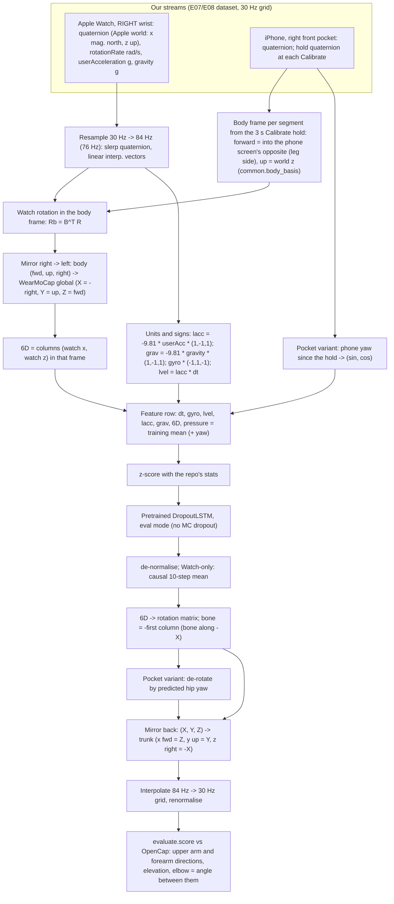

# WearMoCap: pretrained smartwatch arm-pose LSTMs

> **Source**
>
> | | |
> |---|---|
> | Papers | F. C. Weigend, S. Sonawani, M. Drolet, H. Ben Amor, *Anytime, Anywhere: Human Arm Pose from Smartwatch Data for Ubiquitous Robot Control and Teleoperation*, IROS 2023 ([arXiv 2306.13192](https://arxiv.org/abs/2306.13192)). F. C. Weigend, X. Liu, S. Sonawani, N. Kumar, V. Vasudevan, H. Ben Amor, *iRoCo: Intuitive Robot Control From Anywhere Using a Smartwatch*, ICRA 2024 ([arXiv 2403.07199](https://arxiv.org/abs/2403.07199)). F. C. Weigend, N. Kumar, O. Aran, H. Ben Amor, *WearMoCap: multimodal pose tracking for ubiquitous robot control using a smartwatch*, Frontiers in Robotics and AI 11, 2025 ([doi 10.3389/frobt.2024.1478016](https://doi.org/10.3389/frobt.2024.1478016)) |
> | Repo | https://github.com/wearable-motion-capture/arm-pose-estimation (package `wear_mocap_ape` 1.2.3) |
> | Commit used | `b8d5362` (07/18/2025, "Update LICENSE"), cloned to `third_party/wearmocap/`. **Not pinned** in `tools/setup_third_party.sh` and not listed in `third_party/README.md` (MobilePoser and IMUCoCo are). |
> | Weights | Shipped inside the repo: `third_party/wearmocap/src/wear_mocap_ape/data_deploy/nn/04f4ad63bfccb3668f7598c9375403e10b1fae2a/checkpoint.pt` (Watch only, 9.8 MB) and `.../nn/670b66fa7664252d1cfb3b5a8a362002ffeeba5c/checkpoint.pt` (Watch + pocket phone, 9.8 MB). Normalisation statistics: `.../data_deploy/data_stats/WATCH_ONLY_CAL_ORI_CAL_LARM_UARM.pkl` and `.../WATCH_PHONE_CAL_HIP_ORI_CAL_LARM_UARM_HIPS.pkl`. |
> | License | MIT (`third_party/wearmocap/LICENSE`, "Copyright (c) 2025 WearMoCap"). Note: `setup.cfg` still lists an "Apache 2.0" classifier; the LICENSE file is MIT. |
> | Training | **Pretrained by the authors. We did not retrain or fine-tune it.** Their training code is not in this repo, so the training details below come from their papers and from each checkpoint's `results.json`. |
> | Our methods | `wearmocap_watch` (Watch only) and `wearmocap_watch_phone` (Watch + pocket phone), in `experiments/E07_pose_methods/wearmocap.py` |

Abbreviations: IMU = inertial measurement unit; LSTM = long short-term memory network; 6D (or
6DRR) = the 6D rotation representation (the first two columns of a rotation matrix, Zhou et al.
2019); MC = Monte Carlo; MAE = mean absolute error; OpenCap = our video motion-capture ground truth;
trunk frame = x forward, y up, z to the body's right (OpenSim convention).

---

## 1. How the original model works (the authors')

### 1.1 What it predicts

WearMoCap estimates the pose of **one arm (the left arm)** from a **Wear OS smartwatch on the left
wrist**, optionally helped by a phone. The network outputs the **lower-arm and upper-arm
orientations** as 6D rotations in a calibrated global frame. Wrist and elbow positions then come
from forward kinematics with fixed bone lengths. The pocket variant also outputs the **hip yaw**
(rotation about the vertical axis) as (sin, cos).

Global frame (theirs): **left-handed, X right, Y up, Z forward**, with "forward" fixed at the
calibration pose (`third_party/wearmocap/src/wear_mocap_ape/utility/transformations.py:232`).
The bone vectors point along **-X** in that frame, i.e. the identity rotation is a left arm held
straight out to the side (`third_party/wearmocap/src/wear_mocap_ape/estimate/estimator.py:58`).

### 1.2 Architecture (deployed checkpoints)

Both deployed checkpoints are a `DropoutLSTM`
(`third_party/wearmocap/src/wear_mocap_ape/estimate/nn_models.py:160`): a stacked LSTM followed
by one linear layer. Hyperparameters are read from each checkpoint's `results.json`.

| | Watch only (`04f4ad63…`) | Watch + pocket phone (`670b66fa…`) |
|---|---|---|
| Input features per step | 20 | 22 |
| LSTM | 2 layers, 256 hidden units, dropout 0.2 between layers | same |
| Output layer | Linear 256 → 12 | Linear 256 → 14 |
| Sequence length | 8 steps (~95 ms) | 6 steps (~79 ms) |
| Output used | last step of the sequence | same |
| Mean step (`sw_dt`) in its training data | 11.9 ms (~84 Hz) | 13.2 ms (~76 Hz) |
| Training date (`results.json`) | 01/04/2024 | 06/11/2024 |
| Epochs (max), early stopping | 200, patience 10 | 200, patience 10 |
| Batch size, learning rate | 128, 0.001 | 128, 0.0015 |
| Final loss (normalised units) | train 0.221, test 0.337 | train 0.180, test 0.211 |
| Reported test error in `results.json` | — | hand MAE 9.8 cm, elbow MAE 8.2 cm |

```mermaid
flowchart LR
    subgraph IN["Input window: seq_len steps x F features (z-scored)"]
        A["sw_dt (1)"]
        B["gyro x,y,z (3) rad/s"]
        C["lvel x,y,z (3) = lin. acc x dt"]
        D["lacc x,y,z (3) m/s^2"]
        E["gravity x,y,z (3) m/s^2, points up"]
        F["watch 6D orientation, calibrated global (6)"]
        G["relative pressure (1) hPa"]
        H["phone variant only: hip yaw sin, cos (2)"]
    end
    IN --> L1["LSTM layer 1, 256 units"] --> DR["dropout 0.2"] --> L2["LSTM layer 2, 256 units"]
    L2 --> FC["Linear 256 -> 12 (or 14)"]
    FC --> LAST["take last time step"]
    LAST --> DN["de-normalise: y * yy_s + yy_m"]
    DN --> O1["lower arm 6D (6)"]
    DN --> O2["upper arm 6D (6)"]
    DN --> O3["phone variant: hip yaw sin, cos (2)"]
```



All inputs and targets are z-scored with the stored training means and standard deviations
(`xx_m, xx_s, yy_m, yy_s` in the `.pkl` files; applied in
`third_party/wearmocap/src/wear_mocap_ape/estimate/estimator.py:103`).

### 1.3 Inputs as the authors build them

From `third_party/wearmocap/src/wear_mocap_ape/estimate/watch_only.py:46` and
`.../watch_phone_pocket_nn.py:41`:

1. Android sensor values arrive from their Wear OS app at ~80 Hz: gyroscope (rad/s), linear
   acceleration (m/s², physical sign), gravity (m/s², pointing **up**), "lvel" (linear
   acceleration integrated over the message interval), pressure (hPa), and the rotation vector
   quaternion.
2. The watch quaternion is converted from Android's right-handed East-North-Up frame to their
   left-handed frame by `(w,x,y,z) -> (-w, x, z, y)` (`transformations.py:225`), then turned about
   Y so that the forward direction stored at calibration becomes +Z (`transformations.py:232`).
3. The calibrated watch rotation becomes a 6D vector `[m11, m12, m21, m22, m31, m32]`.
4. Pressure is made relative to the calibration pressure (wrist at chest height).
5. Pocket variant: the phone's rotation since calibration, reduced to a yaw angle, gives the hip
   yaw input as (sin, cos).

Calibration pose (IROS 2023): pressure is averaged for 3 s with the watch at chest height, then
the arm is held forward to fix "forward". The 2025 paper uses the lower arm held level across the
chest, ~1 s. In both, the user must keep facing that direction afterwards.

### 1.4 Inference as the authors run it

- A rolling buffer of the last `seq_len` input rows; while it is not full the first row is
  repeated (`estimator.py:96`). Each prediction starts from a zero LSTM state.
- **MC dropout:** 25 stochastic passes with dropout switched on
  (`watch_only.py:16`, `nn_models.py:191`). The spread of the passes is their uncertainty
  estimate.
- **Smoothing:** a moving average of the last 10 predictions for the Watch-only estimator
  (`watch_only.py:16`), none (1) for the pocket estimator (`watch_phone_pocket_nn.py:15`).

### 1.5 How the authors trained it

The training code is not in the vendored repo. From the papers and `results.json`:

| Item | Value |
|---|---|
| Ground truth | OptiTrack optical motion capture, 12 cameras, 25-marker upper-body suit, ~120 Hz |
| Subjects / size | IROS 2023: 6 participants, ~380 k watch samples. Frontiers 2025 (Watch-only mode): 0.6 M observations from 7 subjects, 3 smartwatch models; pocket mode: 0.9 M observations from 8 subjects, augmented to 2.6 M |
| Device | Samsung Galaxy Watch 5 (IROS 2023) on the **left** wrist, plus a phone in the pocket for the pocket mode |
| Task | Free left-arm motion while keeping chest and hips still (IROS 2023); robot handover and teleoperation tasks (later papers) |
| Augmentation | Frontiers 2025: rotations about the global vertical axis; simulated pocket-phone data from hip ground truth |
| Targets | Lower- and upper-arm rotation (6D) relative to the calibrated frame; hip yaw (sin, cos) |
| Loss | IROS 2023: "a Mean Absolute Error (MAE) loss function" on the normalised targets. Not stated for these exact checkpoints |
| Optimiser | Adam, learning rate 0.001 (0.0015 for the pocket checkpoint), up to 200 epochs, early stopping after 10 epochs without improvement |
| Validation | 10-fold cross-validation (IROS 2023) |
| Reported accuracy | IROS 2023: wrist and elbow mean error 2.56 cm (test). Frontiers 2025: Watch-only around 10 cm (hand) / 9 cm (elbow) in its sensitivity table |

Caveat: the IROS paper describes a 4-layer 128-unit LSTM with sequence length 6. The deployed
Watch-only checkpoint is 2 x 256 with sequence length 8 (Frontiers 2025 reports 2 x 256, length
12). The 2025 paper's pocket mode is a differentiable ensemble Kalman filter, while the deployed
pocket checkpoint we use is the LSTM (`deploy_models.py`: `WATCH_PHONE_POCKET`), likely from the
iRoCo work. We use the checkpoints as shipped.

---

## 2. Running specs on our end

| Item | Value |
|---|---|
| Environment | `.venv`, Python 3.9.6, torch 2.1.2, numpy 1.23.0, scipy 1.8.0, macOS arm64 |
| Device | CPU (no `.to(device)` in our code; the repo's loader uses `map_location="cpu"`, `nn_models.py:410`) |
| Import | `third_party/wearmocap/src` put on `sys.path` (`experiments/E07_pose_methods/wearmocap.py:50`); not pip-installed |
| Input data | E07 dataset grid, 30 Hz (`experiments/E07_pose_methods/data.py:28`), built from the Watch's regular device-motion stream (~66 Hz delivered) and the phone's (~33 Hz) |
| Model rate | Re-sampled up to 1 / mean training dt: 84.0 Hz (Watch only), 75.9 Hz (pocket) (`wearmocap.py:156`, `:163`) |
| Sequence handling | Each Calibrate segment separately; sliding windows of `seq_len`, padded at the start (`wearmocap.py:119`) |
| Batching | 4096 windows per forward pass (`wearmocap.py:125`) |
| Runtime (measured 11/10, 8.1 min of Janys 10/28) | 2.9 s Watch only, 1.6 s pocket |
| Output | `results/<player>/method_wearmocap_watch.npz`, `method_wearmocap_watch_phone.npz` (30 Hz grid, unit vectors in the trunk frame) |

Commands:

```bash
.venv/bin/python -m experiments.E07_pose_methods.data          # 10/28 grid (needs E06 results)
.venv/bin/python -m experiments.E07_pose_methods.wearmocap     # both variants, both players
.venv/bin/python -m experiments.E07_pose_methods.evaluate       # scores.json
.venv/bin/python -m experiments.E08_janys_1105.frame_methods wearmocap   # 11/05 rerun
.venv/bin/python -m experiments.E08_janys_1105.evaluate
```

---

## 3. Our adaptations, step by step

### 3.1 Pipeline overview



### 3.2 Devices and variants

| Our method | Checkpoint | Our devices | Their slot |
|---|---|---|---|
| `wearmocap_watch` | `WATCH_ONLY` `04f4ad63…`, stats `WATCH_ONLY_CAL_ORI_CAL_LARM_UARM`, smoothing 10 | Apple Watch (right wrist) | left-wrist Wear OS watch |
| `wearmocap_watch_phone` | `WATCH_PHONE_POCKET` `670b66fa…`, stats `WATCH_PHONE_CAL_HIP_ORI_CAL_LARM_UARM_HIPS`, smoothing 1 | Apple Watch + iPhone (right front pocket) | left watch + phone in a pocket |

Defined at `experiments/E07_pose_methods/wearmocap.py:57`. The third shipped checkpoint
(`WATCH_PHONE_UARM`, phone strapped to the upper arm) is not used: we have no phone on the upper
arm.

### 3.3 Step 1: body frame from the Calibrate hold (replaces their start pose)

- Every segment starts with a 3 s Calibrate hold: standing, arms hanging.
- `body_basis` (`experiments/E07_pose_methods/common.py:49`) builds world <- body with columns
  (forward, up, right): up = world z; forward = the horizontal part of minus the pocket phone's
  screen normal (screen faces the leg). `wearmocap.py:93` calls it **without** the per-segment
  `key`, so the thigh-lean forward set by `set_forward` in E08 (`frame_methods.py:50`) is not
  used here; WearMoCap always uses the screen rule.
- This frame stands in for WearMoCap's own calibration. We never feed their "forward" quaternion;
  we compute the calibrated orientation directly.

### 3.4 Step 2: resample to the model's rate

- Training dt is read from the stats (`stats["xx_m"][0]`, `wearmocap.py:156`), and a new time base
  `t_hi = arange(t0, t1, dt)` is made per segment (`wearmocap.py:163`).
- The Watch quaternion is slerped, rotation rate, user acceleration and gravity are linearly
  interpolated (`wearmocap.py:83`). The source is the 30 Hz grid, not the raw stream, so this
  up-sampling adds no information above 15 Hz.
- `sw_dt` is the constant training mean, not a measured interval (`wearmocap.py:106`).

### 3.5 Step 3: mirror the right-wrist Watch into a left-wrist watch

Our Watch is on the right wrist; the model only knows a left-wrist watch. We reflect the world
through the body's sagittal (mid) plane:

- Apple Watch axes on the right wrist: x toward the hand, z out of the screen (gravity along +x
  with the arm hanging, seen in the Calibrate holds). A left Wear OS watch has the same axis roles.
  After mirroring, the watch's y axis (across the wrist) flips.
- Vectors (acceleration, gravity) in sensor axes: `v -> (vx, -vy, vz)` (`pol`, `wearmocap.py:101`).
- Rotation rates are pseudo-vectors, so they flip the other way: `w -> (-wx, wy, -wz)`
  (`wearmocap.py:104`).
- Frame: body (forward, up, right) maps to WearMoCap global (X, Y, Z) = (-right, up, forward)
  (`to_global`, `wearmocap.py:73`). In the mirrored world the virtual player's right is our
  player's left, so their +X is our −right, hence the minus sign.

### 3.6 Step 4: orientation input (6D)

- `Rb = B^T R` is the Watch rotation in the body frame (`wearmocap.py:95`).
- Their frame swap `(x,y,z) -> (x,z,y)` also reorders the sensor axes, so the first two columns
  of their matrix are the sensor's x and z axes. We take the Watch x and z axes, map them with
  `to_global` and interleave them as `[x0, z0, x1, z1, x2, z2]` (`wearmocap.py:96`).

### 3.7 Step 5: units and signs of the motion inputs

| Their feature | Their convention | Our source | Conversion (`wearmocap.py:102`) |
|---|---|---|---|
| `sw_gyro` | rad/s, Android axes | Apple `rotationRate`, rad/s | `gyro * (-1, 1, -1)` (mirror) |
| `sw_lacc` | m/s², physical acceleration | Apple `userAcceleration`, g, minus the physical acceleration | `-9.81 * acc * (1, -1, 1)` |
| `sw_grav` | m/s², points **up** | Apple `gravity`, g, points down | `-9.81 * grav * (1, -1, 1)` |
| `sw_lvel` | acceleration integrated over one message | — | `lacc * dt` |
| `sw_pres_cal` | hPa relative to calibration | none (no barometer in our set) | training mean, so the normalised input is 0 (`wearmocap.py:157`) |

### 3.8 Step 6 (pocket variant only): hip yaw from the phone

- `f` = the body-forward vector turned by the phone's rotation since the hold:
  `B^T Rp(t) Rp0^T B[:,0]` (`wearmocap.py:110`).
- Mapped with `to_global`; yaw = `atan2(X, Z)`; fed as (sin, cos) (`wearmocap.py:113`).
- The phone sits on the thigh, so this "hip" yaw also moves with the thigh (lunges, split steps).

### 3.9 Step 7: run the network

- Normalise, pad the start with the first row, build all `seq_len` windows, run in batches, keep
  the last step, de-normalise (`wearmocap.py:119`).
- **Change from the authors:** `model.eval()` (`wearmocap.py:152`), so dropout is off and there is
  one deterministic pass instead of 25 MC passes. The output is the network's point estimate, not
  the mean of 25 samples.
- Watch-only: causal 10-step moving mean of the outputs (~119 ms at 84 Hz), as in their estimator
  (`causal_mean`, `wearmocap.py:131`).

### 3.10 Step 8: back to our arm vectors

- 6D -> rotation matrix with their own function (`ts.six_drr_1x6_to_rot_mat_1x9`); the bone
  points along -X, so forearm = `-larm[:, :, 0]`, upper arm = `-uarm[:, :, 0]`
  (`wearmocap.py:138`).
- Pocket variant: the predicted hip yaw rotation `H` de-rotates both vectors into the hip frame,
  which stands in for our trunk frame (`wearmocap.py:144`); an assert checks that `H` turns Z by
  the yaw (`wearmocap.py:145`).
- Watch only: the output is in the fixed hold frame, i.e. a **static trunk** (the trunk is assumed
  not to turn after Calibrate).
- Interpolate back to the 30 Hz grid, renormalise, mirror back with `from_global`:
  trunk (x fwd, y up, z right) = (Z, Y, -X) (`wearmocap.py:78`, `:167`).
- Valid frames: Watch valid (and phone valid for the pocket variant) (`wearmocap.py:170`).
- Elbow flexion = angle between the upper-arm and forearm vectors (`common.py:96`, applied in
  `save`, `common.py:100`).

### 3.11 Patches to their code

None. We import `nn_models.load_deployed_model_from_hash` and `transformations` unchanged
(`wearmocap.py:52`). The `.pkl` stats are loaded with `pickle` from the local checkout
(`wearmocap.py:153`).

### 3.12 E08 rerun (11/05)

`experiments/E08_janys_1105/frame_methods.py:85` calls `W.run` unchanged on the 11/05 dataset
(Janys, session `20261105-124805-P01`, 35.8 min with OpenCap). Each OpenCap segment uses the
latest Calibrate hold before it (six holds, every 8–10 min).

---

## 4. Limitations and why it may underperform on tennis

1. **Different motion.** Trained on slow, deliberate arm motions (teleoperation, handovers) with
   the chest and hips still. Tennis strokes are fast (Watch rotation over 15 rad/s at swing peaks),
   with large trunk rotation.
2. **Static trunk.** The Watch-only output is relative to the frame fixed at Calibrate. Trunk
   rotation during a stroke is read as arm motion. The pocket variant's hip yaw comes from a thigh
   phone, which is not the trunk either.
3. **Heading.** Forward comes from the pocket phone's screen normal. In E07 this rule was off by
   ~110° for Tom (E07 README). Forward-direction and heading drift errors go straight into the
   forearm and upper-arm directions.
4. **Different calibration pose.** Theirs: arm forward or level across the chest. Ours: arms
   hanging. Our frame is built from the phone, so this mostly matters as a distribution shift.
5. **Mirroring.** A right-handed player is fed as a mirrored left arm. The math is exact for the
   sensor signals, but the motion statistics (forehand from a left-arm model's view) are new to it.
6. **No barometer.** Relative pressure (an arm-height cue) is replaced by the training mean.
7. **Coarse input.** Inputs come from a 30 Hz grid of the regular Watch stream (~66 Hz), then are
   up-sampled to 84 Hz. Swing peaks are smoothed, and `lvel` is built from interpolated values.
8. **Deterministic pass.** No MC dropout; the authors' deployed output is the average of 25
   stochastic passes, which may be smoother.
9. **Different device.** Apple Watch sensor fusion and noise differ from the Samsung watches it was
   trained on.
10. **Not pinned.** The checkout is not in `tools/setup_third_party.sh`; a fresh clone may differ.

---

## 5. Our results

Median absolute error vs OpenCap, degrees. "Swing" = ±0.5 s around each Watch rotation-speed
peak above 15 rad/s (`experiments/E07_pose_methods/data.py:31`). Scoring:
`experiments/E07_pose_methods/evaluate.py:16`. Elbow bias = median(model − OpenCap); negative =
model reads the elbow straighter.

### 5.1 E07, 10/28 (from `experiments/E07_pose_methods/results/scores.json`)

| Method | Player | Part | Elbow | Elbow bias | Elbow r | Shoulder elev. | Forearm incl. | Forearm dir. | Upper-arm dir. |
|---|---|---|---|---|---|---|---|---|---|
| Watch only | Janys | swing | 28 | +5 | 0.17 | 23 | 13 | 38 | 41 |
| Watch only | Tom | swing | 26 | −21 | 0.70 | 17 | 11 | 33 | 27 |
| Watch only | Janys | all | 20 | −15 | 0.56 | 25 | 14 | 30 | 34 |
| Watch only | Tom | all | 15 | −9 | 0.72 | 21 | 9 | 33 | 30 |
| Watch + phone | Janys | swing | 28 | +19 | 0.19 | 21 | 14 | 52 | 40 |
| Watch + phone | Tom | swing | 20 | −9 | 0.65 | 22 | 11 | 63 | 52 |
| Watch + phone | Janys | all | 21 | −14 | 0.45 | 26 | 17 | 37 | 40 |
| Watch + phone | Tom | all | 14 | −7 | 0.74 | 25 | 12 | 53 | 42 |

Mean of the two players, swings (`results/summary.md`): Watch only elbow 27, elevation 20,
forearm inclination 12, forearm direction 35, upper-arm direction 34. It was the best published
model on forearm inclination and close to IMUCoCo on forearm direction. The Watch + phone
variant is worse on direction (the thigh-based yaw hurts).

### 5.2 E08, Janys 11/05 (from `experiments/E08_janys_1105/results/scores_all.json`)

| Method | Part | Minutes | Elbow | Elbow bias | Elbow r | Shoulder elev. | Forearm incl. | Forearm dir. | Upper-arm dir. |
|---|---|---|---|---|---|---|---|---|---|
| Watch only | swing | 4.6 | 35 | −11 | 0.12 | 26 | 23 | 58 | 43 |
| Watch only | all | 35.8 | 24 | −17 | 0.50 | 25 | 18 | 53 | 41 |
| Watch + phone | swing | 4.6 | 34 | 0 | 0.03 | 23 | 23 | 70 | 48 |
| Watch + phone | all | 35.8 | 22 | −14 | 0.46 | 28 | 22 | 64 | 46 |

Compared with Janys 10/28 (swings): elbow 28 -> 35, elevation 23 -> 26, forearm inclination
13 -> 23, forearm direction 38 -> 58. E08's README attributes part of the drop to noisier 11/05
ground truth and more trunk lean. Our GRU trained on Janys 10/28 beats it on every metric
(swings: elbow 14, elevation 10, forearm direction 22).
